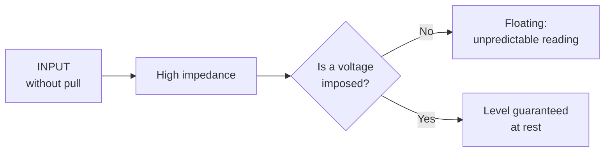

## On the agenda

1. Zero or one
2. A pin as an output
3. A pin as an input
4. Reading the analog world
5. Simulating a voltage

<aside class="notes" markdown="1">
1 h 30 lecture, no hands-on work. The lecture prepares Lab 2: the modules of the kit (button, joystick, buzzer, display) connected to the pins of the future board. Show it early, the whole lecture refers back to it.
Open with the Lecture 1 quiz (registers, `millis()`, interrupt, 3.3 V): all four come back in this lecture.
</aside>

---

## What you will be able to do

### By the end of this lecture, you will be able to:

- tell a **digital** signal from an **analog** signal
- find a value in the **datasheet**
- configure a pin, and calculate an LED's series resistor
- drive a power load through a transistor
- explain the **floating state**, and choose between pull-up and pull-down
- filter a button's **bounce**, by polling or by interrupt
- read a voltage with the **ADC**, and scale it
- produce an average voltage with **PWM**

[GPIO and the digital world](/workshops/microcontroleur/concepts/gpio-monde-numerique/){: .doc-link} [ADC and PWM](/workshops/microcontroleur/concepts/adc-pwm/){: .doc-link}

---

## Quiz: what is left from Lecture 1

1. Where is the program stored when the board is off?
2. Where does a function's local variable live?
3. What does `REG |= (1 << 5)` do?
4. Why not put a `delay()` in `loop()`?
5. Is the ESP32's C++ compiled or interpreted?
6. How does the hardware notify the program of an event?
7. What is the maximum voltage on an ESP32-S3 pin?

<aside class="notes" markdown="1">
On a sheet of paper, no notes or PC, 5 min. Show-of-hands correction on the next slide: ask who got 7/7, 5/7, fewer. The questions that were a struggle show what to recall in passing during the lecture.
</aside>

---

## Quiz: answers

| | Answer |
|---|---|
| 1 | In **flash memory**, which is not erased at power-off |
| 2 | On the **stack**, in RAM, freed when the function returns |
| 3 | Sets bit 5 of the register to 1, without touching the others |
| 4 | `delay()` **blocks** everything; check the time with `millis()` |
| 5 | **Compiled**, once and for all, before uploading |
| 6 | Through an **interrupt** |
| 7 | <span class="highlight-red">**3.3 V**, never 5 V</span> |
{: .table-dense}

These four notions come back today, applied to the pins.
{: .caption}

[Architecture of a microcontroller](/workshops/microcontroleur/concepts/architecture-microcontroleur/){: .doc-link} [From hardware to software](/workshops/microcontroleur/concepts/du-materiel-au-logiciel/){: .doc-link}

---

<!-- .slide: class="slide-section" -->

## Zero or one

Logic levels

---

## Two kinds of signal

{: .img-sm}

| | Digital | Analog |
|---|---|---|
| Possible values | 2 (`LOW` / `HIGH`) | continuous, from 0 to 3.3 V |
| Arduino function | `digitalRead` / `digitalWrite` | `analogRead` (ADC) |
| In your setup | the buttons | the joystick axes |
{: .table-dense}

[GPIO and the digital world](/workshops/microcontroleur/concepts/gpio-monde-numerique/){: .doc-link} [ADC and PWM](/workshops/microcontroleur/concepts/adc-pwm/){: .doc-link}

<aside class="notes" markdown="1">
The whole session fits in this table: first all-or-nothing, then the continuous.
</aside>

---

## The ESP32-S3's thresholds

| Threshold | Value | Interpretation |
|---|---|---|
| $V_{IL}$ (LOW max) | ≤ 0.25 × VDD ≈ **0.8 V** | read as `LOW` |
| Undefined zone | ~0.8 V to ~2.5 V | unpredictable reading |
| $V_{IH}$ (HIGH min) | ≥ 0.75 × VDD ≈ **2.5 V** | read as `HIGH` |
{: .table-dense}

As an **output**, conversely, the chip guarantees clear levels: close to 0 V, or close to 3.3 V.

This grey zone in the middle explains everything that follows about floating inputs. Remember it.
{: .highlight-red}

[GPIO and the digital world](/workshops/microcontroleur/concepts/gpio-monde-numerique/){: .doc-link}

<!-- .down -->

## The thresholds, on a scale

{: .img-md}

A floating input drifts in the red zone.
{: .caption}

[GPIO and the digital world](/workshops/microcontroleur/concepts/gpio-monde-numerique/){: .doc-link}

---

## The datasheet, "DC Characteristics" page

| Symbol | What it is | Value |
|---|---|---|
| $V_{IH}$ | Minimum voltage read as `HIGH` | 0.75 × VDD |
| $V_{IL}$ | Maximum voltage read as `LOW` | 0.25 × VDD |
| $V_{OH}$ | Minimum guaranteed voltage on a `HIGH` output | 0.8 × VDD |
| $V_{OL}$ | Maximum guaranteed voltage on a `LOW` output | 0.1 × VDD |
| $I_{OH}$ | Current a `HIGH` output can supply | 40 mA |
| $R_{PU}$, $R_{PD}$ | Internal pull resistors | 45 kΩ |
{: .table-dense}

Extract from the ESP32-S3 datasheet (VDD = 3.3 V, 25 °C). Just before, the absolute maximum ratings table: **3.6 V** at most on a pin.
{: .caption}

[ESP32-S3: datasheet](https://www.espressif.com/sites/default/files/documentation/esp32-s3_datasheet_en.pdf){: .doc-link} [GPIO and the digital world](/workshops/microcontroleur/concepts/gpio-monde-numerique/#what-the-datasheet-says){: .doc-link}

---

<!-- .slide: class="slide-section" -->

## A pin as an output

From an LED to a motor

---

## Configure, then write

```cpp
pinMode(LED_PIN, OUTPUT);     // the pin becomes an output

digitalWrite(LED_PIN, HIGH);  // 3.3 V: LED on
digitalWrite(LED_PIN, LOW);   // 0 V:   LED off
```

*GPIO* stands for *General Purpose Input/Output*: the same pin can be used as an input or an output, and the software decides, at run time.

Seen in Lecture 1: behind `pinMode`, a configuration register; behind `digitalWrite`, a bit of an output register.
{: .caption}

[GPIO and the digital world](/workshops/microcontroleur/concepts/gpio-monde-numerique/){: .doc-link} [Architecture of a microcontroller](/workshops/microcontroleur/concepts/architecture-microcontroleur/){: .doc-link}

---

## Always a series resistor

An LED has almost no resistance of its own: connected alone, it draws all the current the pin can supply, and one of the two burns out.

$$R = \frac{V_{supply} - V_f}{I} = \frac{3.3 - 2}{0.01} = 130\ \Omega$$

For a red LED ($V_f \approx 2$ V) at 10 mA: **150 Ω** as a standard E12 value.

Maximum current per pin: ~40 mA. In practice, stay below **12 mA**. **↓** for the online calculator.
{: .highlight-red}

[GPIO and the digital world](/workshops/microcontroleur/concepts/gpio-monde-numerique/){: .doc-link}

<!-- .down -->

## The resistor calculator

<iframe class="page-preview" data-src="/workshops/microcontroleur/concepts/gpio-monde-numerique/#output-driving-an-led" title="LED series resistor calculator"></iframe>

---

## How many LEDs on one pin?

<div class="columns" markdown="1">
<div markdown="1">

<p class="big-number">12 mA</p>

**per pin**, in practice. That is **one** correctly sized LED.

</div>
<div markdown="1">

<p class="big-number">40 mA</p>

**the maximum** in the datasheet. Any more, and the pin burns out.

</div>
</div>

To drive more current (a motor, an LED strip, a relay), the pin does not supply the power: it **controls** a transistor, which supplies it.
{: .caption}

[GPIO and the digital world](/workshops/microcontroleur/concepts/gpio-monde-numerique/){: .doc-link}

---

## Driving a load: the MOSFET

{: .img-md}

The pin only imposes a **voltage** on the gate: the motor's current comes from its own power supply. The 10 kΩ keeps the motor stopped at boot; the diode, two slides further on.
{: .caption}

[GPIO and the digital world](/workshops/microcontroleur/concepts/gpio-monde-numerique/#driving-a-power-load-the-mosfet){: .doc-link}

---

## Choosing the MOSFET

| Parameter | What it is | Target |
|---|---|---|
| $V_{GS(th)}$ | Gate voltage at which it starts conducting | Well below 3.3 V |
| $R_{DS(on)}$ | Resistance once on: it heats up | Given at 2.5 V, a few tens of mΩ |
| $I_D$ | Maximum current | At least 2 × the load's |
| $V_{DS}$ | Maximum voltage | Above the load's supply |
{: .table-dense}

A "logic level" MOSFET conducts fully with 3.3 V: AO3400 (SMD), IRLB8721 (through-hole).

A classic IRF540 expects 10 V on its gate: at 3.3 V, it heats up without conducting.
{: .highlight-red}

[GPIO and the digital world](/workshops/microcontroleur/concepts/gpio-monde-numerique/#driving-a-power-load-the-mosfet){: .doc-link}

---

## The flyback diode

Motor, relay, electromagnet: a **coil** opposes any sudden change in current. When the MOSFET switches off, it produces a spike of several tens of volts, which destroys the transistor.

The fix: a **diode** across the load, cathode on the + side. It gives the current a path while it dies out.

Inductive load: a diode in parallel, no exceptions.
{: .highlight-red}

1N4007 for a relay, a Schottky (1N5819) for a motor with fast PWM.
{: .caption}

[GPIO and the digital world](/workshops/microcontroleur/concepts/gpio-monde-numerique/#driving-a-power-load-the-mosfet){: .doc-link}

---

## Push-pull or open-drain

<div class="columns" markdown="1">
<div markdown="1">

### Push-pull

The default mode of `OUTPUT`. Two transistors actively pull the pin `HIGH` **and** `LOW`.

</div>
<div markdown="1">

### Open-drain

The pin can only pull `LOW`, or release. Essential on a shared bus like I2C.

</div>
</div>

Two push-pull components on the same wire, one imposing 0 and the other 1: that is a short circuit. Open-drain solves this problem; we will see it again in Lecture 3 with I2C.
{: .caption}

[GPIO and the digital world](/workshops/microcontroleur/concepts/gpio-monde-numerique/){: .doc-link} [Communication buses](/workshops/microcontroleur/concepts/bus-communication/){: .doc-link}

<!-- .down -->

## Push-pull and open-drain, side by side

{: .img-md}

In open-drain, nobody imposes the HIGH: the wire can be shared.
{: .caption}

[GPIO and the digital world](/workshops/microcontroleur/concepts/gpio-monde-numerique/){: .doc-link} [Communication buses](/workshops/microcontroleur/concepts/bus-communication/){: .doc-link}

---

<!-- .slide: class="slide-section" -->

## A pin as an input

Really reading a button

---

## Activity: the simplest program

<div class="columns" markdown="1">
<div markdown="1">

```cpp
pinMode(BTN_PIN, INPUT);

void loop() {
  if (digitalRead(BTN_PIN) == HIGH)
    Serial.println("Pressed!");
}
```

</div>
<div markdown="1">


</div>
</div>

### Is the program correct?

<aside class="notes" markdown="1">
Answer: no. With the button released, the pin is connected to nothing: it floats, its voltage drifts in the undefined zone from the start of the session, and `digitalRead` returns anything. Move on.
</aside>

---

## The bare input trap

An unconnected input pin is in **high impedance**: almost no current flows through it, and **nothing fixes its voltage**.

It then picks up ambient noise (a nearby cable, the 50 Hz mains, your hand coming closer) and its reading becomes random. This is the **floating state**.

The symptom is easy to recognise: the program "detects presses" that nobody makes.
{: .highlight-red}

[GPIO and the digital world](/workshops/microcontroleur/concepts/gpio-monde-numerique/){: .doc-link}

---

## Why it floats



[GPIO and the digital world](/workshops/microcontroleur/concepts/gpio-monde-numerique/){: .doc-link}

---

## The solution: a pull resistor

<div class="columns" markdown="1">
<div markdown="1">

### Pull-up: HIGH at rest

{: .img-md}

</div>
<div markdown="1">

### Pull-down: LOW at rest

{: .img-md}

</div>
</div>

The resistor sets a level at rest, without a short circuit when the button closes.
{: .caption}

[GPIO and the digital world](/workshops/microcontroleur/concepts/gpio-monde-numerique/){: .doc-link}

---

## The pull resistor is already in the chip

| Mode | At rest | Wiring required |
|---|---|---|
| `INPUT` | floating | external resistor |
| `INPUT_PULLUP` | `HIGH`, pulled internally | button to **GND** |
| `INPUT_PULLDOWN` | `LOW`, pulled internally | button to 3.3 V |
{: .table-dense}

```cpp
pinMode(BTN_PIN, INPUT_PULLUP);                 // internal pull-up (~45 kΩ)
bool pressed = (digitalRead(BTN_PIN) == LOW);   // inverted logic
```

**The logic is inverted**: `LOW` means "pressed".
{: .highlight-red}

[GPIO and the digital world](/workshops/microcontroleur/concepts/gpio-monde-numerique/){: .doc-link} [The modules of the kit](/workshops/microcontroleur/tutorials/entrees-boutons-joystick/){: .doc-link}

---

## A button bounces

The metal blades of a mechanical button **bounce** for a few milliseconds: a burst of `HIGH`/`LOW` before settling, clearly visible on an oscilloscope.

A naive `digitalRead()` then counts *several* presses where you made only one. In a game menu, this shows up as a selection that skips two lines.

The fix: after a change of state, ignore readings for 20 to 50 ms.
{: .caption}

[GPIO and the digital world](/workshops/microcontroleur/concepts/gpio-monde-numerique/){: .doc-link}

---

## One press, two buttons

{: .img-md}

Same press: the ideal button goes down once, the real one bounces. A naive `digitalRead()` counts every falling edge.
{: .caption}

[GPIO and the digital world](/workshops/microcontroleur/concepts/gpio-monde-numerique/){: .doc-link}

---

## Debouncing, without blocking

<pre><code class="language-cpp" data-trim data-line-numbers="1-2|4|5-8|9-11">
const unsigned long DEBOUNCE = 30;                              // ms
int lastState = HIGH;  unsigned long lastChange = 0;
void loop() {
  int state = digitalRead(BTN_PIN);    // INPUT_PULLUP: LOW = pressed
  if (state != lastState) {            // the signal has just moved
    lastChange = millis();
    lastState = state;
  }
  if (millis() - lastChange > DEBOUNCE && state == LOW) {
    // pressed and stable for 30 ms (true as long as it stays pressed)
  }
}
</code></pre>

Same pattern as in Lecture 1: compare `millis()` with a stored time.
{: .caption}

[GPIO and the digital world](/workshops/microcontroleur/concepts/gpio-monde-numerique/){: .doc-link}

<!-- .down -->

## The 30 ms window

{: .img-md}

A single detection per press, without ever blocking the loop.
{: .caption}

[GPIO and the digital world](/workshops/microcontroleur/concepts/gpio-monde-numerique/){: .doc-link}

---



[The modules of the kit](/workshops/microcontroleur/tutorials/entrees-boutons-joystick/){: .doc-link}

---

## The interrupt, facing a bouncing button

The interrupt from Lecture 1 fires on **every edge**: a bouncing button triggers it several times for a single press.

- The interrupt raises a flag; `loop()` filters the **bounces** with `millis()`
- **`volatile`**: the variable changes outside `loop()`, the compiler rereads it every time

For a button read at every frame of a game, polling with debouncing is enough: it is the Lab 2 solution.
{: .caption}

[GPIO and the digital world](/workshops/microcontroleur/concepts/gpio-monde-numerique/){: .doc-link}

---

## `attachInterrupt()` in practice

```cpp
volatile bool pressed = false;               // written by the ISR, read by loop()
void IRAM_ATTR onPress() {                   // the interrupt service routine (ISR)
  pressed = true;                            // raise the flag, nothing more
}
void setup() {
  pinMode(BTN_PIN, INPUT_PULLUP);
  attachInterrupt(digitalPinToInterrupt(BTN_PIN), onPress, FALLING);
}
void loop() {
  if (pressed) { pressed = false; /* handle the press */ }
}
```

`FALLING`: falling edge, i.e. the press in `INPUT_PULLUP` (`RISING` and `CHANGE` exist too). `IRAM_ATTR` puts the ISR in RAM, always accessible.
{: .caption}

[Architecture of a microcontroller](/workshops/microcontroleur/concepts/architecture-microcontroleur/){: .doc-link}

---

## In an interrupt, never

- `delay()` or any waiting: everything else is frozen during the ISR
- `Serial.print()` or drawing on the screen: far too slow
- long calculations: a few microseconds, no more
- {: .highlight-red} The rule: the ISR **notes**, `loop()` **handles**

An ISR that is too long delays the other interrupts, including the Wi-Fi ones: on the ESP32, a watchdog ends up restarting the board.
{: .caption}

[Architecture of a microcontroller](/workshops/microcontroleur/concepts/architecture-microcontroleur/){: .doc-link}

---

## Polling or interrupt?

| | Polling | Interrupt |
|---|---|---|
| Reaction | At the next reading (one frame, 16 ms) | A few microseconds |
| Very brief event | Can be missed | Never missed |
| Bounces | Filtered along the way | Trigger several times |
| Code | Simple | `volatile`, short ISR |
| Examples | A game's buttons and joystick | Rotary encoder, speed sensor |
{: .table-dense}

A rotary encoder produces pulses too brief for polling: there, the interrupt is a must.
{: .caption}

[GPIO and the digital world](/workshops/microcontroleur/concepts/gpio-monde-numerique/){: .doc-link} [Architecture of a microcontroller](/workshops/microcontroleur/concepts/architecture-microcontroleur/){: .doc-link}

---

## A pin is not fixed

The **GPIO matrix** routes UART, SPI, I2C and PWM to almost any pin. On an Arduino Uno, SPI is hard-wired.

Two exceptions to know:

- the **ADC** is hard-wired: only certain pins can measure
- {: .highlight-red} some pins are **reserved**: strapping, SPI Flash, USB

Check the board's pinout before wiring, not after.
{: .caption}

[GPIO and the digital world](/workshops/microcontroleur/concepts/gpio-monde-numerique/){: .doc-link} [XIAO ESP32S3](/docs/references/hardware/xiao-esp32s3/){: .doc-link}

---

## Example: the board's schematic

{: .img-md}

SDA and SCL on D3 and D4, SCK and MOSI on D9 and D10: a **routing choice**, not an obligation. The GPIO matrix makes it possible to move these signals; only the code changes, like `SPI.begin(D9, -1, D10)`.
{: .caption}

[GPIO and the digital world](/workshops/microcontroleur/concepts/gpio-monde-numerique/#gpio-matrix-a-pin-is-not-always-a-simple-gpio){: .doc-link} [Designing the console board](/workshops/microcontroleur/tutorials/conception-carte-kicad/#the-imposed-pinout){: .doc-link}

---

## The kit wiring

| Module | Pin | Mode |
|---|---|---|
| Joystick: X and Y axes | D0, D1 (**ADC1**) | `analogRead` |
| Joystick: pressing the stick | D2 | `INPUT_PULLUP` |
| Button | D5 | `INPUT_PULLUP` |
| Buzzer | D3 | PWM (`tone`) |
| Display (SPI, seen in Lecture 3) | D7 to D10 | Library |
{: .table-dense}

This is the pinout of the future board (Lab 3), plus the buzzer, present only on the breadboard. A program written in Lab 2 will run as is on the soldered board.
{: .caption}

[The modules of the kit](/workshops/microcontroleur/tutorials/entrees-boutons-joystick/){: .doc-link}

<!-- .down -->

## The wiring, module by module

<div class="columns is-3" markdown="1">


</div>

The display wiring is in Lecture 3, with SPI.
{: .caption}

[The modules of the kit](/workshops/microcontroleur/tutorials/entrees-boutons-joystick/){: .doc-link}

---

## Connecting a 5 V component

- **5 V signal to the µC**: a voltage divider of two resistors brings the level below 3.3 V
- **Bidirectional bus** (I2C for example): a dedicated *level shifter*
- **Module powered at 5 V**: check the voltage of its **outputs**; if they go up to 5 V, voltage divider or *level shifter*
- {: .highlight-red} Never 5 V directly on a GPIO

The other direction is harmless for the chip: a 5 V component often reads 3.3 V as a `HIGH`, but not always (check its $V_{IH}$ threshold).
{: .caption}

[GPIO and the digital world](/workshops/microcontroleur/concepts/gpio-monde-numerique/){: .doc-link}

<!-- .down -->

## The voltage divider for a 5 V signal

{: .img-md}

Two resistors are enough in the 5 V to chip direction.
{: .caption}

[GPIO and the digital world](/workshops/microcontroleur/concepts/gpio-monde-numerique/){: .doc-link}

---

<!-- .slide: class="slide-section" -->

## Reading the analog world

The ADC

---

## From continuous to integer

A temperature, a joystick position, a brightness produce voltages that vary **continuously** between 0 and 3.3 V. The microcontroller, on the other hand, only handles integers.

The **analog-to-digital converter** (ADC) does the translation.

```cpp
int value = analogRead(PIN_JOYSTICK_X);   // 0 to 4095
```

No need for `pinMode`: `analogRead()` configures the pin itself.
{: .caption}

[ADC and PWM](/workshops/microcontroleur/concepts/adc-pwm/){: .doc-link}

---

## 12 bits, i.e. 4096 values

$$\text{value} = \frac{V_{\text{in}}}{3.3} \times 4095$$

| Stick position | Voltage | ADC value |
|---|---|---|
| Left or bottom end stop | 0 V | 0 |
| Centre, at rest | 1.65 V | ≈ 2048 |
| Right or top end stop | 3.3 V | 4095 |
{: .table-dense}

This formula assumes an ideal ADC, measuring exactly from 0 to 3.3 V. The next slides show the real one.
{: .caption}

[ADC and PWM](/workshops/microcontroleur/concepts/adc-pwm/){: .doc-link}

<!-- .down -->

## From continuous to steps

{: .img-md}

Here 8 steps so you can see them; the ESP32-S3 has 4096.
{: .caption}

[ADC and PWM](/workshops/microcontroleur/concepts/adc-pwm/){: .doc-link}

---

## The real range: attenuation

The core of the ADC only measures about 1 V: an **attenuator** placed in front widens the range, losing a little precision.

| Attenuation | Measurable range (ESP32-S3) |
|---|---|
| 0 dB | 0 to ~0.95 V |
| 2.5 dB | 0 to ~1.25 V |
| 6 dB | 0 to ~1.75 V |
| 11 dB (Arduino-ESP32 default) | 0 to ~3.1 V |
{: .table-dense}

Beyond ~3.1 V, the reading saturates at 4095.
{: .highlight-red}

[ADC and PWM](/workshops/microcontroleur/concepts/adc-pwm/){: .doc-link}

---

## An accurate measurement: `analogReadMilliVolts()`

```cpp
int raw = analogRead(PIN);             // 0 to 4095, imperfect curve
int mv  = analogReadMilliVolts(PIN);   // corrected voltage, in mV
```

The ADC's response is not a perfect straight line: it flattens near 0 V and near saturation, and varies from one chip to another. Each ESP32-S3 leaves the factory with **calibration coefficients** burned into the chip: `analogReadMilliVolts()` applies them.

Joystick: `analogRead()` is enough, you calibrate the centre yourself. Battery or sensor voltage: `analogReadMilliVolts()`.
{: .caption}

[ADC and PWM](/workshops/microcontroleur/concepts/adc-pwm/){: .doc-link}

<!-- .down -->

## The real ADC

{: .img-md}

Factory calibration straightens this curve.
{: .caption}

[ADC and PWM](/workshops/microcontroleur/concepts/adc-pwm/){: .doc-link}

---

## Measuring more than 3.3 V: the voltage divider

<div class="columns" markdown="1">
<div markdown="1">


</div>
<div markdown="1">

$$V_{ADC} = V_{in} \times \frac{R_2}{R_1 + R_2}$$

With $R_1 = R_2 = 100$ kΩ, the LiPo (4.2 V at most) gives 2.1 V at most on the ADC: within range, with margin.

</div>
</div>

```cpp
float vbat = analogReadMilliVolts(VBAT_PIN) * 2 / 1000.0;   // in volts
```

Large resistors consume little, but the ADC reads such a "soft" source poorly: a 100 nF capacitor on the input stabilises the measurement.
{: .caption}

[ADC and PWM](/workshops/microcontroleur/concepts/adc-pwm/){: .doc-link}

---



[ADC and PWM](/workshops/microcontroleur/concepts/adc-pwm/){: .doc-link} [The modules of the kit](/workshops/microcontroleur/tutorials/entrees-boutons-joystick/){: .doc-link}

---

## A joystick is two potentiometers

<div class="columns" markdown="1">
<div markdown="1">

{: .img-md}

A joystick module, here on another ESP32-S3 board
{: .caption}

</div>
<div markdown="1">

```cpp
int x = analogRead(PIN_JOYSTICK_X);
int y = analogRead(PIN_JOYSTICK_Y);
bool pressed =
  digitalRead(PIN_JOYSTICK_SELECT) == LOW;
```

Two axes read by the ADC, a button under the stick in `INPUT_PULLUP`.

Five wires: `VCC`, `GND`, `VRx`, `VRy`, `SW`.

</div>
</div>

[The modules of the kit](/workshops/microcontroleur/tutorials/entrees-boutons-joystick/){: .doc-link}

---

## From raw values to directions

```cpp
enum Direction { CENTER, UP, DOWN, LEFT, RIGHT };
Direction readDirection() {
  int x = analogRead(PIN_JOYSTICK_X);
  int y = analogRead(PIN_JOYSTICK_Y);
  if (x < 1500) return LEFT;
  if (x > 2500) return RIGHT;
  if (y < 1500) return DOWN;
  if (y > 2500) return UP;
  return CENTER;
}
```

The centre is never at 2048: the thresholds leave a wide **dead zone**.
{: .highlight-red}

`enum` creates a type that can only take the listed values: more readable and safer than an integer from 0 to 4. It comes back in Lecture 3 with the state machine.
{: .caption}

[ADC and PWM](/workshops/microcontroleur/concepts/adc-pwm/){: .doc-link}

<!-- .down -->

## The joystick zones

{: .img-md}

X is tested before Y: diagonally, LEFT and RIGHT win.
{: .caption}

[ADC and PWM](/workshops/microcontroleur/concepts/adc-pwm/){: .doc-link}

---

## A jittery ADC

An analog reading is always a bit noisy: two consecutive `analogRead()` calls on a motionless stick do not return the same value.

```cpp
long sum = 0;
for (int i = 0; i < 16; i++) sum += analogRead(PIN);
int smooth = sum / 16;
```

Sixteen readings cost a few hundred microseconds: negligible compared with the 16 ms of a frame, and the display stops jumping around.
{: .caption}

[ADC and PWM](/workshops/microcontroleur/concepts/adc-pwm/){: .doc-link}

---

## Calibrating and normalising

```cpp
calibrateJoystick();   // at start-up, stick released: average of 16 readings

float normalizeJoystick(int raw, int center) {
  int offset = raw - center;
  if (abs(offset) < JOYSTICK_DEADZONE) return 0.0f;   // dead zone (300)
  int range = (offset > 0) ? (4095 - center) : center;
  return constrain((float)offset / range, -1.0f, 1.0f);
}
```

From **-1** to **+1**, **0** at rest: the paddle moves faster the more the stick is tilted.
{: .caption}

[ADC and PWM](/workshops/microcontroleur/concepts/adc-pwm/){: .doc-link} [The modules of the kit](/workshops/microcontroleur/tutorials/entrees-boutons-joystick/){: .doc-link}

---

## Changing scale: `map()`

`map(x, a, b, c, d)` takes `x` from [a, b] to [c, d] with a rule of three:

$$\text{result} = c + (x - a) \times \frac{d - c}{b - a}$$

```cpp
int reading = analogRead(POT_PIN);             // 0 to 4095
int angle   = map(reading, 0, 4095, 0, 180);   // servo: 0 to 180°
int pwm     = map(reading, 0, 4095, 0, 255);   // analogWrite: 0 to 255
```

Two traps: `map()` computes in **integers** (the decimals are lost), and **does not clamp** its result. `map(3800, 500, 3500, 0, 255)` gives 280, outside `analogWrite`'s range: `constrain(pwm, 0, 255)` brings it back to 255.

Example: potentiometer halfway, reading 2048, so angle 90° and pwm 127.
{: .caption}

[ADC and PWM](/workshops/microcontroleur/concepts/adc-pwm/){: .doc-link}

<!-- .down -->

## map(), as a picture

{: .img-md}

A rule of three, then the decimals are truncated.
{: .caption}

[ADC and PWM](/workshops/microcontroleur/concepts/adc-pwm/){: .doc-link}

---

<!-- .slide: class="slide-section" -->

## Simulating a voltage

PWM

---

## The problem

A GPIO only produces `0 V` or `3.3 V`. And the ESP32-S3 has **no** hardware **DAC**.

How do you set half brightness, a motor speed, a servo position?

**By switching very fast.**
{: .highlight-red}

[ADC and PWM](/workshops/microcontroleur/concepts/adc-pwm/){: .doc-link}

---

## The duty cycle

PWM (*Pulse Width Modulation*) switches between `HIGH` and `LOW` at high frequency. The proportion of time spent `HIGH` is the **duty cycle**.

| Duty cycle | Perceived effect |
|---|---|
| 0 % | Always off |
| 50 % | Half brightness |
| 100 % | Full brightness |
{: .table-dense}

$$V_{avg} = V_{max} \times \frac{\text{duty cycle}}{100}$$

Between 1 and 50 kHz, neither the eye nor a motor perceives the blinking: only the average. **↓** for the demonstrator.
{: .caption}

[ADC and PWM](/workshops/microcontroleur/concepts/adc-pwm/){: .doc-link}

<!-- .down -->

## The PWM demonstrator

<iframe class="page-preview" data-src="/workshops/microcontroleur/concepts/adc-pwm/#from-digital-to-analog-pwm" title="Interactive PWM demonstrator"></iframe>

---

## In practice

```cpp
analogWrite(LED_PIN, 0);     // off
analogWrite(LED_PIN, 128);   // ~50 %: half brightness
analogWrite(LED_PIN, 255);   // full brightness
```

Behind it, Arduino-ESP32 uses the **LEDC** peripheral: 8 independent hardware channels, configurable frequency and resolution (up to 14 bits).

The CPU is not involved. Once the channel is set, the signal is generated by the hardware, even if `loop()` is busy elsewhere. That is the whole point of a dedicated peripheral.
{: .caption}

[ADC and PWM](/workshops/microcontroleur/concepts/adc-pwm/){: .doc-link} [Architecture of a microcontroller](/workshops/microcontroleur/concepts/architecture-microcontroleur/){: .doc-link}

---

## What PWM makes possible

| Application | Principle |
|---|---|
| Dimmable LED | Duty cycle proportional to brightness |
| DC motor | Duty cycle proportional to speed |
| Servo motor | 1 to 2 ms pulse every 20 ms |
| Buzzer (the one in the kit) | The frequency becomes a tone |
{: .table-dense}

A servo motor does not listen to the duty cycle but to the pulse **width**: it is the same peripheral, read differently.
{: .caption}

[ADC and PWM](/workshops/microcontroleur/concepts/adc-pwm/){: .doc-link}

<!-- .down -->

## A servo motor's signal

{: .img-md}

The servo reads the pulse width, not the average.
{: .caption}

[ADC and PWM](/workshops/microcontroleur/concepts/adc-pwm/){: .doc-link}

---

## Activity: what do you need?

For each one, say **which type of pin** and **which Arduino function**:

1. Detect that a lid is closed (mechanical contact)
2. Measure the room's brightness with a photoresistor
3. Vary the speed of a fan
4. Turn on a red fault indicator

<aside class="notes" markdown="1">
Answers: 1. GPIO `INPUT_PULLUP` + `digitalRead`. 2. ADC1 pin + `analogRead`. 3. PWM + `analogWrite`, through a MOSFET and its flyback diode (the pin does not supply the current). 4. GPIO `OUTPUT` + `digitalWrite`, with a series resistor.
</aside>

---

## Answers

| Need | Pin | Function |
|---|---|---|
| Lid closed | GPIO in `INPUT_PULLUP` | `digitalRead` |
| Brightness | **ADC1** pin | `analogRead` |
| Fan speed | PWM, through a MOSFET and its diode | `analogWrite` |
| Fault indicator | GPIO in `OUTPUT` + resistor | `digitalWrite` |
{: .table-dense}

Four lines, and you have already covered most of what a microcontroller does in industry.
{: .caption}

[GPIO and the digital world](/workshops/microcontroleur/concepts/gpio-monde-numerique/){: .doc-link} [ADC and PWM](/workshops/microcontroleur/concepts/adc-pwm/){: .doc-link}

---

## Activity: the datasheet has the answer

With the "DC Characteristics" table seen at the start of the lecture (**↓** to see it again):

1. A sensor signals a `HIGH` with 2.2 V. Does the ESP32-S3 read it?
2. What is the value of the resistor enabled by `INPUT_PULLUP`?
3. A `HIGH` pin must supply 20 mA. Is that allowed?
4. A module outputs 5 V. Can it be connected directly?

<aside class="notes" markdown="1">
End of the lecture: the table is in a sub-slide (↓), to be left on screen during the search. The answer is in the datasheet, not in memory. Answers on the next slide.
</aside>

<!-- .down -->

## The table, to answer

| Symbol | What it is | Value |
|---|---|---|
| $V_{IH}$ | Minimum voltage read as `HIGH` | 0.75 × VDD |
| $V_{IL}$ | Maximum voltage read as `LOW` | 0.25 × VDD |
| $V_{OH}$ | Minimum guaranteed voltage on a `HIGH` output | 0.8 × VDD |
| $V_{OL}$ | Maximum guaranteed voltage on a `LOW` output | 0.1 × VDD |
| $I_{OH}$ | Current a `HIGH` output can supply | 40 mA |
| $R_{PU}$, $R_{PD}$ | Internal pull resistors | 45 kΩ |
{: .table-dense}

3.6 V at most on a pin (absolute maximum ratings).
{: .caption}

[ESP32-S3: datasheet](https://www.espressif.com/sites/default/files/documentation/esp32-s3_datasheet_en.pdf){: .doc-link} [GPIO and the digital world](/workshops/microcontroleur/concepts/gpio-monde-numerique/#what-the-datasheet-says){: .doc-link}

---

## Answers: the datasheet

| | Answer |
|---|---|
| 1 | **No**: 2.2 V < $V_{IH}$ ≈ 2.5 V, undefined zone |
| 2 | **45 kΩ**: a "weak" pull |
| 3 | **Yes**, $I_{OH}$ = 40 mA; in practice, stay below 12 mA |
| 4 | **No**: 3.6 V at most, a voltage divider is needed |
{: .table-dense}

The engineer's reflex: look for the answer in the datasheet before looking for it on a forum.
{: .caption}

[ESP32-S3: datasheet](https://www.espressif.com/sites/default/files/documentation/esp32-s3_datasheet_en.pdf){: .doc-link}

---

## Key takeaways

- `LOW` below ~0.8 V, `HIGH` above ~2.5 V, nothing in between
- An input without a pull resistor **floats**: `INPUT_PULLUP`, inverted logic
- A mechanical button bounces: filter over 20 to 50 ms
- An interrupt: the ISR **notes**, `loop()` **handles**
- The ADC returns 0 to 4095; **ADC1 only** if Wi-Fi is running
- `map()` changes scale, `constrain()` clamps the result
- PWM simulates an average voltage: `analogWrite(pin, 0..255)`
- A load: a "logic level" MOSFET, plus a diode if inductive
- {: .highlight-red} An LED is always driven with its series resistor

[GPIO and the digital world](/workshops/microcontroleur/concepts/gpio-monde-numerique/){: .doc-link} [ADC and PWM](/workshops/microcontroleur/concepts/adc-pwm/){: .doc-link}

---

## The four reflexes to keep

1. An output driving an LED: **always a series resistor**
2. An input reading a button: **`INPUT_PULLUP`**, button to GND, inverted logic
3. A press that counts twice: it is a **bounce**, filter over 30 ms
4. An analog reading: **ADC1 only**, and a wide dead zone in the centre

These four reflexes cover almost all wiring and input-reading bugs.
{: .caption}

[GPIO and the digital world](/workshops/microcontroleur/concepts/gpio-monde-numerique/){: .doc-link} [ADC and PWM](/workshops/microcontroleur/concepts/adc-pwm/){: .doc-link} [The modules of the kit](/workshops/microcontroleur/tutorials/entrees-boutons-joystick/){: .doc-link}

---

## Next lecture

### Lecture 3: serial buses, game loop and state machine

- The UART, I2C and SPI **buses**, to talk to components
- **Pull-up resistors** come back with I2C, in open-drain
- The kit's **display** talks over SPI
- The **game loop** and the **state machine** structure the program

Until then, reread the GPIO and ADC & PWM concepts: they are used from Lab 2 onwards.
{: .caption}

[Communication buses](/workshops/microcontroleur/concepts/bus-communication/){: .doc-link} [Finite state machine](/workshops/microcontroleur/concepts/machine-etats-finis/){: .doc-link}
