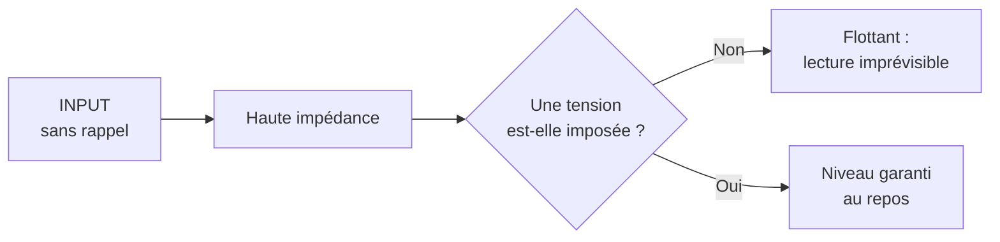

## Au programme

1. Zéro ou un
2. Une broche en sortie
3. Une broche en entrée
4. Lire le monde analogique
5. Simuler une tension

<aside class="notes" markdown="1">
1 h 30 de cours, sans manipulation. Le cours prépare le TD2 : les modules de la mallette (bouton, joystick, buzzer, écran) branchés sur les broches de la future carte. Le montrer tôt, tout le cours y renvoie.
Ouvrir sur la slide de rappel du CM1 : registres, `millis()`, interruption, 3,3 V. Les quatre reviennent dans ce cours.
</aside>

---

## Ce que vous saurez faire

### À la fin de ce cours, vous saurez :

- distinguer un signal **numérique** d'un signal **analogique**
- configurer une broche, et calculer la résistance série d'une LED
- commander une charge de puissance par un transistor
- expliquer l'**état flottant**, et choisir entre pull-up et pull-down
- filtrer les **rebonds** d'un bouton, par scrutation ou par interruption
- lire une tension avec l'**ADC**, et la mettre à l'échelle
- produire une tension moyenne avec le **PWM**

[GPIO et monde numérique](/workshops/microcontroleur/concepts/gpio-monde-numerique/){: .doc-link} [ADC et PWM](/workshops/microcontroleur/concepts/adc-pwm/){: .doc-link}

---

## Quiz : ce qu'il reste du CM1

<p class="activity-meta"><span><i class="fas fa-user"></i>Individuel</span><span><i class="far fa-clock"></i>5 min</span><span><i class="fas fa-pen"></i>Sans notes</span></p>

1. Où est rangé le programme quand la carte est éteinte ?
2. Où vit une variable locale d'une fonction ?
3. Que fait `REG |= (1 << 5)` ?
4. Pourquoi ne pas mettre de `delay()` dans `loop()` ?
5. Le C++ de l'ESP32 est-il compilé ou interprété ?
6. Comment le matériel prévient-il le programme d'un événement ?
7. Quelle tension au plus sur une broche de l'ESP32-S3 ?

<aside class="notes" markdown="1">
Sur une feuille, sans notes ni PC, 5 min. Correction à main levée sur la slide suivante : demander qui a 7/7, 5/7, moins. Les questions qui ont coincé indiquent quoi rappeler en passant pendant le cours.
</aside>

---

## Quiz : correction

| | Réponse |
|---|---|
| 1 | En **mémoire flash**, qui ne s'efface pas à la coupure |
| 2 | Sur la **pile**, en RAM, libérée à la sortie de la fonction |
| 3 | Met le bit 5 du registre à 1, sans toucher aux autres |
| 4 | `delay()` **bloque** tout ; on regarde l'heure avec `millis()` |
| 5 | **Compilé**, une fois pour toutes, avant le téléversement |
| 6 | Par une **interruption** |
| 7 | <span class="highlight-red">**3,3 V**, jamais 5 V</span> |
{: .table-dense}

Registres, `millis()`, interruptions et 3,3 V reviennent tous aujourd'hui, appliqués aux broches.
{: .caption}

[Architecture d'un microcontrôleur](/workshops/microcontroleur/concepts/architecture-microcontroleur/){: .doc-link} [Du matériel au logiciel](/workshops/microcontroleur/concepts/du-materiel-au-logiciel/){: .doc-link}

---

<!-- .slide: class="slide-section" -->

## Zéro ou un

Les niveaux logiques

---

## Deux natures de signal

{: .img-sm}

| | Numérique | Analogique |
|---|---|---|
| Valeurs possibles | 2 (`LOW` / `HIGH`) | continues, de 0 à 3,3 V |
| Fonction Arduino | `digitalRead` / `digitalWrite` | `analogRead` (ADC) |
| Dans votre montage | les boutons | les axes du joystick |
{: .table-dense}

[GPIO et monde numérique](/workshops/microcontroleur/concepts/gpio-monde-numerique/){: .doc-link} [ADC et PWM](/workshops/microcontroleur/concepts/adc-pwm/){: .doc-link}

<aside class="notes" markdown="1">
Toute la séance tient dans ce tableau : d'abord le tout-ou-rien, ensuite le continu.
</aside>

---

## Les seuils de l'ESP32-S3

| Seuil | Valeur | Interprétation |
|---|---|---|
| $V_{IL}$ (LOW max) | ≤ 0,25 × VDD ≈ **0,8 V** | lu comme `LOW` |
| Zone indéterminée | ~0,8 V à ~2,5 V | lecture imprévisible |
| $V_{IH}$ (HIGH min) | ≥ 0,75 × VDD ≈ **2,5 V** | lu comme `HIGH` |
{: .table-dense}

En **sortie**, la puce garantit à l'inverse des niveaux francs : proche de 0 V, ou proche de 3,3 V.

Cette zone grise au milieu explique tout ce qui suit sur les entrées flottantes. Retenez-la.
{: .highlight-red}

[GPIO et monde numérique](/workshops/microcontroleur/concepts/gpio-monde-numerique/){: .doc-link}

---

## La datasheet, page « DC Characteristics »

| Symbole | Ce que c'est | Valeur |
|---|---|---|
| $V_{IH}$ | Tension minimale lue comme `HIGH` | 0,75 × VDD |
| $V_{IL}$ | Tension maximale lue comme `LOW` | 0,25 × VDD |
| $V_{OH}$ | Tension minimale garantie en sortie `HIGH` | 0,8 × VDD |
| $V_{OL}$ | Tension maximale garantie en sortie `LOW` | 0,1 × VDD |
| $I_{OH}$ | Courant que peut fournir une sortie `HIGH` | 40 mA |
| $R_{PU}$, $R_{PD}$ | Résistances de tirage internes | 45 kΩ |
{: .table-dense}

Extrait de la datasheet de l'ESP32-S3 (VDD = 3,3 V, 25 °C). Juste avant, le tableau des valeurs maximales absolues : **3,6 V** au plus sur une broche.
{: .caption}

[ESP32-S3 : datasheet](https://www.espressif.com/sites/default/files/documentation/esp32-s3_datasheet_en.pdf){: .doc-link} [GPIO et monde numérique](/workshops/microcontroleur/concepts/gpio-monde-numerique/){: .doc-link}

---

## Activité : la datasheet répond

<p class="activity-meta"><span><i class="fas fa-user-friends"></i>En binôme</span><span><i class="far fa-clock"></i>5 min</span><span><i class="fas fa-pen"></i>Sans PC</span></p>

Avec le tableau précédent :

1. Un capteur signale un `HIGH` par 2,2 V. L'ESP32-S3 le lit-il ?
2. Que vaut la résistance activée par `INPUT_PULLUP` ?
3. Une broche à `HIGH` doit fournir 20 mA. C'est permis ?
4. Un module sort 5 V. Peut-on le brancher directement ?

<aside class="notes" markdown="1">
Laisser chercher dans le tableau, c'est l'objectif : la réponse est dans la datasheet, pas dans la mémoire. Correction sur la slide suivante.
</aside>

---

## Correction : la datasheet

| | Réponse |
|---|---|
| 1 | **Non** : 2,2 V < $V_{IH}$ ≈ 2,5 V, zone indéterminée |
| 2 | **45 kΩ** : un rappel « faible », une résistance externe de 10 kΩ est plus ferme |
| 3 | **Oui**, $I_{OH}$ = 40 mA ; en pratique, rester sous 12 mA |
| 4 | **Non** : 3,6 V au plus, il faut un pont diviseur |
{: .table-dense}

Le réflexe d'ingénieur : chercher la réponse dans la datasheet avant de la chercher sur un forum.
{: .caption}

[ESP32-S3 : datasheet](https://www.espressif.com/sites/default/files/documentation/esp32-s3_datasheet_en.pdf){: .doc-link}

---

<!-- .slide: class="slide-section" -->

## Une broche en sortie

Piloter une LED

---

## Configurer, puis écrire

```cpp
pinMode(LED_PIN, OUTPUT);     // la broche devient une sortie

digitalWrite(LED_PIN, HIGH);  // 3,3 V : LED allumée
digitalWrite(LED_PIN, LOW);   // 0 V   : LED éteinte
```

*GPIO* veut dire *General Purpose Input/Output* : la même broche peut servir d'entrée ou de sortie, et c'est le logiciel qui décide, à l'exécution.

Vu au CM1 : derrière `pinMode`, un registre de configuration ; derrière `digitalWrite`, un bit d'un registre de sortie.
{: .caption}

[GPIO et monde numérique](/workshops/microcontroleur/concepts/gpio-monde-numerique/){: .doc-link} [Architecture d'un microcontrôleur](/workshops/microcontroleur/concepts/architecture-microcontroleur/){: .doc-link}

---

## Toujours une résistance série

Une LED n'a quasiment pas de résistance propre : branchée seule, elle tire tout le courant que la broche peut fournir, et l'une des deux grille.

$$R = \frac{V_{alim} - V_f}{I} = \frac{3{,}3 - 2}{0{,}01} = 130\ \Omega$$

Pour une LED rouge ($V_f \approx 2$ V) à 10 mA : **150 Ω** en valeur normalisée E12.

Courant maximal par broche : ~40 mA. En pratique, rester sous **12 mA**. **↓** pour le calculateur en ligne.
{: .highlight-red}

[GPIO et monde numérique](/workshops/microcontroleur/concepts/gpio-monde-numerique/){: .doc-link}

<!-- .down -->

## Le calculateur de résistance

<iframe class="page-preview" data-src="/workshops/microcontroleur/concepts/gpio-monde-numerique/#sortie--piloter-une-led" title="Calculateur de résistance série pour LED"></iframe>

---

## Combien de LED sur une broche ?

<div class="columns" markdown="1">
<div markdown="1">

<p class="big-number">12 mA</p>

**par broche**, en pratique. Soit **une** LED correctement calibrée.

</div>
<div markdown="1">

<p class="big-number">40 mA</p>

**le maximum** de la datasheet. Plus, et la broche grille.

</div>
</div>

Pour piloter plus de courant (un moteur, un ruban de LED, un relais), la broche ne fournit pas la puissance : elle **commande** un transistor, qui lui la fournit.
{: .caption}

[GPIO et monde numérique](/workshops/microcontroleur/concepts/gpio-monde-numerique/){: .doc-link}

---

## Commander une charge : le MOSFET

{: .img-md}

La broche n'impose qu'une **tension** sur la grille : le courant du moteur vient de sa propre alimentation. La 10 kΩ garde le moteur arrêté au démarrage ; la diode, deux slides plus loin.
{: .caption}

[GPIO et monde numérique](/workshops/microcontroleur/concepts/gpio-monde-numerique/){: .doc-link}

---

## Choisir le MOSFET

| Paramètre | Ce que c'est | À viser |
|---|---|---|
| $V_{GS(th)}$ | Tension de grille où il commence à conduire | Bien sous 3,3 V |
| $R_{DS(on)}$ | Résistance une fois passant : elle chauffe | Donnée à 2,5 V, quelques dizaines de mΩ |
| $I_D$ | Courant maximal | Au moins 2 × celui de la charge |
| $V_{DS}$ | Tension maximale | Au-dessus de l'alimentation de la charge |
{: .table-dense}

Un MOSFET « logic level » conduit franchement avec 3,3 V : AO3400 (CMS), IRLB8721 (traversant).

Un IRF540 classique attend 10 V sur sa grille : à 3,3 V, il chauffe sans conduire.
{: .highlight-red}

[GPIO et monde numérique](/workshops/microcontroleur/concepts/gpio-monde-numerique/){: .doc-link}

---

## La diode de roue libre

Moteur, relais, électro-aimant : une **bobine** s'oppose à toute variation brutale de courant. Quand le MOSFET coupe, elle produit une pointe de plusieurs dizaines de volts, qui détruit le transistor.

La parade : une **diode** aux bornes de la charge, cathode côté +. Elle offre un chemin au courant le temps qu'il s'éteigne.

Charge inductive : une diode en parallèle, sans exception.
{: .highlight-red}

1N4007 pour un relais, une Schottky (1N5819) pour un moteur en PWM rapide.
{: .caption}

[GPIO et monde numérique](/workshops/microcontroleur/concepts/gpio-monde-numerique/){: .doc-link}

---

## Push-pull ou open-drain

<div class="columns" markdown="1">
<div markdown="1">

### Push-pull

Le mode par défaut d'`OUTPUT`. Deux transistors tirent activement la broche vers `HIGH` **et** vers `LOW`.

</div>
<div markdown="1">

### Open-drain

La broche ne peut que tirer vers `LOW`, ou relâcher. Indispensable sur un bus partagé comme l'I2C.

</div>
</div>

Deux composants en push-pull sur le même fil, l'un imposant 0 et l'autre 1 : c'est un court-circuit. L'open-drain règle ce problème, on le retrouvera au CM3 avec l'I2C.
{: .caption}

[GPIO et monde numérique](/workshops/microcontroleur/concepts/gpio-monde-numerique/){: .doc-link} [Les bus de communication](/workshops/microcontroleur/concepts/bus-communication/){: .doc-link}

---

<!-- .slide: class="slide-section" -->

## Une broche en entrée

Lire un bouton, vraiment

---

## Activité : le programme le plus simple du monde

<p class="activity-meta"><span><i class="fas fa-user-friends"></i>En binôme</span><span><i class="far fa-clock"></i>3 min</span><span><i class="fas fa-pen"></i>Sans PC</span></p>

<div class="columns" markdown="1">
<div markdown="1">

```cpp
pinMode(BTN_PIN, INPUT);

void loop() {
  if (digitalRead(BTN_PIN) == HIGH)
    Serial.println("Appui !");
}
```

</div>
<div markdown="1">


</div>
</div>

### Le programme est-il correct ?

<aside class="notes" markdown="1">
Réponse : non. Bouton relâché, la broche n'est reliée à rien : elle flotte, sa tension traîne dans la zone indéterminée du début de séance, et `digitalRead` rend n'importe quoi. Enchaîner.
</aside>

---

## Le piège de l'entrée nue

Une broche en entrée non connectée est en **haute impédance** : presque aucun courant ne la traverse, et **rien ne fixe sa tension**.

Elle capte alors le bruit ambiant (un câble voisin, le secteur à 50 Hz, votre main qui s'approche) et sa lecture devient aléatoire. C'est l'**état flottant**.

Le symptôme est reconnaissable : le programme « détecte des appuis » que personne ne fait.
{: .highlight-red}

[GPIO et monde numérique](/workshops/microcontroleur/concepts/gpio-monde-numerique/){: .doc-link}

---

## Pourquoi ça flotte



[GPIO et monde numérique](/workshops/microcontroleur/concepts/gpio-monde-numerique/){: .doc-link}

---

## La solution : une résistance de rappel

<div class="columns" markdown="1">
<div markdown="1">

### Pull-up : repos à HIGH

{: .img-md}

</div>
<div markdown="1">

### Pull-down : repos à LOW

{: .img-md}

</div>
</div>

La résistance fixe un niveau au repos, sans court-circuit quand le bouton se ferme.
{: .caption}

[GPIO et monde numérique](/workshops/microcontroleur/concepts/gpio-monde-numerique/){: .doc-link}

---

## Le rappel est déjà dans la puce

| Mode | Au repos | Câblage requis |
|---|---|---|
| `INPUT` | flottant | résistance externe |
| `INPUT_PULLUP` | `HIGH`, tiré en interne | bouton vers **GND** |
| `INPUT_PULLDOWN` | `LOW`, tiré en interne | bouton vers 3,3 V |
{: .table-dense}

```cpp
pinMode(BTN_PIN, INPUT_PULLUP);                // pull-up interne (~45 kΩ)
bool presse = (digitalRead(BTN_PIN) == LOW);   // logique inversée
```

**La logique est inversée** : `LOW` veut dire « pressé ».
{: .highlight-red}

[GPIO et monde numérique](/workshops/microcontroleur/concepts/gpio-monde-numerique/){: .doc-link} [Les modules de la mallette](/workshops/microcontroleur/tutorials/entrees-boutons-joystick/){: .doc-link}

---

## Un bouton rebondit

Les lamelles métalliques d'un bouton mécanique **rebondissent** pendant quelques millisecondes : une rafale de `HIGH`/`LOW` avant stabilisation, parfaitement visible à l'oscilloscope.

Un `digitalRead()` naïf compte alors *plusieurs* appuis là où vous n'en avez fait qu'un. Dans un menu de jeu, cela se traduit par une sélection qui saute deux lignes.

La parade : après un changement d'état, ignorer les lectures pendant 20 à 50 ms.
{: .caption}

[GPIO et monde numérique](/workshops/microcontroleur/concepts/gpio-monde-numerique/){: .doc-link}

---

## Un appui, deux boutons

{: .img-md}

Même appui : le bouton idéal descend une fois, le vrai rebondit. Un `digitalRead()` naïf compte chaque front descendant.
{: .caption}

[GPIO et monde numérique](/workshops/microcontroleur/concepts/gpio-monde-numerique/){: .doc-link}

---

## L'anti-rebond, sans bloquer

<pre><code class="language-cpp" data-trim data-line-numbers="1-2|4|5-8|9-11">
const unsigned long ANTIREBOND = 30;                            // ms
int dernierEtat = HIGH;  unsigned long dernierChangement = 0;
void loop() {
  int etat = digitalRead(BTN_PIN);     // INPUT_PULLUP : LOW = pressé
  if (etat != dernierEtat) {           // le signal vient de bouger
    dernierChangement = millis();
    dernierEtat = etat;
  }
  if (millis() - dernierChangement > ANTIREBOND && etat == LOW) {
    // enfoncé et stable depuis 30 ms (vrai tant qu'il reste enfoncé)
  }
}
</code></pre>

Même motif qu'au CM1 : comparer `millis()` à une date mémorisée.
{: .caption}

[GPIO et monde numérique](/workshops/microcontroleur/concepts/gpio-monde-numerique/){: .doc-link}

---



[Les modules de la mallette](/workshops/microcontroleur/tutorials/entrees-boutons-joystick/){: .doc-link}

---

## L'interruption, face à un bouton qui rebondit

L'interruption du CM1 se déclenche sur **chaque front** : un bouton qui rebondit la déclenche plusieurs fois pour un seul appui.

- L'interruption lève un drapeau ; `loop()` filtre les **rebonds** avec `millis()`
- **`volatile`** : la variable change hors de `loop()`, le compilateur la relit à chaque fois

Pour un bouton lu à chaque image d'un jeu, la scrutation avec anti-rebond suffit : c'est la solution du TD2.
{: .caption}

[GPIO et monde numérique](/workshops/microcontroleur/concepts/gpio-monde-numerique/){: .doc-link}

---

## `attachInterrupt()` en pratique

```cpp
volatile bool appui = false;                 // écrite par l'ISR, lue par loop()
void IRAM_ATTR surAppui() {                  // la routine d'interruption (ISR)
  appui = true;                              // lever le drapeau, rien de plus
}
void setup() {
  pinMode(BTN_PIN, INPUT_PULLUP);
  attachInterrupt(digitalPinToInterrupt(BTN_PIN), surAppui, FALLING);
}
void loop() {
  if (appui) { appui = false; /* traiter l'appui */ }
}
```

`FALLING` : front descendant, donc l'appui en `INPUT_PULLUP` (`RISING` et `CHANGE` existent aussi). `IRAM_ATTR` range l'ISR en RAM, toujours accessible.
{: .caption}

[Architecture d'un microcontrôleur](/workshops/microcontroleur/concepts/architecture-microcontroleur/){: .doc-link}

---

## Dans une interruption, jamais

- de `delay()` ni d'attente : tout le reste est figé pendant l'ISR
- de `Serial.print()` ni de dessin à l'écran : bien trop lents
- de calcul long : quelques microsecondes, pas plus
- {: .highlight-red} La règle : l'ISR **note**, `loop()` **traite**

Une ISR trop longue retarde les autres interruptions, dont celles du Wi-Fi : sur l'ESP32, un chien de garde finit par redémarrer la carte.
{: .caption}

[Architecture d'un microcontrôleur](/workshops/microcontroleur/concepts/architecture-microcontroleur/){: .doc-link}

---

## Scrutation ou interruption ?

| | Scrutation | Interruption |
|---|---|---|
| Réaction | À la prochaine lecture (une image, 16 ms) | Quelques microsecondes |
| Événement très bref | Peut être manqué | Jamais manqué |
| Rebonds | Filtrés au passage | Déclenchent plusieurs fois |
| Code | Simple | `volatile`, ISR courte |
| Exemples | Boutons et joystick d'un jeu | Encodeur rotatif, capteur de vitesse |
{: .table-dense}

Un encodeur rotatif produit des impulsions trop brèves pour la scrutation : là, l'interruption s'impose.
{: .caption}

[GPIO et monde numérique](/workshops/microcontroleur/concepts/gpio-monde-numerique/){: .doc-link} [Architecture d'un microcontrôleur](/workshops/microcontroleur/concepts/architecture-microcontroleur/){: .doc-link}

---

## Une broche n'est pas figée

La **GPIO matrix** route UART, SPI, I2C et PWM vers presque n'importe quelle broche. Sur un Arduino Uno, le SPI est câblé en dur.

Deux exceptions à connaître :

- l'**ADC** est câblé en dur : seules certaines broches mesurent
- {: .highlight-red} des broches sont **réservées** : strapping, Flash SPI, USB

Vérifiez le brochage de la carte avant de câbler, pas après.
{: .caption}

[GPIO et monde numérique](/workshops/microcontroleur/concepts/gpio-monde-numerique/){: .doc-link} [XIAO ESP32S3](/docs/references/hardware/xiao-esp32s3/){: .doc-link}

---

## Le câblage de la mallette

| Module | Broche | Mode |
|---|---|---|
| Joystick : axes X et Y | D0, D1 (**ADC1**) | `analogRead` |
| Joystick : appui sur le stick | D2 | `INPUT_PULLUP` |
| Bouton | D5 | `INPUT_PULLUP` |
| Buzzer | D3 | PWM (`tone`) |
| Écran (SPI, vu au CM3) | D7 à D10 | Bibliothèque |
{: .table-dense}

C'est le brochage de la future carte (TD3), plus le buzzer, présent seulement sur breadboard. Un programme écrit au TD2 tournera tel quel sur la carte soudée.
{: .caption}

[Les modules de la mallette](/workshops/microcontroleur/tutorials/entrees-boutons-joystick/){: .doc-link}

---

## Connecter un composant 5 V

- **Signal 5 V vers le µC** : un pont diviseur de deux résistances ramène le niveau sous 3,3 V
- **Bus bidirectionnel** (I2C par exemple) : un *level shifter* dédié
- **Module alimenté en 5 V** : vérifier la tension de ses **sorties** ; si elles montent à 5 V, pont diviseur ou *level shifter*
- {: .highlight-red} Jamais 5 V directement sur un GPIO

Le sens inverse est sans danger pour la puce : un composant 5 V lit souvent 3,3 V comme un `HIGH`, mais pas toujours (vérifier son seuil $V_{IH}$).
{: .caption}

[GPIO et monde numérique](/workshops/microcontroleur/concepts/gpio-monde-numerique/){: .doc-link}

---

<!-- .slide: class="slide-section" -->

## Lire le monde analogique

L'ADC

---

## Du continu vers l'entier

Une température, une position de joystick, une luminosité produisent des tensions qui varient **en continu** entre 0 et 3,3 V. Le microcontrôleur, lui, ne manipule que des entiers.

Le **convertisseur analogique-numérique** (ADC) fait la traduction.

```cpp
int valeur = analogRead(JOY_X);   // 0 à 4095
```

Pas besoin de `pinMode` : `analogRead()` configure la broche lui-même.
{: .caption}

[ADC et PWM](/workshops/microcontroleur/concepts/adc-pwm/){: .doc-link}

---

## 12 bits, soit 4096 valeurs

$$\text{valeur} = \frac{V_{\text{entrée}}}{3{,}3} \times 4095$$

| Position du stick | Tension | Valeur ADC |
|---|---|---|
| Butée gauche ou bas | 0 V | 0 |
| Centre, au repos | 1,65 V | ≈ 2048 |
| Butée droite ou haut | 3,3 V | 4095 |
{: .table-dense}

Cette formule suppose un ADC idéal, qui mesure exactement de 0 à 3,3 V. Les slides suivantes montrent le vrai.
{: .caption}

[ADC et PWM](/workshops/microcontroleur/concepts/adc-pwm/){: .doc-link}

---

## La plage réelle : l'atténuation

Le cœur de l'ADC ne mesure qu'environ 1 V : un **atténuateur** placé devant élargit la plage, en perdant un peu de précision.

| Atténuation | Plage mesurable (ESP32-S3) |
|---|---|
| 0 dB | 0 à ~0,95 V |
| 2,5 dB | 0 à ~1,25 V |
| 6 dB | 0 à ~1,75 V |
| 11 dB (défaut d'Arduino-ESP32) | 0 à ~3,1 V |
{: .table-dense}

Au-delà de ~3,1 V, la lecture sature à 4095.
{: .highlight-red}

[ADC et PWM](/workshops/microcontroleur/concepts/adc-pwm/){: .doc-link}

---

## Une mesure juste : `analogReadMilliVolts()`

```cpp
int brut = analogRead(PIN);            // 0 à 4095, courbe imparfaite
int mv   = analogReadMilliVolts(PIN);  // tension corrigée, en mV
```

La réponse de l'ADC n'est pas une droite parfaite : elle s'écrase près de 0 V et près de la saturation, et varie d'une puce à l'autre. Chaque ESP32-S3 sort d'usine avec des **coefficients de calibration** gravés dans la puce : `analogReadMilliVolts()` les applique.

Joystick : `analogRead()` suffit, on calibre le centre soi-même. Tension d'une batterie ou d'un capteur : `analogReadMilliVolts()`.
{: .caption}

[ADC et PWM](/workshops/microcontroleur/concepts/adc-pwm/){: .doc-link}

---

## Mesurer plus de 3,3 V : le pont diviseur

$$V_{ADC} = V_{in} \times \frac{R_2}{R_1 + R_2}$$

Une batterie LiPo (4,2 V au plus) avec $R_1 = R_2 = 100$ kΩ donne 2,1 V au plus sur l'ADC : dans la plage, avec de la marge.

```cpp
float vbat = analogReadMilliVolts(VBAT_PIN) * 2 / 1000.0;   // en volts
```

De grandes résistances consomment peu, mais l'ADC lit mal une source aussi « molle » : un condensateur de 100 nF sur l'entrée stabilise la mesure.
{: .caption}

[ADC et PWM](/workshops/microcontroleur/concepts/adc-pwm/){: .doc-link}

---



[ADC et PWM](/workshops/microcontroleur/concepts/adc-pwm/){: .doc-link} [Les modules de la mallette](/workshops/microcontroleur/tutorials/entrees-boutons-joystick/){: .doc-link}

---

## Un joystick, c'est deux potentiomètres

<div class="columns" markdown="1">
<div markdown="1">

{: .img-md}

Un module joystick, ici sur une autre carte ESP32-S3
{: .caption}

</div>
<div markdown="1">

```cpp
int x = analogRead(JOY_X);
int y = analogRead(JOY_Y);
bool btn = !digitalRead(JOY_BTN);
```

Deux axes lus par l'ADC, un bouton sous le stick en `INPUT_PULLUP`.

Cinq fils : `VCC`, `GND`, `VRx`, `VRy`, `SW`.

</div>
</div>

[Les modules de la mallette](/workshops/microcontroleur/tutorials/entrees-boutons-joystick/){: .doc-link}

---

## Des valeurs brutes aux directions

```cpp
enum Direction { CENTRE, HAUT, BAS, GAUCHE, DROITE };

Direction lireDirection() {
  int x = analogRead(JOY_X), y = analogRead(JOY_Y);
  if (x < 1500) return GAUCHE;
  if (x > 2500) return DROITE;
  if (y < 1500) return BAS;
  if (y > 2500) return HAUT;
  return CENTRE;
}
```

Le centre n'est jamais à 2048 : sans **zone morte**, la raquette dérive.
{: .highlight-red}

[ADC et PWM](/workshops/microcontroleur/concepts/adc-pwm/){: .doc-link}

---

## Calibrer et normaliser

```cpp
int centre = moyenneDe16Lectures();      // au démarrage, stick relâché

float normaliser(int brut, int centre) {
  int ecart = brut - centre;
  if (abs(ecart) < 300) return 0.0f;     // zone morte
  int course = (ecart > 0) ? (4095 - centre) : centre;
  return constrain((float)ecart / course, -1.0f, 1.0f);
}
```

De **-1** à **+1**, **0** au repos : la raquette avance d'autant plus vite que le stick est incliné.
{: .caption}

[ADC et PWM](/workshops/microcontroleur/concepts/adc-pwm/){: .doc-link} [Les modules de la mallette](/workshops/microcontroleur/tutorials/entrees-boutons-joystick/){: .doc-link}

---

## Changer d'échelle : `map()`

```cpp
int lecture = analogRead(POT_PIN);             // 0 à 4095
int angle   = map(lecture, 0, 4095, 0, 180);   // 0 à 180°
int pwm     = map(lecture, 0, 4095, 0, 255);   // 0 à 255
```

`map()` fait la règle de trois d'un coup, mais **ne borne pas** son résultat :

```cpp
pwm = constrain(pwm, 0, 255);
```

[ADC et PWM](/workshops/microcontroleur/concepts/adc-pwm/){: .doc-link}

---

## Un ADC qui tremble

Une lecture analogique bruite toujours un peu : deux `analogRead()` consécutifs sur un stick immobile ne rendent pas la même valeur.

```cpp
long somme = 0;
for (int i = 0; i < 16; i++) somme += analogRead(PIN);
int lisse = somme / 16;
```

Seize lectures coûtent quelques centaines de microsecondes : négligeable face aux 16 ms d'une image, et l'affichage arrête de sautiller.
{: .caption}

[ADC et PWM](/workshops/microcontroleur/concepts/adc-pwm/){: .doc-link}

---

<!-- .slide: class="slide-section" -->

## Simuler une tension

Le PWM

---

## Le problème

Un GPIO ne produit que `0 V` ou `3,3 V`. Et l'ESP32-S3 n'a **pas de DAC** matériel.

Comment régler une demi-luminosité, une vitesse de moteur, la position d'un servo ?

**En alternant très vite.**
{: .highlight-red}

[ADC et PWM](/workshops/microcontroleur/concepts/adc-pwm/){: .doc-link}

---

## Le rapport cyclique

Le PWM (*Pulse Width Modulation*) bascule entre `HIGH` et `LOW` à haute fréquence. La proportion de temps passée à `HIGH` est le **rapport cyclique**.

| Duty cycle | Effet perçu |
|---|---|
| 0 % | Toujours éteint |
| 50 % | Mi-luminosité |
| 100 % | Plein éclat |
{: .table-dense}

$$V_{moyen} = V_{max} \times \frac{\text{duty cycle}}{100}$$

À 1 à 50 kHz, ni l'œil ni un moteur ne perçoivent le clignotement : seulement la moyenne. **↓** pour le démonstrateur.
{: .caption}

[ADC et PWM](/workshops/microcontroleur/concepts/adc-pwm/){: .doc-link}

<!-- .down -->

## Le démonstrateur PWM

<iframe class="page-preview" data-src="/workshops/microcontroleur/concepts/adc-pwm/#du-numérique-vers-lanalogique--le-pwm" title="Démonstrateur PWM interactif"></iframe>

---

## En pratique

```cpp
analogWrite(LED_PIN, 0);     // éteint
analogWrite(LED_PIN, 128);   // ~50 % : demi-luminosité
analogWrite(LED_PIN, 255);   // plein éclat
```

Derrière, Arduino-ESP32 utilise le périphérique **LEDC** : 8 canaux matériels indépendants, fréquence et résolution configurables (jusqu'à 14 bits).

Le CPU n'intervient pas. Une fois le canal réglé, le signal est généré par le matériel, même si la `loop()` est occupée ailleurs. C'est tout l'intérêt d'un périphérique dédié.
{: .caption}

[ADC et PWM](/workshops/microcontroleur/concepts/adc-pwm/){: .doc-link} [Architecture d'un microcontrôleur](/workshops/microcontroleur/concepts/architecture-microcontroleur/){: .doc-link}

---

## Ce que le PWM permet

| Application | Principe |
|---|---|
| LED dimmable | Duty cycle proportionnel à la luminosité |
| Moteur à courant continu | Duty cycle proportionnel à la vitesse |
| Servomoteur | Impulsion de 1 à 2 ms toutes les 20 ms |
| Buzzer (celui de la mallette) | La fréquence devient un ton |
{: .table-dense}

Un servomoteur n'écoute pas le rapport cyclique mais la **largeur** de l'impulsion : c'est le même périphérique, lu autrement.
{: .caption}

[ADC et PWM](/workshops/microcontroleur/concepts/adc-pwm/){: .doc-link}

---

## Activité : de quoi avez-vous besoin ?

<p class="activity-meta"><span><i class="fas fa-user-friends"></i>En binôme</span><span><i class="far fa-clock"></i>5 min</span><span><i class="fas fa-pen"></i>Sans PC</span></p>

Pour chacun, dites **quel type de broche** et **quelle fonction Arduino** :

1. Détecter qu'un capot est fermé (contact mécanique)
2. Mesurer la luminosité de la pièce avec une photorésistance
3. Faire varier la vitesse d'un ventilateur
4. Allumer un voyant rouge de défaut

<aside class="notes" markdown="1">
Corrections : 1. GPIO `INPUT_PULLUP` + `digitalRead`. 2. broche ADC1 + `analogRead`. 3. PWM + `analogWrite` (et un transistor, la broche ne fournit pas le courant). 4. GPIO `OUTPUT` + `digitalWrite`, avec résistance série.
</aside>

---

## Correction

| Besoin | Broche | Fonction |
|---|---|---|
| Capot fermé | GPIO en `INPUT_PULLUP` | `digitalRead` |
| Luminosité | broche **ADC1** | `analogRead` |
| Vitesse d'un ventilateur | GPIO en PWM, via un transistor | `analogWrite` |
| Voyant de défaut | GPIO en `OUTPUT` + résistance | `digitalWrite` |
{: .table-dense}

Quatre lignes, et vous avez déjà couvert l'essentiel de ce que fait un microcontrôleur dans l'industrie.
{: .caption}

[GPIO et monde numérique](/workshops/microcontroleur/concepts/gpio-monde-numerique/){: .doc-link} [ADC et PWM](/workshops/microcontroleur/concepts/adc-pwm/){: .doc-link}

---

## À retenir

- `LOW` sous ~0,8 V, `HIGH` au-dessus de ~2,5 V, rien entre les deux
- Une entrée sans rappel **flotte** : `INPUT_PULLUP`, logique inversée
- Un bouton mécanique rebondit : filtrer sur 20 à 50 ms
- L'ADC rend 0 à 4095 ; **ADC1 seulement** si le Wi-Fi tourne
- `map()` change d'échelle, `constrain()` borne le résultat
- Le PWM simule une tension moyenne : `analogWrite(pin, 0..255)`
- Une charge de puissance : un MOSFET « logic level », et une diode si elle est inductive
- {: .highlight-red} Une LED se pilote toujours avec sa résistance série

[GPIO et monde numérique](/workshops/microcontroleur/concepts/gpio-monde-numerique/){: .doc-link} [ADC et PWM](/workshops/microcontroleur/concepts/adc-pwm/){: .doc-link}

---

## Les quatre réflexes à garder

1. Une sortie qui pilote une LED : **toujours une résistance série**
2. Une entrée qui lit un bouton : **`INPUT_PULLUP`**, bouton vers GND, logique inversée
3. Un appui qui compte double : c'est un **rebond**, filtrez sur 30 ms
4. Une lecture analogique : **ADC1 uniquement**, et une zone morte large au centre

Ces quatre réflexes couvrent la quasi-totalité des bugs de câblage et de lecture d'entrées.
{: .caption}

[GPIO et monde numérique](/workshops/microcontroleur/concepts/gpio-monde-numerique/){: .doc-link} [ADC et PWM](/workshops/microcontroleur/concepts/adc-pwm/){: .doc-link} [Les modules de la mallette](/workshops/microcontroleur/tutorials/entrees-boutons-joystick/){: .doc-link}
