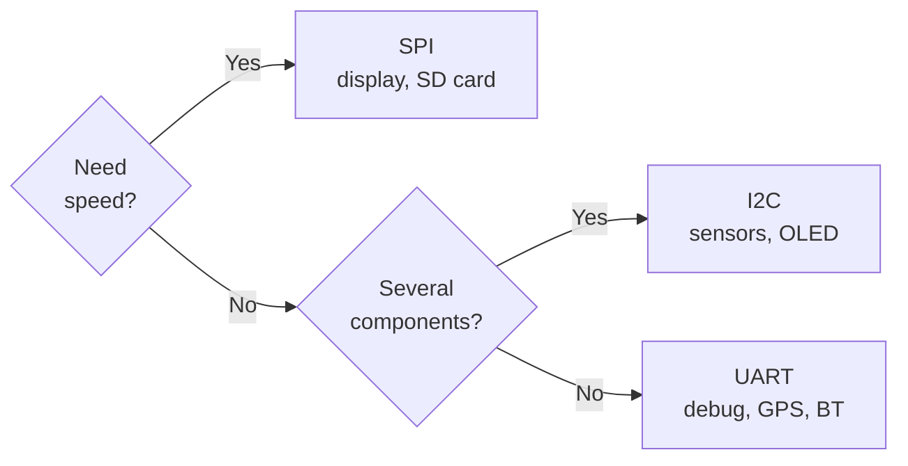
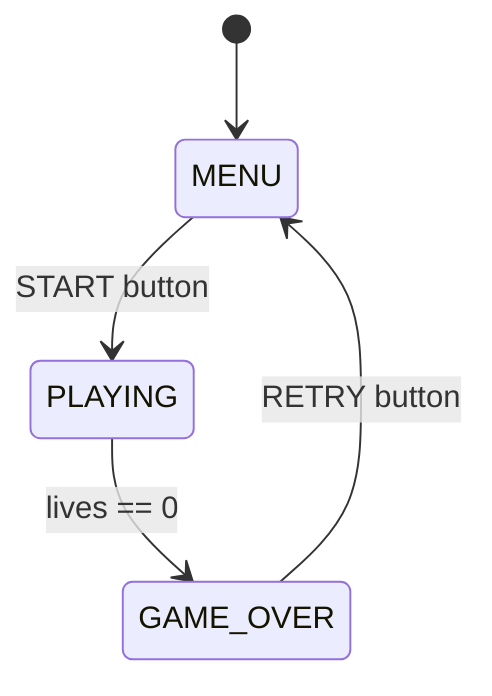
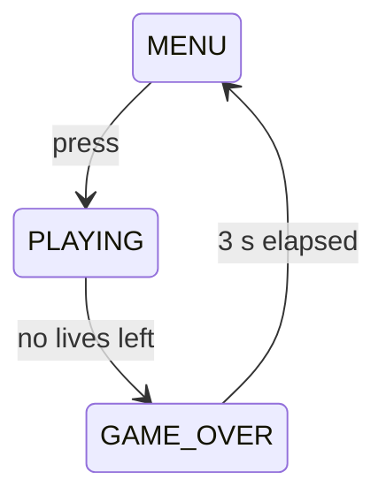
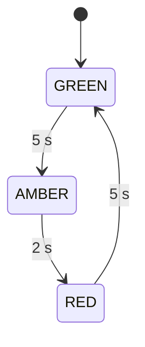

## On the agenda

1. Why buses
2. UART, I2C, SPI
3. Choosing your bus
4. The game loop
5. The state machine

<aside class="notes" markdown="1">
1 h 30, last lecture of the series, just before the labs. Keep time for the Pong FSM exercise: an FSM is drawn on paper, not in front of a screen.
Open with the Lecture 2 quiz: high impedance and open-drain come back with I2C, `millis()` with the game loop.
</aside>

---

## What you will be able to do

### By the end of this lecture, you will be able to:

- say why a **serial bus** exists, and tell UART, I2C and SPI apart
- choose the right bus for a peripheral, and wire it correctly
- write a **game loop** that never blocks
- recognise a situation where a **state machine** is needed
- implement it with an `enum` and a `switch`

The first two make the chip talk to the world; the last three keep your code readable.
{: .caption}

[Communication buses](/workshops/microcontroleur/concepts/bus-communication/){: .doc-link} [Finite state machine](/workshops/microcontroleur/concepts/machine-etats-finis/){: .doc-link}

---

## Quiz: what is left from Lecture 2

1. Between 0.8 V and 2.5 V, what does an ESP32-S3 input read?
2. Why does an unconnected input read anything at all?
3. With `INPUT_PULLUP`, what is read when the button is pressed?
4. Can an open-drain output impose a `HIGH`?
5. Why does a single press sometimes count twice?
6. Which pins to read the joystick while Wi-Fi is running?
7. How do you run a 12 V motor from a pin?

<aside class="notes" markdown="1">
Same format as in Lecture 2: on a sheet of paper, no notes, 5 min, show-of-hands correction. Questions 2 and 4 (high impedance, open-drain) prepare I2C, question 5 (`millis()`) the game loop: insist on them if they were a struggle.
</aside>

---

## Quiz: answers

| | Answer |
|---|---|
| 1 | Nothing reliable: it is the **undefined zone** |
| 2 | It **floats**: high impedance, nothing fixes its voltage |
| 3 | `LOW`: the logic is **inverted** |
| 4 | **No**: it pulls to 0 V, a pull resistor provides the `HIGH` |
| 5 | Contact **bounce**; filter it with `millis()` |
| 6 | The **ADC1** pins (ADC2 is unusable with Wi-Fi) |
| 7 | A "logic level" **MOSFET**, and a flyback diode |
{: .table-dense}

High impedance, open-drain and `millis()` come back today, with I2C and the game loop.
{: .caption}

[GPIO and the digital world](/workshops/microcontroleur/concepts/gpio-monde-numerique/){: .doc-link} [ADC and PWM](/workshops/microcontroleur/concepts/adc-pwm/){: .doc-link}

---

<!-- .slide: class="slide-section" -->

## Why buses

Making components talk

---

## One wire per piece of information?

The course's display (240 × 320) receives **76,800 pixels per frame**, i.e. more than 150,000 bytes in 16-bit colour. A sensor returns a temperature on 16 bits. An SD card, blocks of 512 bytes.

Wiring one wire per bit would be impractical: no pins left, an unreadable board, and interference between tracks.

A **serial bus** sends the bits **one after the other**, over two to four wires. Width is traded for time, and the chip is fast enough for it not to show.
{: .highlight-red}

[Communication buses](/workshops/microcontroleur/concepts/bus-communication/){: .doc-link}

---

## Serial or parallel

{: .img-md}

In parallel, one wire per bit: fast, but bulky. In serial, a single data wire: the bits go one after the other.
{: .caption}

[Communication buses](/workshops/microcontroleur/concepts/bus-communication/){: .doc-link}

---

## Four questions to compare two links

| Question | The two possible answers |
|---|---|
| How many parties? | **Point-to-point** (two) or **multipoint** (several) |
| A shared clock? | **Synchronous** (yes) or **asynchronous** (no) |
| Both directions at once? | **Full-duplex** (yes) or **half-duplex** (taking turns) |
| How is the recipient chosen? | An **address** in the message, or a select **wire** |
{: .table-dense}

These four answers are enough to describe UART, I2C and SPI.
{: .caption}

[Communication buses](/workshops/microcontroleur/concepts/bus-communication/){: .doc-link}

---

## Three buses, three trade-offs

- **UART**: the simplest. Two wires, a single party, no shared clock
- **I2C**: two wires, several components told apart by an **address**
- **SPI**: four wires, a clock, the fastest of the three

None is better in absolute terms: each trades speed for wires, or wires for complexity. The choice is made by the need.
{: .caption}

[Communication buses](/workshops/microcontroleur/concepts/bus-communication/){: .doc-link}

---

<!-- .slide: class="slide-section" -->

## UART

Two wires, point-to-point

---

## The simplest of the three

{: .img-md}

**Point-to-point**, **full-duplex**, **asynchronous**: without a clock, the speed (the **baud rate**, often 115,200 baud) is set in advance on both sides.
{: .caption}

[Communication buses](/workshops/microcontroleur/concepts/bus-communication/){: .doc-link}

---



[Communication buses](/workshops/microcontroleur/concepts/bus-communication/){: .doc-link}

---

## Anatomy of a frame

{: .img-md}

The **start** gives the signal, the receiver counts the bits at the agreed speed. 8 bits, no parity, 1 stop: **`8N1`**. Different format or speed: gibberish.
{: .caption}

[Communication buses](/workshops/microcontroleur/concepts/bus-communication/){: .doc-link}

---

## A frame, for real

{: .img-md}

The cursors measure **103.6 µs** per bit, i.e. 9600 baud. Screenshot: Haji akhundov, via [Wikimedia Commons](https://commons.wikimedia.org/wiki/File:RS232-UART_Oscilloscope_Screenshot.png), under [CC BY-SA 3.0](https://creativecommons.org/licenses/by-sa/3.0/deed.en).
{: .caption}

[Communication buses](/workshops/microcontroleur/concepts/bus-communication/){: .doc-link}

---

## Where you already use it

```cpp
Serial.begin(115200);                 // the serial monitor port
Serial.printf("x=%d y=%d\n", x, y);
```

The serial monitor is handled like a UART. UART is also the bus of GPS, Bluetooth or GSM modules, and the simplest way of making two microcontrollers talk.

On many boards, a USB-serial chip (CP2102, CH340) translates UART into USB and requires a driver on Windows. The XIAO has none: `Serial` goes directly through the ESP32-S3's native USB, and UART0 stays free on D6/D7.
{: .caption}

[The serial port in VSCode](/docs/tutorials/electronics/vscode-port-serie/){: .doc-link} [Checking the toolchain](/workshops/microcontroleur/tutorials/toolchain-blink/){: .doc-link}

---

<!-- .slide: class="slide-section" -->

## I2C

Two wires, several components

---

## One bus, addresses

{: .img-md}

**Multipoint**, **synchronous** (SCL), **half-duplex**. Each slave has a 7-bit **address**; the master writes it at the head of each message.
{: .caption}

[Communication buses](/workshops/microcontroleur/concepts/bus-communication/){: .doc-link}

---

## An I2C exchange

{: .img-md}

**Start**, **address + R/W**, slave **ACK**, **data** (one ACK per byte), **stop**. No ACK after the address: nobody answers at that address.
{: .caption}

[Communication buses](/workshops/microcontroleur/concepts/bus-communication/){: .doc-link}

---

## Pull-ups are not optional

SDA and SCL are **open-drain**, as in Lecture 2: components can only pull the line `LOW`, never `HIGH`. This is precisely what allows several of them to share the wire without a short circuit.

Two **pull-up** resistors (~4.7 kΩ) to 3.3 V are therefore needed. Without them, the line never rises and **nothing communicates**.

Most commercial modules already include them. If you chain several, a single pair is enough for the whole bus: no need to stack them. **↓** for the details.
{: .caption}

[Communication buses](/workshops/microcontroleur/concepts/bus-communication/){: .doc-link} [GPIO and the digital world](/workshops/microcontroleur/concepts/gpio-monde-numerique/){: .doc-link}

<!-- .down -->

## Sharing a wire without a short circuit

{: .img-md}

Anyone can pull the line to 0 or release it, never impose a 1: two components cannot contradict each other.
{: .caption}

[GPIO and the digital world](/workshops/microcontroleur/concepts/gpio-monde-numerique/){: .doc-link}

---

## Who is there? The I2C scanner

You do not always know the address. Sweep them all:

```cpp
for (byte addr = 1; addr < 127; addr++) {
  Wire.beginTransmission(addr);
  if (Wire.endTransmission() == 0) {
    Serial.printf("Found: 0x%02X\n", addr);
  }
}
```

Missing from the scan? The problem is the wiring or the pull-ups.
{: .highlight-red}

[Communication buses](/workshops/microcontroleur/concepts/bus-communication/){: .doc-link}

---

## Standard speeds

| Mode | Speed |
|---|---|
| Standard | 100 kHz |
| Fast | 400 kHz |
| Fast+ | 1 MHz |
| High Speed | 3.4 MHz |
{: .table-dense}

More than enough for sensors or a small monochrome OLED display, over one or two metres at most. Far too slow for a colour TFT display: at 400 kHz, a 240 × 320 pixel frame would take more than three seconds.
{: .highlight-red}

[Communication buses](/workshops/microcontroleur/concepts/bus-communication/){: .doc-link}

---

<!-- .slide: class="slide-section" -->

## SPI

Four wires, full speed

---

## The display's bus

| Wire | Role |
|---|---|
| **MOSI** | Data from master to slave |
| **MISO** | Data from slave to master |
| **SCK** | Clock, generated by the master |
| **CS** | *Chip Select*: one wire per slave |
{: .table-dense}

**Synchronous** transmission (the clock paces each bit, so no baud rate to agree on) and **full-duplex** (both directions at once).

[Communication buses](/workshops/microcontroleur/concepts/bus-communication/){: .doc-link}

---

## One master, several slaves

{: .img-md}

No address: the **CS** at 0 designates the slave. The others leave MISO in high impedance. From a few MHz up to **80 MHz** on the ESP32-S3.
{: .caption}

[Communication buses](/workshops/microcontroleur/concepts/bus-communication/){: .doc-link}

---

## An SPI exchange

{: .img-md}

At each clock pulse, one bit leaves and one bit comes back: **full-duplex**. No address, no acknowledgement: that is what makes it so fast.
{: .caption}

[Communication buses](/workshops/microcontroleur/concepts/bus-communication/){: .doc-link}

---

## The display wiring

| Signal | Pin | Role |
|---|---|---|
| SCK | D9 (GPIO8) | SPI clock |
| MOSI | D10 (GPIO9) | Data from CPU to display |
| DC | D8 (GPIO7) | Command / data switch |
| RESET | D7 (GPIO44) | Display hardware reset |
| CS | GND | Display always selected |
| LED | 3V3 | Backlight, always on |
{: .table-dense}

**MISO is not wired** (write only) and **CS is at GND**: a single slave, always selected.
{: .caption}

[ST7789 SPI TFT display](/docs/references/hardware/ecran-tft-spi-st7789/){: .doc-link}

<!-- .down -->

## The display wiring, wire by wire

{: .img-md}

CS is connected to GND: a single slave, always selected.
{: .caption}

[The modules of the kit](/workshops/microcontroleur/tutorials/entrees-boutons-joystick/){: .doc-link}

---

## In practice, you will not write the SPI

```ini
lib_deps =
    adafruit/Adafruit ST7735 and ST7789 Library@^1.11.0
```

```cpp
Adafruit_ST7789 tft(&SPI, -1, D8, D7);  // CS (none), DC, RESET
SPI.begin(D9, -1, D10, -1);             // SCK, MISO, MOSI, CS
tft.init(240, 320, SPI_MODE3);
tft.fillScreen(ST77XX_BLACK);
```



[The modules of the kit](/workshops/microcontroleur/tutorials/entrees-boutons-joystick/){: .doc-link}

---

<!-- .slide: class="slide-section" -->

## Choosing your bus

---

## The dashboard

| Criterion | UART | I2C | SPI |
|---|---|---|---|
| Wires (excluding ground) | 2 | 2 | 3 + 1 CS per slave |
| Link | point-to-point | multipoint | multipoint |
| Clock | asynchronous | synchronous | synchronous |
| Direction | full-duplex | half-duplex | full-duplex |
| Recipient | none to choose | 7-bit address | CS wire |
| Acknowledgement | no | yes (ACK) | no |
| Speed | ~1 Mbit/s | 0.1 to 3.4 Mbit/s | up to 80 Mbit/s |
| Typical use | debugging, modules | sensors, OLED | displays, SD card |
{: .table-dense}

[Communication buses](/workshops/microcontroleur/concepts/bus-communication/){: .doc-link}

---

## The decision tree



Our project: a **serial port** for the monitor, **SPI** for the display. **↓** for the page.
{: .caption}

[Communication buses](/workshops/microcontroleur/concepts/bus-communication/){: .doc-link}

<!-- .down -->

## The concept online

<iframe class="page-preview" data-src="/workshops/microcontroleur/concepts/bus-communication/#comparison-table" title="Concept: communication buses"></iframe>

---

<!-- .slide: class="slide-section" -->

## The game loop

Never block

---

## Read, compute, display

<pre><code class="language-cpp" data-trim data-line-numbers="2-7|9-10|11|12">
void loop() {
  static uint32_t lastFrameMs = 0;
  uint32_t nowMs = millis();
  if (nowMs - lastFrameMs < FRAME_TIME_MS) {   // 16 ms
    return;                                    // not time yet
  }
  lastFrameMs = nowMs;

  float joystickX   = normalizeJoystick(analogRead(PIN_JOYSTICK_X), joystickCenterX);
  bool startPressed = justPressed(selectButton);          // 1. read
  gameUpdate(game, joystickX, startPressed, nowMs);       // 2. compute
  rendererDraw(game);                                     // 3. display
}
</code></pre>

This framework will not change any more: the Pong of Lab 4 and then the project's Snake will enrich `gameUpdate()` and `rendererDraw()`.
{: .caption}

[Pong on the console](/workshops/microcontroleur/tutorials/collisions-fsm-pong/){: .doc-link}

<!-- .down -->

## The game loop over time

{: .img-md}

The remaining time is never lost in a delay().
{: .caption}

[From hardware to software](/workshops/microcontroleur/concepts/du-materiel-au-logiciel/){: .doc-link}

---

## Why 16 ms

<div class="columns" markdown="1">
<div markdown="1">

<p class="big-number">16 ms</p>

**per frame**, i.e. 60 frames per second. Below that, the eye sees stutter.

</div>
<div markdown="1">

<p class="big-number">4 M</p>

**CPU cycles available** in those 16 ms, at 240 MHz. Enough to do a lot.

</div>
</div>

If a frame takes more than 16 ms to compute, the game slows down instead of skipping frames. First suspect when things are slow: a forgotten `delay()`, or a full redraw of the screen instead of only the modified areas.
{: .caption}

[Pong on the console](/workshops/microcontroleur/tutorials/collisions-fsm-pong/){: .doc-link}

---

<!-- .slide: class="slide-section" -->

## The state machine

Getting out of the spaghetti

---

## Code that gets tangled

A game has several stages in its life: a welcome menu, a game in progress, a game over screen. Handled by hand, they give this:

```cpp
bool inGame = false;
bool gameOver = false;
bool menuActive = true;
// and it gets worse with every new phase
```

What does `inGame && gameOver` mean? Nothing. And yet nothing prevents it.
{: .highlight-red}

[Finite state machine](/workshops/microcontroleur/concepts/machine-etats-finis/){: .doc-link}

---

## An FSM is three things

- a **finite set of states**, **transitions**, a **single active state**



[Finite state machine](/workshops/microcontroleur/concepts/machine-etats-finis/){: .doc-link}

---

## The same thing, as a table

| State \ Event | START | lives == 0 | RETRY |
|---|---|---|---|
| **MENU** | PLAYING | - | - |
| **PLAYING** | - | GAME_OVER | - |
| **GAME_OVER** | - | - | MENU |
{: .table-dense}

A "-" cell means "event ignored in this state". The table translates line by line into a `switch/case`, and reveals the forgotten cases.

Drawing it before coding takes five minutes, and saves two hours.
{: .caption}

[Finite state machine](/workshops/microcontroleur/concepts/machine-etats-finis/){: .doc-link}

---

## `enum` and `switch`

```cpp
enum GameState { MENU, PLAYING, GAME_OVER };
GameState state = MENU;                   // the current state, only one

void loop() {
  readInputs();
  switch (state) {
    // one case per state
  }
}
```

An `enum` names the states, a variable remembers the active one. The `switch` does the rest.
{: .caption}

[Finite state machine](/workshops/microcontroleur/concepts/machine-etats-finis/){: .doc-link}

---

## One `case` per state

<pre><code class="language-cpp" data-trim data-line-numbers="1-3|4-7|8-10">
case MENU:
  if (startPressed()) { drawGame(); state = PLAYING; }
  break;
case PLAYING:
  updateGame();              // and redraws what has moved
  if (playerLives == 0) { drawGameOver(); state = GAME_OVER; }
  break;
case GAME_OVER:
  if (retryPressed()) { drawMenu(); state = MENU; }
  break;
</code></pre>

A full screen is drawn **once, at the transition**, never at every pass. And `startPressed()` is only `true` once per press (edge).
{: .caption}

[Finite state machine](/workshops/microcontroleur/concepts/machine-etats-finis/){: .doc-link}

---



[Finite state machine](/workshops/microcontroleur/concepts/machine-etats-finis/){: .doc-link}

---

## Doing something only once

Resetting the score or clearing the screen must not be repeated 60 times per second. It is run **at the moment of the transition**, not in the `case`:

```cpp
void goTo(GameState next) {
  state = next;
  stateEntry = millis();                      // time of entry
  if (next == PLAYING)   initGame();
  if (next == GAME_OVER) drawGameOver();
}
```

This is the **entry action** (*onEnter*). All the transitions go through here.
{: .caption}

[Finite state machine](/workshops/microcontroleur/concepts/machine-etats-finis/){: .doc-link}

---

## A state that switches on its own

The "GAME OVER" screen goes back to the menu after three seconds, without blocking anything:

```cpp
case GAME_OVER:
  if (millis() - stateEntry > 3000) {
    goTo(MENU);
  }
  break;
```

FSM and `millis()` combine naturally: this is the **timed transition**. The time of entry into the state, stored by `goTo()`, serves as the reference.
{: .caption}

[Finite state machine](/workshops/microcontroleur/concepts/machine-etats-finis/){: .doc-link} [From hardware to software](/workshops/microcontroleur/concepts/du-materiel-au-logiciel/){: .doc-link}

<!-- .down -->

## The timed transition, as a diagram



The bottom arrow depends on no input: only on the time spent in the state.
{: .caption}

[Finite state machine](/workshops/microcontroleur/concepts/machine-etats-finis/){: .doc-link}

---

## The canonical example: the traffic light



Three states, purely timed transitions, no button.
{: .caption}

[Finite state machine](/workshops/microcontroleur/concepts/machine-etats-finis/){: .doc-link}

---

## The traffic light, in full

```cpp
void loop() {
  unsigned long el = millis() - stateEntry;

  switch (state) {
    case GREEN: if (el > 5000) goTo(AMBER); break;
    case AMBER: if (el > 2000) goTo(RED);   break;
    case RED:   if (el > 5000) goTo(GREEN); break;
  }
}
```

No `delay()`: the program could also read a pedestrian button.
{: .caption}

[Finite state machine](/workshops/microcontroleur/concepts/machine-etats-finis/){: .doc-link}

---

## What the FSM gains you

| Approach | Readability | Extensibility | Typical bugs |
|---|---|---|---|
| Booleans | low | hard | contradictory states |
| **FSM `enum`** | high | one more `case` | none |

In the project, this FSM will extend to the **network states** of the multiplayer Snake.
{: .highlight-red}

[Finite state machine](/workshops/microcontroleur/concepts/machine-etats-finis/){: .doc-link}

---

## Activity: your Pong's FSM

### Draw your game's state machine

1. What are the states? (`MENU`, `PLAYING`, `PAUSE`?, `GAME_OVER`)
2. Which events trigger each transition?
3. What is the initial state?
4. Fill in the table: are there any forgotten cells?

Compare with the neighbouring pair: the differences are instructive.
{: .caption}

<aside class="notes" markdown="1">
Classic trap to point out during the debrief: forgetting to reset the score when entering PLAYING, or allowing a RETRY during the game. This is exactly what the transition table reveals.
</aside>

[Finite state machine](/workshops/microcontroleur/concepts/machine-etats-finis/){: .doc-link}

---

## Key takeaways

- A serial bus sends the bits one after the other
- **UART**: 2 wires, TX/RX crossed, same baud rate on both sides
- **I2C**: 2 wires, addressing, ~4.7 kΩ pull-ups mandatory
- **SPI**: 4 wires, one CS per slave, the only fast one for a TFT
- The game loop paces at 16 ms with `millis()`, never blocking
- An FSM = states + transitions + a single active state
- {: .highlight-red} Entry action at the transition, never in the `case`

[Communication buses](/workshops/microcontroleur/concepts/bus-communication/){: .doc-link} [Finite state machine](/workshops/microcontroleur/concepts/machine-etats-finis/){: .doc-link}

---

## And now: the labs, then the project

| Session | What you are going to do |
|---|---|
| Lab 1 | Install, flash, read the serial port |
| Lab 2 | Test the modules of the kit: GPIO, ADC, PWM, SPI |
| Lab 3 | Design your board in KiCad |
| Lab 4 | Solder the board, write a Pong on it: game loop and FSM |
| Project | A multiplayer Snake, the FSM extended to the network |
{: .table-dense}

The three lectures are over: everything you have just seen is used from Lab 2 onwards.
{: .caption}

[Course syllabus](/workshops/microcontroleur/syllabus/){: .doc-link} [The modules of the kit](/workshops/microcontroleur/tutorials/entrees-boutons-joystick/){: .doc-link}
