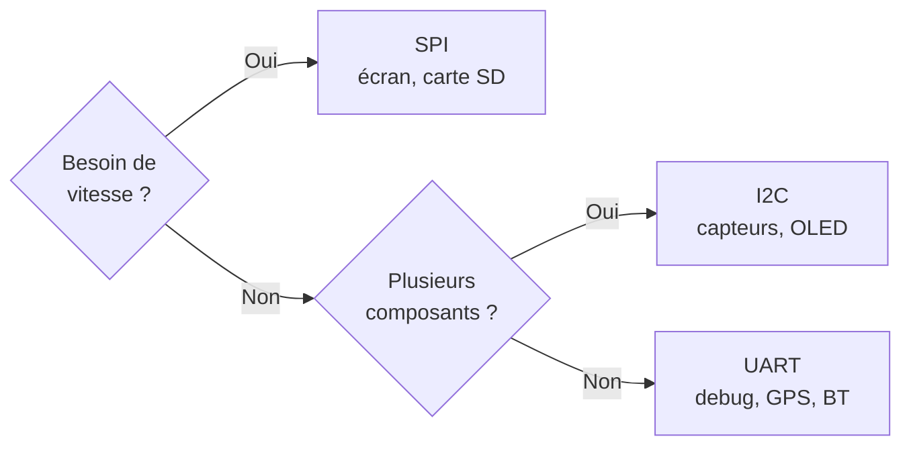
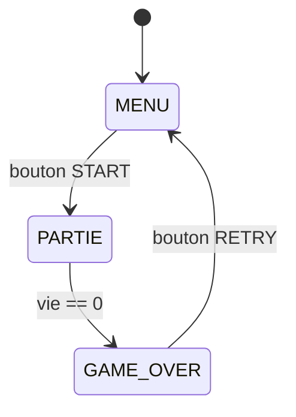
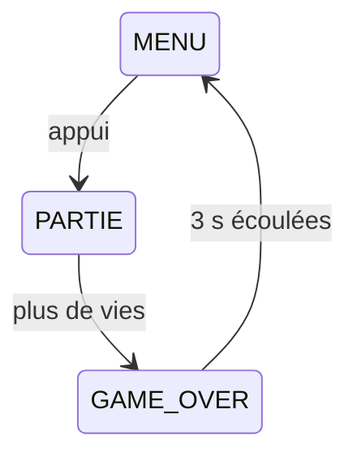
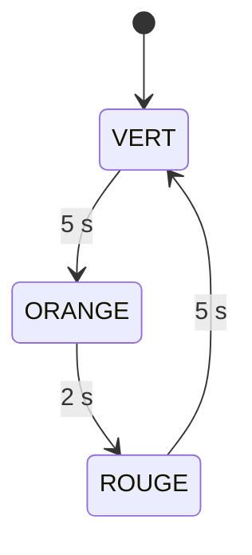
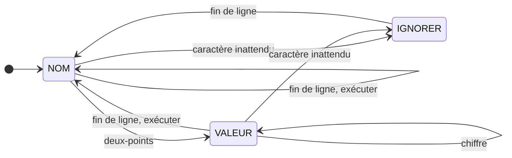

## Au programme

1. Pourquoi des bus
2. UART, I2C, SPI
3. Choisir son bus
4. La game loop
5. La machine à états, et un parseur de messages
6. Et après le microcontrôleur ?

<aside class="notes" markdown="1">
1 h 30, dernier cours de la série, juste avant les TD. Garder du temps pour l'exercice de la FSM du Pong : une FSM se dessine sur papier, pas devant un écran.
Ouvrir sur le quiz du CM2 : la haute impédance et l'open-drain reviennent avec l'I2C, `millis()` avec la game loop.
</aside>

---

## Ce que vous saurez faire

### À la fin de ce cours, vous saurez :

- dire pourquoi un **bus série** existe, et distinguer UART, I2C et SPI
- choisir le bus adapté à un périphérique, et le câbler correctement
- écrire une **game loop** qui ne bloque jamais
- reconnaître une situation où une **machine à états** s'impose
- l'implémenter avec un `enum` et un `switch`
- lire des commandes sur le port série avec une FSM

Les deux premiers font dialoguer la puce avec le monde ; les quatre derniers gardent votre code lisible, jusqu'à la réception des messages.
{: .caption}

[Les bus de communication](/workshops/microcontroleur/concepts/bus-communication/){: .doc-link} [Machine à états finis](/workshops/microcontroleur/concepts/machine-etats-finis/){: .doc-link}

---

## Quiz : ce qu'il reste du CM2

1. Entre 0,8 V et 2,5 V, que lit une entrée de l'ESP32-S3 ?
2. Pourquoi une entrée non branchée lit-elle n'importe quoi ?
3. Avec `INPUT_PULLUP`, que lit-on quand le bouton est pressé ?
4. Une sortie open-drain peut-elle imposer un `HIGH` ?
5. Pourquoi un seul appui compte-t-il parfois double ?
6. Quelles broches pour lire le joystick quand le Wi-Fi tourne ?
7. Comment faire tourner un moteur 12 V depuis une broche ?

<aside class="notes" markdown="1">
Même format qu'au CM2 : sur une feuille, sans notes, 5 min, correction à main levée. Les questions 2 et 4 (haute impédance, open-drain) préparent l'I2C, la 5 (`millis()`) la game loop : insister dessus si elles ont coincé.
</aside>

---

## Quiz : correction

| | Réponse |
|---|---|
| 1 | Rien de fiable : c'est la **zone indéterminée** |
| 2 | Elle **flotte** : haute impédance, rien ne fixe sa tension |
| 3 | `LOW` : la logique est **inversée** |
| 4 | **Non** : elle tire vers 0 V, une résistance de rappel fait le `HIGH` |
| 5 | Le **rebond** du contact ; on filtre avec `millis()` |
| 6 | Les broches **ADC1** (ADC2 est inutilisable avec le Wi-Fi) |
| 7 | Un **MOSFET** « logic level », et une diode de roue libre |
{: .table-dense}

Haute impédance, open-drain et `millis()` reviennent aujourd'hui, avec l'I2C et la game loop.
{: .caption}

[GPIO et monde numérique](/workshops/microcontroleur/concepts/gpio-monde-numerique/){: .doc-link} [ADC et PWM](/workshops/microcontroleur/concepts/adc-pwm/){: .doc-link}

---

<!-- .slide: class="slide-section" -->

## Pourquoi des bus

Faire dialoguer les composants

---

## Un fil par information ?

L'écran de l'atelier (240 × 320) reçoit **76 800 pixels par image**, soit plus de 150 000 octets en couleur 16 bits. Un capteur renvoie une température sur 16 bits. Une carte SD, des blocs de 512 octets.

Câbler un fil par bit serait impraticable : plus aucune broche disponible, une carte illisible, et des perturbations entre pistes.

Un **bus série** envoie les bits **les uns après les autres**, sur deux à quatre fils. On échange de la largeur contre du temps, et la puce est assez rapide pour que ça ne se voie pas.
{: .highlight-red}

[Les bus de communication](/workshops/microcontroleur/concepts/bus-communication/){: .doc-link}

---

## Série ou parallèle

{: .img-md}

En parallèle, un fil par bit : rapide, mais encombrant. En série, un seul fil de données : les bits passent l'un après l'autre.
{: .caption}

[Les bus de communication](/workshops/microcontroleur/concepts/bus-communication/){: .doc-link}

---

## Quatre questions pour comparer deux liaisons

| Question | Les deux réponses possibles |
|---|---|
| Combien d'interlocuteurs ? | **Point à point** (deux) ou **multipoint** (plusieurs) |
| Une horloge partagée ? | **Synchrone** (oui) ou **asynchrone** (non) |
| Les deux sens en même temps ? | **Full-duplex** (oui) ou **half-duplex** (chacun son tour) |
| Comment choisir le destinataire ? | Une **adresse** dans le message, ou un **fil** de sélection |
{: .table-dense}

Ces quatre réponses suffisent à décrire UART, I2C et SPI.
{: .caption}

[Les bus de communication](/workshops/microcontroleur/concepts/bus-communication/){: .doc-link}

---

## Trois bus, trois compromis

- **UART** : le plus simple. Deux fils, un seul interlocuteur, pas d'horloge partagée
- **I2C** : deux fils, plusieurs composants distingués par une **adresse**
- **SPI** : quatre fils, une horloge, le plus rapide des trois

Aucun n'est meilleur dans l'absolu : chacun échange de la vitesse contre des fils, ou des fils contre de la complexité. Le choix se fait par le besoin.
{: .caption}

[Les bus de communication](/workshops/microcontroleur/concepts/bus-communication/){: .doc-link}

---

<!-- .slide: class="slide-section" -->

## UART

Deux fils, point à point

---

## Le plus simple des trois

{: .img-md}

**Point à point**, **full-duplex**, **asynchrone** : sans horloge, la vitesse (le **baud rate**, souvent 115 200 bauds) est fixée à l'avance des deux côtés.
{: .caption}

[Les bus de communication](/workshops/microcontroleur/concepts/bus-communication/){: .doc-link}

---



[Les bus de communication](/workshops/microcontroleur/concepts/bus-communication/){: .doc-link}

---

## Anatomie d'une trame

{: .img-md}

Le **start** donne le signal, le récepteur compte les bits à la vitesse convenue. 8 bits, pas de parité, 1 stop : **`8N1`**. Format ou vitesse différents : du charabia.
{: .caption}

[Les bus de communication](/workshops/microcontroleur/concepts/bus-communication/){: .doc-link}

---

## Le bit de parité

{: .img-md}

Un bit ajouté après les données pour que le nombre total de 1 soit **pair** (`E`, *even*) ou **impair** (`O`, *odd*). En **`8E1`**, « C » compte trois 1 : la parité vaut 1. Le récepteur recompte ; un total impair signale un octet abîmé. **↓** pour un exemple d'erreur.
{: .caption}

[Les bus de communication](/workshops/microcontroleur/concepts/bus-communication/){: .doc-link}

<!-- .down -->

## Une erreur détectée

{: .img-md}

Sans parité, le récepteur lirait « A » au lieu de « C » sans rien voir. La parité **détecte** l'erreur mais ne la corrige pas (l'octet est à renvoyer), et deux bits inversés se compensent : ils passent inaperçus.
{: .caption}

[Les bus de communication](/workshops/microcontroleur/concepts/bus-communication/){: .doc-link}

---

## Une trame, en vrai

{: .img-md}

Les curseurs mesurent **103,6 µs** par bit, soit 9600 bauds. Copie d'écran : Haji akhundov, via [Wikimedia Commons](https://commons.wikimedia.org/wiki/File:RS232-UART_Oscilloscope_Screenshot.png), sous [CC BY-SA 3.0](https://creativecommons.org/licenses/by-sa/3.0/deed.fr).
{: .caption}

[Les bus de communication](/workshops/microcontroleur/concepts/bus-communication/){: .doc-link}

---

## Là où vous l'utilisez déjà

```cpp
Serial.begin(115200);                 // le port série du moniteur
Serial.printf("x=%d y=%d\n", x, y);
```

Le moniteur série se manie comme un UART. L'UART est aussi le bus des modules GPS, Bluetooth ou GSM, et le moyen le plus simple de faire dialoguer deux microcontrôleurs.

Sur beaucoup de cartes, une puce USB-série (CP2102, CH340) traduit l'UART en USB et réclame un driver sous Windows. La XIAO n'en a pas : `Serial` passe directement par l'USB natif de l'ESP32-S3, et l'UART0 reste libre sur D6/D7.
{: .caption}

[Le port série sous VSCode](/docs/tutorials/electronics/vscode-port-serie/){: .doc-link} [Vérification de la toolchain](/workshops/microcontroleur/tutorials/toolchain-blink/){: .doc-link}

---

<!-- .slide: class="slide-section" -->

## I2C

Deux fils, plusieurs composants

---

## Un bus, des adresses

{: .img-md}

**Multipoint**, **synchrone** (SCL), **half-duplex**. Chaque esclave a une **adresse** sur 7 bits ; le maître l'écrit en tête de chaque message.
{: .caption}

[Les bus de communication](/workshops/microcontroleur/concepts/bus-communication/){: .doc-link}

---

## Un échange I2C

{: .img-md}

**Start**, **adresse + R/W**, **ACK**, **données** (un ACK par octet), **stop**. Après chaque octet, celui qui l'a reçu répond **ACK** (*acknowledge*, « bien reçu ») ou **NACK**. **↓** le détail, puis une lecture.
{: .caption}

[Les bus de communication](/workshops/microcontroleur/concepts/bus-communication/){: .doc-link}

<!-- .down -->

## ACK et NACK

{: .img-md}

Un octet dure **9** coups d'horloge : 8 bits, puis un coup où l'émetteur **relâche** SDA. Le **récepteur** répond : il tire SDA à 0 (**ACK**), ou ne fait rien et la pull-up la laisse à 1 (**NACK**). Un esclave absent ne tire rien : il répond NACK sans le savoir.
{: .caption}

[Les bus de communication](/workshops/microcontroleur/concepts/bus-communication/){: .doc-link}

<!-- .down -->

## Ce que dit un NACK

| Le NACK arrive... | Il signifie | Côté code |
|---|---|---|
| Après l'adresse | Personne à cette adresse | `endTransmission()` ≠ 0 |
| Après un octet écrit | L'esclave refuse l'octet | `endTransmission()` ≠ 0 |
| Après un octet lu | Le maître a fini de lire | Normal |
{: .table-dense}

Seul le dernier cas est normal. Le scanner I2C repose sur le premier : `endTransmission()` renvoie `0` quand l'adresse a été acquittée, donc quand un composant est là.
{: .caption}

[Les bus de communication](/workshops/microcontroleur/concepts/bus-communication/){: .doc-link}

<!-- .down -->

## Lire une donnée

{: .img-md}

Le maître **écrit** d'abord le registre voulu, puis, sans STOP, relance un **start répété** en lecture. L'esclave envoie les octets ; c'est alors le **maître** qui acquitte, et son **NACK** sur le dernier dit « j'ai fini ».
{: .caption}

[Les bus de communication](/workshops/microcontroleur/concepts/bus-communication/){: .doc-link}

<!-- .down -->

## La même lecture, avec Wire

```cpp
Wire.beginTransmission(0x48);
Wire.write(0x00);              // le registre de température
Wire.endTransmission(false);   // false : pas de STOP, start répété
Wire.requestFrom(0x48, 2);     // adresse + R, 2 octets, NACK, STOP
uint8_t fort = Wire.read();    // 0x19 = 0001 1001
uint8_t faible = Wire.read();  // 0x80 = 1000 0000
int brut = (fort << 4) | (faible >> 4);  // 0001 1001 1000 = 408
float t = brut * 0.0625;       // 408 pas de 0,0625 °C = 25.5 °C
```

Chaque ligne correspond à un morceau de la trame. Les bibliothèques de capteurs font exactement cela pour vous. **↓** le calcul.
{: .caption}

[Les bus de communication](/workshops/microcontroleur/concepts/bus-communication/){: .doc-link}

<!-- .down -->

## Reconstituer la température

{: .img-md}

La mesure tient sur **12 bits** : les 8 de `fort`, puis les 4 de tête de `faible`. `<< 4` décale `fort` pour leur faire place, `>> 4` jette les 4 bits inutilisés, `|` assemble le tout. Chaque pas vaut 0,0625 °C.
{: .caption}

[Les bus de communication](/workshops/microcontroleur/concepts/bus-communication/){: .doc-link}

---

## Les pull-ups ne sont pas optionnelles

SDA et SCL sont en **open-drain**, comme au CM2 : les composants ne peuvent que tirer la ligne vers `LOW`, jamais vers `HIGH`. C'est précisément ce qui permet à plusieurs d'entre eux de partager le fil sans court-circuit.

Il faut donc deux résistances de **pull-up** (~4,7 kΩ) vers le 3,3 V. Sans elles, la ligne ne remonte jamais et **rien ne communique**.

La plupart des modules du commerce les intègrent déjà. Si vous en chaînez plusieurs, une seule paire suffit sur tout le bus : inutile de les cumuler. **↓** pour le détail.
{: .caption}

[Les bus de communication](/workshops/microcontroleur/concepts/bus-communication/){: .doc-link} [GPIO et monde numérique](/workshops/microcontroleur/concepts/gpio-monde-numerique/){: .doc-link}

<!-- .down -->

## Partager un fil sans court-circuit

{: .img-md}

Chacun peut tirer la ligne à 0 ou la relâcher, jamais imposer un 1 : deux composants ne peuvent pas se contredire.
{: .caption}

[GPIO et monde numérique](/workshops/microcontroleur/concepts/gpio-monde-numerique/){: .doc-link}

---

## Qui est là ? Le scanner I2C

On ne connaît pas toujours l'adresse. On les balaie toutes :

```cpp
for (byte adr = 1; adr < 127; adr++) {
  Wire.beginTransmission(adr);
  if (Wire.endTransmission() == 0) {
    Serial.printf("Trouvé : 0x%02X\n", adr);
  }
}
```

Absent du scan ? Le problème est le câblage ou les pull-ups.
{: .highlight-red}

[Les bus de communication](/workshops/microcontroleur/concepts/bus-communication/){: .doc-link}

---

## Vitesses standard

| Mode | Vitesse |
|---|---|
| Standard | 100 kHz |
| Fast | 400 kHz |
| Fast+ | 1 MHz |
| High Speed | 3,4 MHz |
{: .table-dense}

Largement suffisant pour des capteurs ou un petit écran OLED monochrome, sur un ou deux mètres au plus. Bien trop lent pour un écran TFT couleur : à 400 kHz, une image de 240 × 320 pixels demanderait plus de trois secondes.
{: .highlight-red}

[Les bus de communication](/workshops/microcontroleur/concepts/bus-communication/){: .doc-link}

---

<!-- .slide: class="slide-section" -->

## SPI

Quatre fils, plein débit

---

## Le bus de l'écran

| Fil | Rôle |
|---|---|
| **MOSI** | Données du maître vers l'esclave |
| **MISO** | Données de l'esclave vers le maître |
| **SCK** | Horloge, générée par le maître |
| **CS** | *Chip Select* : un fil par esclave |
{: .table-dense}

Transmission **synchrone** (l'horloge cadence chaque bit, donc pas de baud rate à accorder) et **full-duplex** (les deux sens en même temps).

[Les bus de communication](/workshops/microcontroleur/concepts/bus-communication/){: .doc-link}

---

## Un maître, plusieurs esclaves

{: .img-md}

Pas d'adresse : le **CS** à 0 désigne l'esclave. Les autres laissent MISO en haute impédance. De quelques MHz à **80 MHz** sur ESP32-S3.
{: .caption}

[Les bus de communication](/workshops/microcontroleur/concepts/bus-communication/){: .doc-link}

---

## Un échange SPI

{: .img-md}

À chaque coup d'horloge, un bit part et un bit revient : **full-duplex**. Ni adresse, ni accusé de réception : c'est ce qui le rend si rapide.
{: .caption}

[Les bus de communication](/workshops/microcontroleur/concepts/bus-communication/){: .doc-link}

---

## Le câblage de l'écran

| Signal | Broche | Rôle |
|---|---|---|
| SCK | D9 (GPIO8) | Horloge SPI |
| MOSI | D10 (GPIO9) | Données CPU vers écran |
| DC | D8 (GPIO7) | Bascule commande / donnée |
| RESET | D7 (GPIO44) | Reset matériel de l'écran |
| CS | GND | Écran toujours sélectionné |
| LED | 3V3 | Rétroéclairage, toujours allumé |
{: .table-dense}

**MISO n'est pas câblé** (écriture seule) et **CS est à GND** : un seul esclave, toujours sélectionné.
{: .caption}

[Écran TFT SPI ST7789](/docs/references/hardware/ecran-tft-spi-st7789/){: .doc-link}

<!-- .down -->

## Le câblage de l'écran, fil par fil

{: .img-md}

CS est relié à GND : un seul esclave, toujours sélectionné.
{: .caption}

[Les modules de la mallette](/workshops/microcontroleur/tutorials/entrees-boutons-joystick/){: .doc-link}

---

## En pratique, vous n'écrirez pas le SPI

```ini
lib_deps =
    adafruit/Adafruit ST7735 and ST7789 Library@^1.11.0
```

```cpp
Adafruit_ST7789 tft(&SPI, -1, D8, D7);  // CS (aucun), DC, RESET
SPI.begin(D9, -1, D10, -1);             // SCK, MISO, MOSI, CS
tft.init(240, 320, SPI_MODE3);
tft.fillScreen(ST77XX_BLACK);
```



[Les modules de la mallette](/workshops/microcontroleur/tutorials/entrees-boutons-joystick/){: .doc-link}

---

<!-- .slide: class="slide-section" -->

## Choisir son bus

---

## Le tableau de bord

| Critère | UART | I2C | SPI |
|---|---|---|---|
| Fils (hors masse) | 2 | 2 | 3 + 1 CS par esclave |
| Liaison | point à point | multipoint | multipoint |
| Horloge | asynchrone | synchrone | synchrone |
| Sens | full-duplex | half-duplex | full-duplex |
| Destinataire | aucun à choisir | adresse 7 bits | fil CS |
| Accusé de réception | non | oui (ACK) | non |
| Vitesse | ~1 Mbit/s | 0,1 à 3,4 Mbit/s | jusqu'à 80 Mbit/s |
| Usage type | debug, modules | capteurs, OLED | écrans, carte SD |
{: .table-dense}

[Les bus de communication](/workshops/microcontroleur/concepts/bus-communication/){: .doc-link}

---

## L'arbre de décision



Notre projet : un **port série** pour le moniteur, **SPI** pour l'écran. **↓** pour la page.
{: .caption}

[Les bus de communication](/workshops/microcontroleur/concepts/bus-communication/){: .doc-link}

<!-- .down -->

## Le concept en ligne

<iframe class="page-preview" data-src="/workshops/microcontroleur/concepts/bus-communication/#tableau-comparatif" title="Concept : les bus de communication"></iframe>

---

<!-- .slide: class="slide-section" -->

## La game loop

Ne jamais bloquer

---

## Lire, calculer, afficher

<pre><code class="language-cpp" data-trim data-line-numbers="2-7|9-10|11|12">
void loop() {
  static uint32_t lastFrameMs = 0;
  uint32_t nowMs = millis();
  if (nowMs - lastFrameMs < FRAME_TIME_MS) {   // 16 ms
    return;                                    // pas encore l'heure
  }
  lastFrameMs = nowMs;

  float joystickX   = normalizeJoystick(analogRead(PIN_JOYSTICK_X), joystickCenterX);
  bool startPressed = justPressed(selectButton);          // 1. lire
  gameUpdate(game, joystickX, startPressed, nowMs);       // 2. calculer
  rendererDraw(game);                                     // 3. afficher
}
</code></pre>

Cette charpente ne changera plus : le Pong du TD4 puis le Snake du projet enrichiront `gameUpdate()` et `rendererDraw()`.
{: .caption}

[Le Pong sur la console](/workshops/microcontroleur/tutorials/collisions-fsm-pong/){: .doc-link}

<!-- .down -->

## La game loop dans le temps

{: .img-md}

Le temps restant n'est jamais perdu dans un delay().
{: .caption}

[Du matériel au logiciel](/workshops/microcontroleur/concepts/du-materiel-au-logiciel/){: .doc-link}

---

## Pourquoi 16 ms

<div class="columns" markdown="1">
<div markdown="1">

<p class="big-number">16 ms</p>

**par image**, soit 60 images par seconde. En dessous, l'œil voit saccader.

</div>
<div markdown="1">

<p class="big-number">4 M</p>

**cycles CPU disponibles** dans ces 16 ms, à 240 MHz. De quoi faire beaucoup.

</div>
</div>

Si une image prend plus de 16 ms à calculer, le jeu ralentit au lieu de sauter des images. Premier suspect en cas de lenteur : un `delay()` oublié, ou un redessin complet de l'écran au lieu des seules zones modifiées.
{: .caption}

[Le Pong sur la console](/workshops/microcontroleur/tutorials/collisions-fsm-pong/){: .doc-link}

---

<!-- .slide: class="slide-section" -->

## La machine à états

Sortir du plat de spaghettis

---

## Le code qui s'emmêle

Un jeu a plusieurs moments de vie : un menu d'accueil, une partie en cours, un écran de fin. Gérés à la main, ils donnent ceci :

```cpp
bool enPartie = false;
bool gameOver = false;
bool menuActif = true;
// et ça empire à chaque nouvelle phase
```

Que veut dire `enPartie && gameOver` ? Rien. Et pourtant rien ne l'empêche.
{: .highlight-red}

[Machine à états finis](/workshops/microcontroleur/concepts/machine-etats-finis/){: .doc-link}

---

## Une FSM, c'est trois choses

- un ensemble **fini d'états**, des **transitions**, un **seul état actif**



[Machine à états finis](/workshops/microcontroleur/concepts/machine-etats-finis/){: .doc-link}

---

## La même chose, en tableau

| État \ Événement | START | vie == 0 | RETRY |
|---|---|---|---|
| **MENU** | PARTIE | - | - |
| **PARTIE** | - | GAME_OVER | - |
| **GAME_OVER** | - | - | MENU |
{: .table-dense}

Une case « - » veut dire « événement ignoré dans cet état ». Le tableau se traduit ligne à ligne en `switch/case`, et révèle les cas oubliés.

Le dessiner avant de coder prend cinq minutes, et en fait gagner deux heures.
{: .caption}

[Machine à états finis](/workshops/microcontroleur/concepts/machine-etats-finis/){: .doc-link}

---

## `enum` et `switch`

```cpp
enum EtatJeu { MENU, PARTIE, GAME_OVER };
EtatJeu etat = MENU;                      // l'état courant, un seul

void loop() {
  lireEntrees();
  switch (etat) {
    // un case par état
  }
}
```

Un `enum` nomme les états, une variable retient celui qui est actif. Le `switch` fait le reste.
{: .caption}

[Machine à états finis](/workshops/microcontroleur/concepts/machine-etats-finis/){: .doc-link}

---

## Un `case` par état

<pre><code class="language-cpp" data-trim data-line-numbers="1-3|4-7|8-10">
case MENU:
  if (appuiStart()) { afficherJeu(); etat = PARTIE; }
  break;
case PARTIE:
  mettreAJourJeu();          // et redessine ce qui a bougé
  if (vieJoueur == 0) { afficherGameOver(); etat = GAME_OVER; }
  break;
case GAME_OVER:
  if (appuiRetry()) { afficherMenu(); etat = MENU; }
  break;
</code></pre>

Un écran complet se dessine **une fois, à la transition**, jamais à chaque tour. Et `appuiStart()` ne vaut `true` qu'une fois par appui (front).
{: .caption}

[Machine à états finis](/workshops/microcontroleur/concepts/machine-etats-finis/){: .doc-link}

---



[Machine à états finis](/workshops/microcontroleur/concepts/machine-etats-finis/){: .doc-link}

---

## Faire une chose une seule fois

Réinitialiser le score ou effacer l'écran ne doit pas se répéter 60 fois par seconde. On l'exécute **au moment de la transition**, pas dans le `case` :

```cpp
void allerVers(EtatJeu nouvel) {
  etat = nouvel;
  entreeEtat = millis();                        // date d'entrée
  if (nouvel == PARTIE)    initialiserPartie();
  if (nouvel == GAME_OVER) afficherGameOver();
}
```

C'est l'**action d'entrée** (*onEnter*). Toutes les transitions passent par là.
{: .caption}

[Machine à états finis](/workshops/microcontroleur/concepts/machine-etats-finis/){: .doc-link}

---

## Un état qui bascule tout seul

L'écran « GAME OVER » revient au menu après trois secondes, sans bloquer quoi que ce soit :

```cpp
case GAME_OVER:
  if (millis() - entreeEtat > 3000) {
    allerVers(MENU);
  }
  break;
```

FSM et `millis()` se combinent naturellement : c'est la **transition temporisée**. La date d'entrée dans l'état, mémorisée par `allerVers()`, sert de référence.
{: .caption}

[Machine à états finis](/workshops/microcontroleur/concepts/machine-etats-finis/){: .doc-link} [Du matériel au logiciel](/workshops/microcontroleur/concepts/du-materiel-au-logiciel/){: .doc-link}

<!-- .down -->

## La transition temporisée, en schéma



La flèche du bas ne dépend d'aucune entrée : seulement du temps passé dans l'état.
{: .caption}

[Machine à états finis](/workshops/microcontroleur/concepts/machine-etats-finis/){: .doc-link}

---

## L'exemple canonique : le feu tricolore



Trois états, des transitions purement temporisées, aucun bouton.
{: .caption}

[Machine à états finis](/workshops/microcontroleur/concepts/machine-etats-finis/){: .doc-link}

---

## Le feu tricolore, en entier

```cpp
void loop() {
  unsigned long ec = millis() - entreeEtat;

  switch (etat) {
    case VERT:   if (ec > 5000) allerVers(ORANGE); break;
    case ORANGE: if (ec > 2000) allerVers(ROUGE);  break;
    case ROUGE:  if (ec > 5000) allerVers(VERT);   break;
  }
}
```

Aucun `delay()` : le programme pourrait aussi lire un bouton piéton.
{: .caption}

[Machine à états finis](/workshops/microcontroleur/concepts/machine-etats-finis/){: .doc-link}

---

## Ce que la FSM vous fait gagner

| Approche | Lisibilité | Extensibilité | Bugs typiques |
|---|---|---|---|
| Booléens | faible | difficile | états contradictoires |
| **FSM `enum`** | élevée | un `case` de plus | aucun |

Au projet, cette FSM s'étendra aux **états réseau** du Snake multijoueur.
{: .highlight-red}

[Machine à états finis](/workshops/microcontroleur/concepts/machine-etats-finis/){: .doc-link}

---

<!-- .slide: class="slide-section" -->

## Un parseur est une FSM

Lire des commandes sur le port série

---

## Des caractères, pas des messages

{: .img-md}

On veut piloter le Pong depuis le moniteur série : `VITESSE:5`, `MENU`. Mais `Serial.read()` rend **un caractère** à la fois, et une ligne peut s'étaler sur plusieurs tours de `loop()`. Format retenu : `NOM:VALEUR`, une commande par ligne.
{: .caption}

[Machine à états finis](/workshops/microcontroleur/concepts/machine-etats-finis/#un-autre-exemple--lire-des-commandes){: .doc-link}

---

## Le récepteur est une FSM



Chaque **caractère reçu** est un événement. Une ligne fausse part dans `IGNORER`, et la fin de ligne remet tout le monde d'accord.
{: .caption}

[Machine à états finis](/workshops/microcontroleur/concepts/machine-etats-finis/#un-autre-exemple--lire-des-commandes){: .doc-link}

---

## Le parseur en code

```cpp
enum EtatRx { NOM, VALEUR, IGNORER };
EtatRx etatRx = NOM;
char nom[12]; uint8_t n = 0;  // le nom lu, et son nombre de lettres
int valeur = 0;

void recevoirCaractere(char c) {
  if (c == '\r') return;      // envoyé par certains moniteurs : ignoré
  switch (etatRx) {
    case NOM:
      if (c == ':')        { valeur = 0; etatRx = VALEUR; }
      else if (c == '\n')  executer();       // commande sans valeur
      else if (isalpha(c) && n < sizeof(nom) - 1) nom[n++] = c;
      else                 etatRx = IGNORER;
      break;
```

**↓** la suite.
{: .caption}

[Machine à états finis](/workshops/microcontroleur/concepts/machine-etats-finis/#un-autre-exemple--lire-des-commandes){: .doc-link}

<!-- .down -->

## Le parseur en code (suite)

```cpp
    case VALEUR:
      if (isdigit(c))      valeur = valeur * 10 + (c - '0');
      else if (c == '\n')  executer();
      else                 etatRx = IGNORER;
      break;
    case IGNORER:
      if (c == '\n') { n = 0; etatRx = NOM; }   // on repart à zéro
      break;
  }
}
```

`valeur * 10 + (c - '0')` construit le nombre chiffre par chiffre : `'4'` puis `'2'` donnent 4, puis 42.
{: .caption}

[Machine à états finis](/workshops/microcontroleur/concepts/machine-etats-finis/#un-autre-exemple--lire-des-commandes){: .doc-link}

<!-- .down -->

## Exécuter la commande

```cpp
void executer() {
  nom[n] = '\0';                             // termine la chaîne
  if (strcmp(nom, "VITESSE") == 0) vitesseBalle = valeur;
  else if (strcmp(nom, "MENU") == 0) allerVers(MENU);
  // nom inconnu : ignoré
  n = 0;
  valeur = 0;
  etatRx = NOM;                               // prêt pour la ligne suivante
}
```

Le parseur ne sait rien du jeu : il découpe. `executer()` décide, et **refuse** ce qu'il ne connaît pas.
{: .caption}

[Machine à états finis](/workshops/microcontroleur/concepts/machine-etats-finis/#un-autre-exemple--lire-des-commandes){: .doc-link}

---

## Brancher le parseur sur la game loop

```cpp
void loop() {
  while (Serial.available()) {        // seulement ce qui est déjà arrivé
    recevoirCaractere(Serial.read());
  }
  // ... puis la game loop habituelle
}
```

On ne lit que les caractères déjà reçus : la boucle ne bloque jamais. Si la ligne n'est pas complète, la FSM s'en souvient, et reprend au tour suivant.
{: .caption}

[Machine à états finis](/workshops/microcontroleur/concepts/machine-etats-finis/#un-autre-exemple--lire-des-commandes){: .doc-link}

---

## À vous : que fait le parseur ?

| Vous tapez | Résultat |
|---|---|
| `VITESSE:5` | `vitesseBalle` vaut 5 |
| `MENU` | Retour au menu |
| `VITESSE:5x` | ? |
| `VITESE:5` | ? |
| `VITESSE:` | ? |
{: .table-dense}

Suivez la FSM caractère par caractère. **↓** la correction.
{: .caption}

[Machine à états finis](/workshops/microcontroleur/concepts/machine-etats-finis/#un-autre-exemple--lire-des-commandes){: .doc-link}

<!-- .down -->

## Correction

| Vous tapez | Résultat |
|---|---|
| `VITESSE:5x` | `x` n'est pas un chiffre : `IGNORER`, la ligne est perdue |
| `VITESE:5` | Bien découpée, mais nom inconnu : `executer()` l'ignore |
| `VITESSE:` | Valeur vide : `vitesseBalle` passe à **0**. Un bug ! |
{: .table-dense}

Le dernier cas montre qu'un parseur se **teste** avec des entrées fausses. Correctif : retenir qu'au moins un chiffre a été lu avant d'accepter la ligne.
{: .caption}

[Machine à états finis](/workshops/microcontroleur/concepts/machine-etats-finis/#un-autre-exemple--lire-des-commandes){: .doc-link}

---

## Et au projet ?

Avec le **WebSocket** du Snake, chaque message arrive entier : plus besoin de découper caractère par caractère. Le reste ne change pas :

- un **protocole écrit** avant d'être codé : quels messages, quel format, quel sens ;
- une console **arbitre** : chaque message est vérifié avant d'être appliqué, un message invalide est ignoré sans planter.

C'est le réflexe d'`executer()` : ne jamais croire ce qui arrive sur le fil.
{: .highlight-red}

[Le projet Snake](/workshops/microcontroleur/projet-snake/){: .doc-link} [Machine à états finis](/workshops/microcontroleur/concepts/machine-etats-finis/#un-autre-exemple--lire-des-commandes){: .doc-link}

---

## Activité : la FSM de votre Pong

### Dessinez la machine à états de votre jeu

1. Quels sont les états ? (`MENU`, `PARTIE`, `PAUSE` ?, `GAME_OVER`)
2. Quels événements déclenchent chaque transition ?
3. Quel est l'état initial ?
4. Remplissez la table : y a-t-il des cases oubliées ?

Comparez avec le binôme voisin : les différences sont instructives.
{: .caption}

<aside class="notes" markdown="1">
Piège classique à relever pendant la mise en commun : oublier de réinitialiser le score en entrant dans PARTIE, ou permettre un RETRY pendant la partie. C'est exactement ce que la table de transitions révèle.
</aside>

[Machine à états finis](/workshops/microcontroleur/concepts/machine-etats-finis/){: .doc-link}

---

## À retenir

- Un bus série envoie les bits l'un après l'autre
- **UART** : 2 fils, croisement TX/RX, même baud des deux côtés
- **I2C** : 2 fils, adressage, pull-ups ~4,7 kΩ obligatoires
- **SPI** : 4 fils, un CS par esclave, le seul rapide pour un TFT
- La game loop cadence à 16 ms avec `millis()`, sans jamais bloquer
- Une FSM = états + transitions + un seul état actif
- {: .highlight-red} Action d'entrée à la transition, jamais dans le `case`
- Une commande se lit caractère par caractère, avec une FSM

[Les bus de communication](/workshops/microcontroleur/concepts/bus-communication/){: .doc-link} [Machine à états finis](/workshops/microcontroleur/concepts/machine-etats-finis/){: .doc-link}

---

<!-- .slide: class="slide-section" -->

## Et après le microcontrôleur ?

Un océan de puces

---

## Votre ESP32-S3, vous n'en avez vu qu'une partie

| Ressource | Ce qu'elle fait |
|---|---|
| Le second cœur | `loop()` n'occupe qu'un des deux cœurs |
| Le DMA | Copie les données vers l'écran pendant que le code continue |
| Le coprocesseur ULP | Un petit RISC-V qui veille pendant que le reste dort |
| Les instructions vectorielles | Accélèrent les réseaux de neurones (ESP-DL) |
| La cryptographie matérielle | Chiffre (AES) et signe (SHA) sans charger le processeur |
| Caméra, USB OTG, tactile | Des périphériques entiers, jamais branchés |
{: .table-dense}

Et ce n'est qu'**un** microcontrôleur parmi des milliers. **↓** la famille.
{: .caption}

[Au-delà du microcontrôleur](/workshops/microcontroleur/concepts/au-dela-du-microcontroleur/){: .doc-link}

<!-- .down -->

## Même chez les microcontrôleurs

| Puce | Ce qui la distingue |
|---|---|
| ATmega328P (Arduino Uno) | 8 bits, 16 MHz, 2 Ko de RAM : le point de départ |
| ESP32-S3 (votre console) | 2 cœurs à 240 MHz, 512 Ko de RAM, Wi-Fi |
| RP2040, RP2350 (Pico) | Des PIO : des machines à états **matérielles** |
| STM32H7 | Jusqu'à 550 MHz : audio, moteurs, industrie |
| STM32N6, MAX78000 | Un accélérateur de réseaux de neurones intégré |
{: .table-dense}

Les PIO du Pico exécutent de minuscules programmes pour inventer ses propres protocoles : vos FSM, gravées dans le silicium.
{: .caption}

[Au-delà du microcontrôleur](/workshops/microcontroleur/concepts/au-dela-du-microcontroleur/){: .doc-link}

---

## La carte des puces

{: .img-md}

À gauche, des puces qui exécutent n'importe quel programme ; à droite, des puces qui ne font qu'une chose, mais bien plus vite et pour bien moins d'énergie. **↓** chaque famille.
{: .caption}

[Au-delà du microcontrôleur](/workshops/microcontroleur/concepts/au-dela-du-microcontroleur/){: .doc-link}

<!-- .down -->

## Du MCU au CPU

| Famille | Exemple | Ce qui change |
|---|---|---|
| MCU | ESP32-S3 | RAM intégrée, pas de système, temps réel |
| MPU | Raspberry Pi 5 | 4 cœurs à 2,4 GHz, RAM externe, Linux |
| SoC de smartphone | Apple A, Snapdragon | CPU, GPU, NPU et modem sur une puce |
| CPU de serveur | AMD EPYC | Jusqu'à 192 cœurs, environ 500 W |
{: .table-dense}

Un MPU a une **MMU** (unité de gestion de la mémoire) : c'est ce qui lui permet de faire tourner Linux. Le STM32MP1 réunit les deux mondes : un cœur Linux et un cœur Cortex-M4 pour le temps réel.
{: .caption}

[Au-delà du microcontrôleur](/workshops/microcontroleur/concepts/au-dela-du-microcontroleur/#du-microcontrôleur-au-processeur){: .doc-link}

<!-- .down -->

## Calculer en masse : DSP et GPU

<div class="columns" markdown="1">
<div markdown="1">

### DSP

- Multiplier et additionner en **un cycle**
- Filtres audio, radars, modems
- Le Cortex-M4 en a déjà les instructions

</div>
<div markdown="1">

### GPU

- Des **milliers** de cœurs simples
- Tous font le même calcul en parallèle
- Conçus pour l'image, adoptés par l'IA

</div>
</div>

Une NVIDIA H100 : environ 17 000 cœurs, 700 W. Votre ESP32-S3 : 2 cœurs, moins d'un demi-watt.
{: .caption}

[Au-delà du microcontrôleur](/workshops/microcontroleur/concepts/au-dela-du-microcontroleur/#calculer-en-masse--dsp-et-gpu){: .doc-link}

<!-- .down -->

## Accélérer l'IA : NPU et TPU

Un réseau de neurones, c'est surtout des **multiplications de matrices**. D'où des puces qui ne savent faire que ça :

- **TPU** (Google) : dans les datacenters, et en miniature, l'**Edge TPU** (Coral) : 4 TOPS pour 2 W, sur une clé USB
- **NPU** : intégré à une puce plus large : Neural Engine d'Apple, PC récents, STM32N6

Un TOPS : mille milliards d'opérations par seconde.
{: .caption}

[Au-delà du microcontrôleur](/workshops/microcontroleur/concepts/au-dela-du-microcontroleur/#accélérer-lia--npu-et-tpu){: .doc-link} [L'atelier TinyML](/workshops/tinyml/){: .doc-link}

<!-- .down -->

## Recâbler la puce : le FPGA

- On ne programme plus un processeur : on **décrit un circuit** (Verilog, VHDL)
- Tout s'exécute **en parallèle**, réglé à la nanoseconde
- Du Lattice iCE40 (quelques euros, outils libres) aux AMD Versal
- Les Zynq associent des cœurs ARM et un FPGA sur la même puce

Une FSM y devient un vrai circuit, fait de bascules et de portes logiques. Usages : prototyper une puce avant de la graver, radio logicielle, vidéo.
{: .caption}

[Au-delà du microcontrôleur](/workshops/microcontroleur/concepts/au-dela-du-microcontroleur/#recâbler-la-puce--le-fpga){: .doc-link}

<!-- .down -->

## Graver sa propre puce : l'ASIC

- Un circuit conçu pour **une seule tâche**, gravé dans le silicium
- Imbattable en vitesse et en énergie, mais impossible à modifier
- Le TPU de Google en est un, comme les puces des mineurs de Bitcoin
- Fabriquer une puce coûte des millions, sauf à partager : **Tiny Tapeout** grave votre petit circuit avec des centaines d'autres, pour quelques centaines d'euros

[Au-delà du microcontrôleur](/workshops/microcontroleur/concepts/au-dela-du-microcontroleur/#graver-sa-propre-puce--lasic){: .doc-link}

---

## Flexibilité contre efficacité

| Famille | Flexibilité | Efficacité | Consommation |
|---|---|---|---|
| MCU, MPU, CPU | ★★★★★ | ★ | De quelques µW à 500 W |
| DSP, GPU | ★★★ | ★★★ | Jusqu'à 700 W |
| FPGA | ★★★ (on recâble) | ★★★★ | Du mW à quelques dizaines de W |
| NPU, TPU, ASIC | ★ | ★★★★★ | 2 W pour 4 TOPS (Edge TPU) |
{: .table-dense}

Choisir une puce, c'est placer le curseur entre ces deux extrêmes, comme vous avez choisi un bus.
{: .caption}

[Au-delà du microcontrôleur](/workshops/microcontroleur/concepts/au-dela-du-microcontroleur/#flexibilité-contre-efficacité){: .doc-link}

---

## Et demain ?

- **Neuromorphique** : des puces qui imitent les neurones et calculent par impulsions (Intel Loihi)
- **Quantique** : des qubits, pour des problèmes hors de portée des puces classiques
- **Photonique** : calculer avec de la lumière plutôt qu'avec des électrons
- **RISC-V** : un jeu d'instructions libre, déjà partout, de l'ESP32-C3 aux cœurs que l'on implante soi-même dans un FPGA

[Au-delà du microcontrôleur](/workshops/microcontroleur/concepts/au-dela-du-microcontroleur/#et-demain-){: .doc-link}

---

## Et vous pouvez y toucher

| Pour découvrir... | Commencer par |
|---|---|
| Linux embarqué | Un Raspberry Pi |
| L'IA embarquée | Votre ESP32-S3 avec ESP-DL, ou une clé Coral |
| Le FPGA | Une petite carte Lattice iCE40, avec les outils libres |
| La conception de puces | Tiny Tapeout, en ligne |
{: .table-dense}

Ce module vous a donné le socle : registres, bus, temps réel, machines à états. Il sert partout dans cet océan.
{: .highlight-red}

[Au-delà du microcontrôleur](/workshops/microcontroleur/concepts/au-dela-du-microcontroleur/#et-tu-peux-y-toucher){: .doc-link} [L'atelier TinyML](/workshops/tinyml/){: .doc-link}

---

## Et maintenant : les TD, puis le projet

| Séance | Ce que vous allez faire |
|---|---|
| TD1 | Installer, flasher, lire le port série |
| TD2 | Tester les modules de la mallette : GPIO, ADC, PWM, SPI |
| TD3 | Concevoir votre carte sous KiCad |
| TD4 | Souder la carte, y écrire un Pong : game loop et FSM |
| Projet | Un Snake multijoueur, la FSM étendue au réseau |
{: .table-dense}

Les trois cours sont terminés : tout ce que vous venez de voir sert dès le TD2.
{: .caption}

[Syllabus de l'atelier](/workshops/microcontroleur/syllabus/){: .doc-link} [Les modules de la mallette](/workshops/microcontroleur/tutorials/entrees-boutons-joystick/){: .doc-link}
