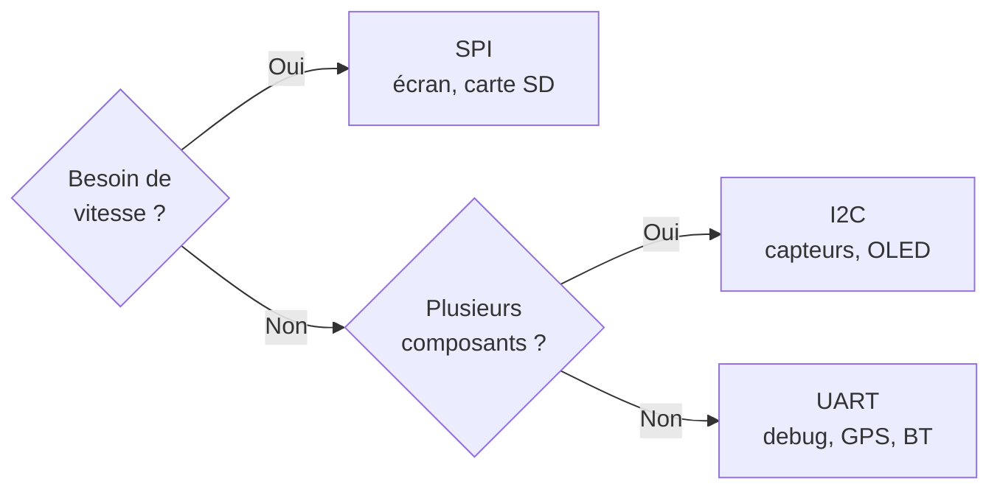
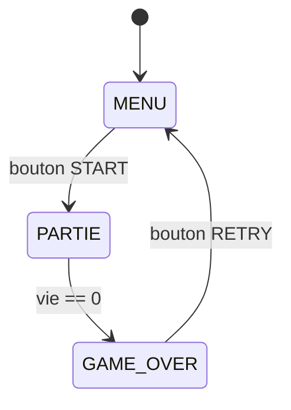
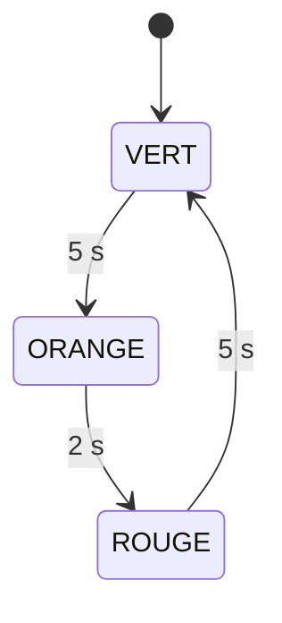

## Au programme

1. Pourquoi des bus
2. UART, I2C, SPI
3. Choisir son bus
4. La game loop
5. La machine à états

<aside class="notes" markdown="1">
1 h 30, dernier cours de la série, juste avant les TD. Garder du temps pour l'exercice de la FSM du Pong : une FSM se dessine sur papier, pas devant un écran.
Ouvrir sur le quiz du CM2 : la haute impédance et l'open-drain reviennent avec l'I2C, `millis()` avec la game loop.
</aside>

---

## Ce que vous saurez faire

### À la fin de ce cours, vous saurez :

- dire pourquoi un **bus série** existe, et distinguer UART, I2C et SPI
- choisir le bus adapté à un périphérique, et le câbler correctement
- écrire une **game loop** qui ne bloque jamais
- reconnaître une situation où une **machine à états** s'impose
- l'implémenter avec un `enum` et un `switch`

Les deux premiers font dialoguer la puce avec le monde ; les trois derniers gardent votre code lisible.
{: .caption}

[Les bus de communication](/workshops/microcontroleur/concepts/bus-communication/){: .doc-link} [Machine à états finis](/workshops/microcontroleur/concepts/machine-etats-finis/){: .doc-link}

---

## Quiz : ce qu'il reste du CM2

<p class="activity-meta"><span><i class="fas fa-user"></i>Individuel</span><span><i class="far fa-clock"></i>5 min</span><span><i class="fas fa-pen"></i>Sans notes</span></p>

1. Entre 0,8 V et 2,5 V, que lit une entrée de l'ESP32-S3 ?
2. Pourquoi une entrée non branchée lit-elle n'importe quoi ?
3. Avec `INPUT_PULLUP`, que lit-on quand le bouton est pressé ?
4. Une sortie open-drain peut-elle imposer un `HIGH` ?
5. Pourquoi un seul appui compte-t-il parfois double ?
6. Quelles broches pour lire le joystick quand le Wi-Fi tourne ?
7. Comment faire tourner un moteur 12 V depuis une broche ?

<aside class="notes" markdown="1">
Même format qu'au CM2 : sur une feuille, sans notes, 5 min, correction à main levée. Les questions 2 et 4 (haute impédance, open-drain) préparent l'I2C, la 5 (`millis()`) la game loop : insister dessus si elles ont coincé.
</aside>

---

## Quiz : correction

| | Réponse |
|---|---|
| 1 | Rien de fiable : c'est la **zone indéterminée** |
| 2 | Elle **flotte** : haute impédance, rien ne fixe sa tension |
| 3 | `LOW` : la logique est **inversée** |
| 4 | **Non** : elle tire vers 0 V, une résistance de rappel fait le `HIGH` |
| 5 | Le **rebond** du contact ; on filtre avec `millis()` |
| 6 | Les broches **ADC1** (ADC2 est inutilisable avec le Wi-Fi) |
| 7 | Un **MOSFET** « logic level », et une diode de roue libre |
{: .table-dense}

Haute impédance, open-drain et `millis()` reviennent aujourd'hui, avec l'I2C et la game loop.
{: .caption}

[GPIO et monde numérique](/workshops/microcontroleur/concepts/gpio-monde-numerique/){: .doc-link} [ADC et PWM](/workshops/microcontroleur/concepts/adc-pwm/){: .doc-link}

---

<!-- .slide: class="slide-section" -->

## Pourquoi des bus

Faire dialoguer les composants

---

## Un fil par information ?

L'écran de l'atelier (240 × 320) reçoit **76 800 pixels par image**, soit plus de 150 000 octets en couleur 16 bits. Un capteur renvoie une température sur 16 bits. Une carte SD, des blocs de 512 octets.

Câbler un fil par bit serait impraticable : plus aucune broche disponible, une carte illisible, et des perturbations entre pistes.

Un **bus série** envoie les bits **les uns après les autres**, sur deux à quatre fils. On échange de la largeur contre du temps, et la puce est assez rapide pour que ça ne se voie pas.
{: .highlight-red}

[Les bus de communication](/workshops/microcontroleur/concepts/bus-communication/){: .doc-link}

---

## Série ou parallèle

{: .img-md}

En parallèle, un fil par bit : rapide, mais encombrant. En série, un seul fil de données : les bits passent l'un après l'autre.
{: .caption}

[Les bus de communication](/workshops/microcontroleur/concepts/bus-communication/){: .doc-link}

---

## Quatre questions pour comparer deux liaisons

| Question | Les deux réponses possibles |
|---|---|
| Combien d'interlocuteurs ? | **Point à point** (deux) ou **multipoint** (plusieurs) |
| Une horloge partagée ? | **Synchrone** (oui) ou **asynchrone** (non) |
| Les deux sens en même temps ? | **Full-duplex** (oui) ou **half-duplex** (chacun son tour) |
| Comment choisir le destinataire ? | Une **adresse** dans le message, ou un **fil** de sélection |
{: .table-dense}

Ces quatre réponses suffisent à décrire UART, I2C et SPI.
{: .caption}

[Les bus de communication](/workshops/microcontroleur/concepts/bus-communication/){: .doc-link}

---

## Trois bus, trois compromis

- **UART** : le plus simple. Deux fils, un seul interlocuteur, pas d'horloge partagée
- **I2C** : deux fils, plusieurs composants distingués par une **adresse**
- **SPI** : quatre fils, une horloge, le plus rapide des trois

Aucun n'est meilleur dans l'absolu : chacun échange de la vitesse contre des fils, ou des fils contre de la complexité. Le choix se fait par le besoin.
{: .caption}

[Les bus de communication](/workshops/microcontroleur/concepts/bus-communication/){: .doc-link}

---

<!-- .slide: class="slide-section" -->

## UART

Deux fils, point à point

---

## Le plus simple des trois

{: .img-md}

**Point à point**, **full-duplex**, **asynchrone** : sans horloge, la vitesse (le **baud rate**, souvent 115 200 bauds) est fixée à l'avance des deux côtés.
{: .caption}

[Les bus de communication](/workshops/microcontroleur/concepts/bus-communication/){: .doc-link}

---



[Les bus de communication](/workshops/microcontroleur/concepts/bus-communication/){: .doc-link}

---

## Anatomie d'une trame

{: .img-md}

Le **start** donne le signal, le récepteur compte les bits à la vitesse convenue. 8 bits, pas de parité, 1 stop : **`8N1`**. Format ou vitesse différents : du charabia.
{: .caption}

[Les bus de communication](/workshops/microcontroleur/concepts/bus-communication/){: .doc-link}

---

## Une trame, en vrai

{: .img-md}

Les curseurs mesurent **103,6 µs** par bit, soit 9600 bauds. Copie d'écran : Haji akhundov, via [Wikimedia Commons](https://commons.wikimedia.org/wiki/File:RS232-UART_Oscilloscope_Screenshot.png), sous [CC BY-SA 3.0](https://creativecommons.org/licenses/by-sa/3.0/deed.fr).
{: .caption}

[Les bus de communication](/workshops/microcontroleur/concepts/bus-communication/){: .doc-link}

---

## Là où vous l'utilisez déjà

```cpp
Serial.begin(115200);                 // le port série du moniteur
Serial.printf("x=%d y=%d\n", x, y);
```

Le moniteur série se manie comme un UART. L'UART est aussi le bus des modules GPS, Bluetooth ou GSM, et le moyen le plus simple de faire dialoguer deux microcontrôleurs.

Sur beaucoup de cartes, une puce USB-série (CP2102, CH340) traduit l'UART en USB et réclame un driver sous Windows. La XIAO n'en a pas : `Serial` passe directement par l'USB natif de l'ESP32-S3, et l'UART0 reste libre sur D6/D7.
{: .caption}

[Le port série sous VSCode](/docs/tutorials/electronics/vscode-port-serie/){: .doc-link} [Vérification de la toolchain](/workshops/microcontroleur/tutorials/toolchain-blink/){: .doc-link}

---

<!-- .slide: class="slide-section" -->

## I2C

Deux fils, plusieurs composants

---

## Un bus, des adresses

{: .img-md}

**Multipoint**, **synchrone** (SCL), **half-duplex**. Chaque esclave a une **adresse** sur 7 bits ; le maître l'écrit en tête de chaque message.
{: .caption}

[Les bus de communication](/workshops/microcontroleur/concepts/bus-communication/){: .doc-link}

---

## Un échange I2C

{: .img-md}

**Start**, **adresse + R/W**, **ACK** de l'esclave, **données** (un ACK par octet), **stop**. Pas d'ACK après l'adresse : personne ne répond à cette adresse.
{: .caption}

[Les bus de communication](/workshops/microcontroleur/concepts/bus-communication/){: .doc-link}

---

## Les pull-ups ne sont pas optionnelles

SDA et SCL sont en **open-drain**, comme au CM2 : les composants ne peuvent que tirer la ligne vers `LOW`, jamais vers `HIGH`. C'est précisément ce qui permet à plusieurs d'entre eux de partager le fil sans court-circuit.

Il faut donc deux résistances de **pull-up** (~4,7 kΩ) vers le 3,3 V. Sans elles, la ligne ne remonte jamais et **rien ne communique**.

La plupart des modules du commerce les intègrent déjà. Si vous en chaînez plusieurs, une seule paire suffit sur tout le bus : inutile de les cumuler. **↓** pour le détail.
{: .caption}

[Les bus de communication](/workshops/microcontroleur/concepts/bus-communication/){: .doc-link} [GPIO et monde numérique](/workshops/microcontroleur/concepts/gpio-monde-numerique/){: .doc-link}

<!-- .down -->

## Partager un fil sans court-circuit

{: .img-md}

Chacun peut tirer la ligne à 0 ou la relâcher, jamais imposer un 1 : deux composants ne peuvent pas se contredire.
{: .caption}

[GPIO et monde numérique](/workshops/microcontroleur/concepts/gpio-monde-numerique/){: .doc-link}

---

## Qui est là ? Le scanner I2C

On ne connaît pas toujours l'adresse. On les balaie toutes :

```cpp
for (byte adr = 1; adr < 127; adr++) {
  Wire.beginTransmission(adr);
  if (Wire.endTransmission() == 0) {
    Serial.printf("Trouvé : 0x%02X\n", adr);
  }
}
```

Absent du scan ? Le problème est le câblage ou les pull-ups.
{: .highlight-red}

[Les bus de communication](/workshops/microcontroleur/concepts/bus-communication/){: .doc-link}

---

## Vitesses standard

| Mode | Vitesse |
|---|---|
| Standard | 100 kHz |
| Fast | 400 kHz |
| Fast+ | 1 MHz |
| High Speed | 3,4 MHz |
{: .table-dense}

Largement suffisant pour des capteurs ou un petit écran OLED monochrome, sur un ou deux mètres au plus. Bien trop lent pour un écran TFT couleur : à 400 kHz, une image de 240 × 320 pixels demanderait plus de trois secondes.
{: .highlight-red}

[Les bus de communication](/workshops/microcontroleur/concepts/bus-communication/){: .doc-link}

---

<!-- .slide: class="slide-section" -->

## SPI

Quatre fils, plein débit

---

## Le bus de l'écran

| Fil | Rôle |
|---|---|
| **MOSI** | Données du maître vers l'esclave |
| **MISO** | Données de l'esclave vers le maître |
| **SCK** | Horloge, générée par le maître |
| **CS** | *Chip Select* : un fil par esclave |
{: .table-dense}

Transmission **synchrone** (l'horloge cadence chaque bit, donc pas de baud rate à accorder) et **full-duplex** (les deux sens en même temps).

[Les bus de communication](/workshops/microcontroleur/concepts/bus-communication/){: .doc-link}

---

## Un maître, plusieurs esclaves

{: .img-md}

Pas d'adresse : le **CS** à 0 désigne l'esclave. Les autres laissent MISO en haute impédance. De quelques MHz à **80 MHz** sur ESP32-S3.
{: .caption}

[Les bus de communication](/workshops/microcontroleur/concepts/bus-communication/){: .doc-link}

---

## Un échange SPI

{: .img-md}

À chaque coup d'horloge, un bit part et un bit revient : **full-duplex**. Ni adresse, ni accusé de réception : c'est ce qui le rend si rapide.
{: .caption}

[Les bus de communication](/workshops/microcontroleur/concepts/bus-communication/){: .doc-link}

---

## Le câblage de l'écran

| Signal | Broche | Rôle |
|---|---|---|
| SCK | D9 (GPIO8) | Horloge SPI |
| MOSI | D10 (GPIO9) | Données CPU vers écran |
| DC | D8 (GPIO7) | Bascule commande / donnée |
| RESET | D7 (GPIO44) | Reset matériel de l'écran |
| CS | GND | Écran toujours sélectionné |
| LED | 3V3 | Rétroéclairage, toujours allumé |
{: .table-dense}

**MISO n'est pas câblé** (écriture seule) et **CS est à GND** : un seul esclave, toujours sélectionné.
{: .caption}

[Écran TFT SPI ST7789](/docs/references/hardware/ecran-tft-spi-st7789/){: .doc-link}

---

## En pratique, vous n'écrirez pas le SPI

```ini
lib_deps =
    adafruit/Adafruit ST7735 and ST7789 Library@^1.11.0
```

```cpp
Adafruit_ST7789 tft(&SPI, -1, D8, D7);  // CS (aucun), DC, RESET
SPI.begin(D9, -1, D10, -1);             // SCK, MISO, MOSI, CS
tft.init(240, 320, SPI_MODE3);
tft.fillScreen(ST77XX_BLACK);
```



[Les modules de la mallette](/workshops/microcontroleur/tutorials/entrees-boutons-joystick/){: .doc-link}

---

<!-- .slide: class="slide-section" -->

## Choisir son bus

---

## Le tableau de bord

| Critère | UART | I2C | SPI |
|---|---|---|---|
| Fils (hors masse) | 2 | 2 | 3 + 1 CS par esclave |
| Liaison | point à point | multipoint | multipoint |
| Horloge | asynchrone | synchrone | synchrone |
| Sens | full-duplex | half-duplex | full-duplex |
| Destinataire | aucun à choisir | adresse 7 bits | fil CS |
| Accusé de réception | non | oui (ACK) | non |
| Vitesse | ~1 Mbit/s | 0,1 à 3,4 Mbit/s | jusqu'à 80 Mbit/s |
| Usage type | debug, modules | capteurs, OLED | écrans, carte SD |
{: .table-dense}

[Les bus de communication](/workshops/microcontroleur/concepts/bus-communication/){: .doc-link}

---

## L'arbre de décision



Notre projet : un **port série** pour le moniteur, **SPI** pour l'écran. **↓** pour la page.
{: .caption}

[Les bus de communication](/workshops/microcontroleur/concepts/bus-communication/){: .doc-link}

<!-- .down -->

## Le concept en ligne

<iframe class="page-preview" data-src="/workshops/microcontroleur/concepts/bus-communication/#tableau-comparatif" title="Concept : les bus de communication"></iframe>

---

<!-- .slide: class="slide-section" -->

## La game loop

Ne jamais bloquer

---

## Lire, calculer, afficher

<pre><code class="language-cpp" data-trim data-line-numbers="2-7|9|10-11">
void loop() {
  static uint32_t lastFrameMs = 0;
  uint32_t nowMs = millis();
  if (nowMs - lastFrameMs < FRAME_TIME_MS) {   // 16 ms
    return;                                    // pas encore l'heure
  }
  lastFrameMs = nowMs;

  float x = readJoystick();                    // 1. lire
  gameUpdate(game, x, nowMs);                  // 2. calculer
  rendererDraw(game);                          // 3. afficher
}
</code></pre>

Cette charpente ne changera plus : le Pong du TD4 puis le Snake du projet enrichiront `gameUpdate()` et `rendererDraw()`.
{: .caption}

[Le Pong sur la console](/workshops/microcontroleur/tutorials/collisions-fsm-pong/){: .doc-link}

---

## Pourquoi 16 ms

<div class="columns" markdown="1">
<div markdown="1">

<p class="big-number">16 ms</p>

**par image**, soit 60 images par seconde. En dessous, l'œil voit saccader.

</div>
<div markdown="1">

<p class="big-number">4 M</p>

**cycles CPU disponibles** dans ces 16 ms, à 240 MHz. De quoi faire beaucoup.

</div>
</div>

Si une image prend plus de 16 ms à calculer, le jeu ralentit au lieu de sauter des images. Premier suspect en cas de lenteur : un `delay()` oublié, ou un redessin complet de l'écran au lieu des seules zones modifiées.
{: .caption}

[Le Pong sur la console](/workshops/microcontroleur/tutorials/collisions-fsm-pong/){: .doc-link}

---

<!-- .slide: class="slide-section" -->

## La machine à états

Sortir du plat de spaghettis

---

## Le code qui s'emmêle

Un jeu a plusieurs moments de vie : un menu d'accueil, une partie en cours, un écran de fin. Gérés à la main, ils donnent ceci :

```cpp
bool enPartie = false;
bool gameOver = false;
bool menuActif = true;
// et ça empire à chaque nouvelle phase
```

Que veut dire `enPartie && gameOver` ? Rien. Et pourtant rien ne l'empêche.
{: .highlight-red}

[Machine à états finis](/workshops/microcontroleur/concepts/machine-etats-finis/){: .doc-link}

---

## Une FSM, c'est trois choses

- un ensemble **fini d'états**, des **transitions**, un **seul état actif**



[Machine à états finis](/workshops/microcontroleur/concepts/machine-etats-finis/){: .doc-link}

---

## La même chose, en tableau

| État \ Événement | START | vie == 0 | RETRY |
|---|---|---|---|
| **MENU** | PARTIE | - | - |
| **PARTIE** | - | GAME_OVER | - |
| **GAME_OVER** | - | - | MENU |
{: .table-dense}

Une case « - » veut dire « événement ignoré dans cet état ». Le tableau se traduit ligne à ligne en `switch/case`, et révèle les cas oubliés.

Le dessiner avant de coder prend cinq minutes, et en fait gagner deux heures.
{: .caption}

[Machine à états finis](/workshops/microcontroleur/concepts/machine-etats-finis/){: .doc-link}

---

## `enum` et `switch`

```cpp
enum EtatJeu { MENU, PARTIE, GAME_OVER };
EtatJeu etat = MENU;                      // l'état courant, un seul

void loop() {
  lireEntrees();
  switch (etat) {
    // un case par état
  }
}
```

Un `enum` nomme les états, une variable retient celui qui est actif. Le `switch` fait le reste.
{: .caption}

[Machine à états finis](/workshops/microcontroleur/concepts/machine-etats-finis/){: .doc-link}

---

## Un `case` par état

<pre><code class="language-cpp" data-trim data-line-numbers="1-3|4-7|8-10">
case MENU:
  if (appuiStart()) { afficherJeu(); etat = PARTIE; }
  break;
case PARTIE:
  mettreAJourJeu();          // et redessine ce qui a bougé
  if (vieJoueur == 0) { afficherGameOver(); etat = GAME_OVER; }
  break;
case GAME_OVER:
  if (appuiRetry()) { afficherMenu(); etat = MENU; }
  break;
</code></pre>

Un écran complet se dessine **une fois, à la transition**, jamais à chaque tour. Et `appuiStart()` ne vaut `true` qu'une fois par appui (front).
{: .caption}

[Machine à états finis](/workshops/microcontroleur/concepts/machine-etats-finis/){: .doc-link}

---



[Machine à états finis](/workshops/microcontroleur/concepts/machine-etats-finis/){: .doc-link}

---

## Faire une chose une seule fois

Réinitialiser le score ou effacer l'écran ne doit pas se répéter 60 fois par seconde. On l'exécute **au moment de la transition**, pas dans le `case` :

```cpp
void allerVers(EtatJeu nouvel) {
  etat = nouvel;
  entreeEtat = millis();                        // date d'entrée
  if (nouvel == PARTIE)    initialiserPartie();
  if (nouvel == GAME_OVER) afficherGameOver();
}
```

C'est l'**action d'entrée** (*onEnter*). Toutes les transitions passent par là.
{: .caption}

[Machine à états finis](/workshops/microcontroleur/concepts/machine-etats-finis/){: .doc-link}

---

## Un état qui bascule tout seul

L'écran « GAME OVER » revient au menu après trois secondes, sans bloquer quoi que ce soit :

```cpp
case GAME_OVER:
  if (millis() - entreeEtat > 3000) {
    allerVers(MENU);
  }
  break;
```

FSM et `millis()` se combinent naturellement : c'est la **transition temporisée**. La date d'entrée dans l'état, mémorisée par `allerVers()`, sert de référence.
{: .caption}

[Machine à états finis](/workshops/microcontroleur/concepts/machine-etats-finis/){: .doc-link} [Du matériel au logiciel](/workshops/microcontroleur/concepts/du-materiel-au-logiciel/){: .doc-link}

---

## L'exemple canonique : le feu tricolore



Trois états, des transitions purement temporisées, aucun bouton.
{: .caption}

[Machine à états finis](/workshops/microcontroleur/concepts/machine-etats-finis/){: .doc-link}

---

## Le feu tricolore, en entier

```cpp
void loop() {
  unsigned long ec = millis() - entreeEtat;

  switch (etat) {
    case VERT:   if (ec > 5000) allerVers(ORANGE); break;
    case ORANGE: if (ec > 2000) allerVers(ROUGE);  break;
    case ROUGE:  if (ec > 5000) allerVers(VERT);   break;
  }
}
```

Aucun `delay()` : le programme pourrait aussi lire un bouton piéton.
{: .caption}

[Machine à états finis](/workshops/microcontroleur/concepts/machine-etats-finis/){: .doc-link}

---

## Ce que la FSM vous fait gagner

| Approche | Lisibilité | Extensibilité | Bugs typiques |
|---|---|---|---|
| Booléens | faible | difficile | états contradictoires |
| **FSM `enum`** | élevée | un `case` de plus | aucun |

Au projet, cette FSM s'étendra aux **états réseau** du Snake multijoueur.
{: .highlight-red}

[Machine à états finis](/workshops/microcontroleur/concepts/machine-etats-finis/){: .doc-link}

---

## Activité : la FSM de votre Pong

<p class="activity-meta"><span><i class="fas fa-user-friends"></i>En binôme</span><span><i class="far fa-clock"></i>10 min</span><span><i class="fas fa-pen"></i>Sur papier</span></p>

### Dessinez la machine à états de votre jeu

1. Quels sont les états ? (`MENU`, `PARTIE`, `PAUSE` ?, `GAME_OVER`)
2. Quels événements déclenchent chaque transition ?
3. Quel est l'état initial ?
4. Remplissez la table : y a-t-il des cases oubliées ?

Comparez avec le binôme voisin : les différences sont instructives.
{: .caption}

<aside class="notes" markdown="1">
Piège classique à relever pendant la mise en commun : oublier de réinitialiser le score en entrant dans PARTIE, ou permettre un RETRY pendant la partie. C'est exactement ce que la table de transitions révèle.
</aside>

[Machine à états finis](/workshops/microcontroleur/concepts/machine-etats-finis/){: .doc-link}

---

## À retenir

- Un bus série envoie les bits l'un après l'autre
- **UART** : 2 fils, croisement TX/RX, même baud des deux côtés
- **I2C** : 2 fils, adressage, pull-ups ~4,7 kΩ obligatoires
- **SPI** : 4 fils, un CS par esclave, le seul rapide pour un TFT
- La game loop cadence à 16 ms avec `millis()`, sans jamais bloquer
- Une FSM = états + transitions + un seul état actif
- {: .highlight-red} Action d'entrée à la transition, jamais dans le `case`

[Les bus de communication](/workshops/microcontroleur/concepts/bus-communication/){: .doc-link} [Machine à états finis](/workshops/microcontroleur/concepts/machine-etats-finis/){: .doc-link}

---

## Et maintenant : les TD, puis le projet

| Séance | Ce que vous allez faire |
|---|---|
| TD1 | Installer, flasher, lire le port série |
| TD2 | Tester les modules de la mallette : GPIO, ADC, PWM, SPI |
| TD3 | Concevoir votre carte sous KiCad |
| TD4 | Souder la carte, y écrire un Pong : game loop et FSM |
| Projet | Un Snake multijoueur, la FSM étendue au réseau |
{: .table-dense}

Les trois cours sont terminés : tout ce que vous venez de voir sert dès le TD2.
{: .caption}

[Syllabus de l'atelier](/workshops/microcontroleur/syllabus/){: .doc-link} [Les modules de la mallette](/workshops/microcontroleur/tutorials/entrees-boutons-joystick/){: .doc-link}
