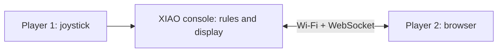
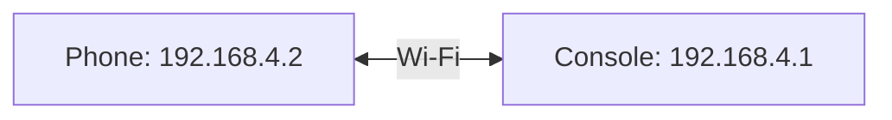
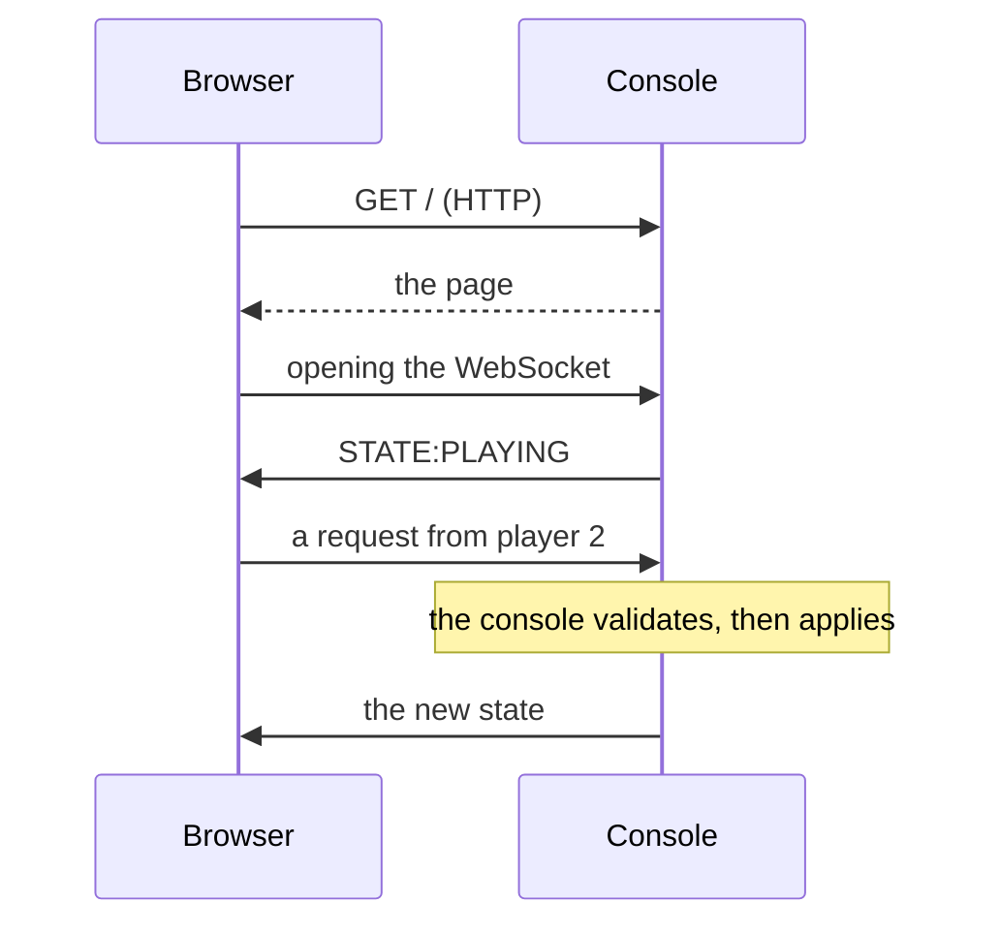
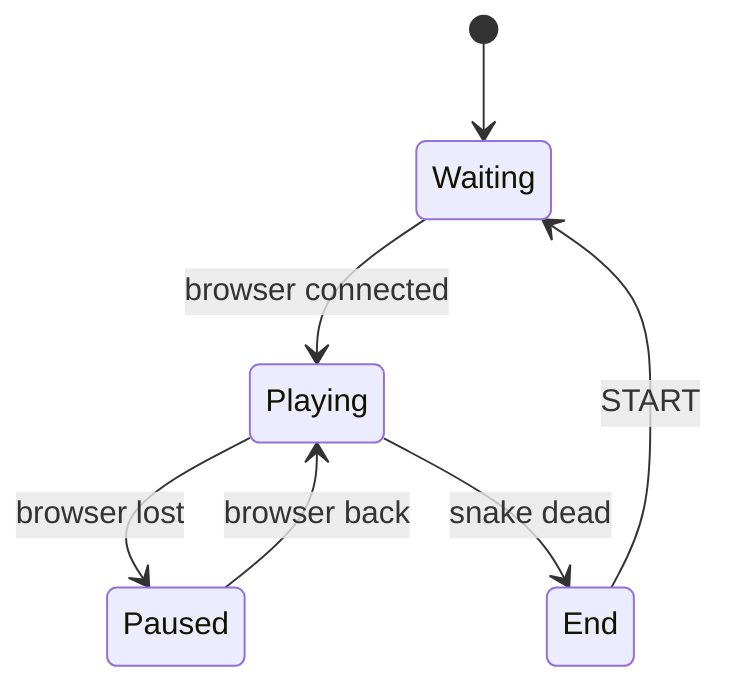

## On the agenda

1. The challenge
2. Your console
3. The network
4. Your organisation

<aside class="notes" markdown="1">
Session P1 (3 h): about 45 min of presentation, with the "invent a role" activity in the middle, then the rest of the session in pairs (repo, Snake and player 2 on paper).
Key message to get across: the console has been ready since the labs, the project is about the game, and there are no more step-by-step guides.
</aside>

---

## What you are going to do

### In pairs, for about 24 h

- **design and code** a Snake on the console soldered in Lab 4
- **invent** a second player, in a browser, who does not play the same game
- **document** it all in your repo, and **demonstrate** it

Everything from the labs is useful: the board, the game loop, the state machine, the display, the joystick.
{: .caption}

[Project brief](/workshops/microcontroleur/projet-snake/){: .doc-link}

---

<!-- .slide: class="slide-section" -->

## The challenge

One Snake, two players, two games

---

## One console, one browser

**Player 1** plays Snake on the console. **Player 2** joins the game from their phone, on a page served by the console itself.
{: .caption}

The two do **not** play the same game: it is **asymmetric** multiplayer.
{: .highlight-red}

[Project brief](/workshops/microcontroleur/projet-snake/){: .doc-link}

---

## Player 1: a real Snake

- The snake moves **cell by cell**, at its own pace
- Four directions with the joystick, **never** a U-turn
- It eats, it grows, the score goes up
- A wall or its own body: the game stops
- Welcome, game, end: a **state machine**
- No flicker, no `delay()`

[Project brief](/workshops/microcontroleur/projet-snake/){: .doc-link}

---

## Player 2: a role to invent

- **The game master** places food and obstacles
- **The saboteur** speeds up the snake, reverses its controls
- **The ally** guides towards bonuses, saves once
- **The gambler** bets on the snake's downfall

Ideas, **not** a list: take one, combine them, or invent your own.

A single rule: their actions must **really change** the game.

[Project brief](/workshops/microcontroleur/projet-snake/){: .doc-link}

---

## Activity: invent a role

### Imagine your player 2's role

1. What do they see in their page?
2. What can they do, and how often?
3. How do they win? How do they lose?
4. Play a game **by hand**: one plays the snake, the other player 2

<aside class="notes" markdown="1">
Have two or three ideas presented to the class. Point out the roles where player 2 has nothing to do half of the time, or where the snake cannot win: that is the transition to the next slide.
</aside>

[Project brief](/workshops/microcontroleur/projet-snake/){: .doc-link}

---

## A good asymmetric role

1

**Can each player win?** A role that is too powerful kills the other's game.

2

**Do both always have something to do?** A player who waits drops out.

Two "yes" answers, and your idea holds up. Keep track of your trials: they justify your choice.
{: .caption}

[Project brief](/workshops/microcontroleur/projet-snake/){: .doc-link}

---

<!-- .slide: class="slide-section" -->

## Your console

Ready since Lab 4

---

## What you already have

### The hardware

- A board **designed** by you, then **soldered** and tested
- Joystick, two buttons, display, XIAO
- The lab pinout, which no longer changes

### The software

- A 16 ms **game loop**, without `delay()`
- `justPressed()` and the calibrated joystick
- A display that does not flicker
- A **state machine**

The Snake starts from all of this. Only the game mechanics and the network are new.
{: .caption}

[Pong on the console](/workshops/microcontroleur/tutorials/collisions-fsm-pong/){: .doc-link} [Soldering and testing the board](/workshops/microcontroleur/tutorials/souder-tester-carte/){: .doc-link}

---

<!-- .slide: class="slide-section" -->

## The network

Bringing a browser into the game

---

## The console creates its own Wi-Fi

As an **access point**, the console creates its own network: no need for the school Wi-Fi, nor the Internet. The phone connects to it and opens `http://192.168.4.1/`.
{: .caption}

Give your network a **unique** name in the room.
{: .highlight-red}

[Wi-Fi, HTTP and WebSocket](/docs/concepts/reseau-wifi-websocket/){: .doc-link}

---

## Two servers, two roles

### HTTP, port 80

Sends player 2's **page**, once, when it is opened.

The browser asks, the console answers, the connection closes.

### WebSocket, port 81

Exchanges **the game messages**, throughout the game.

The line stays open: each side talks whenever it wants.

[Wi-Fi, HTTP and WebSocket](/docs/concepts/reseau-wifi-websocket/){: .doc-link} [ESP32, Wi-Fi and WebSocket](/docs/tutorials/electronics/esp32-wifi-websocket/){: .doc-link}

<!-- .down -->

## The network architecture

{: .img-md}

The page once, then the messages continuously.
{: .caption}

[Wi-Fi, HTTP and WebSocket](/docs/concepts/reseau-wifi-websocket/){: .doc-link}

---

## Your protocol

| Direction | Message | Meaning |
|---|---|---|
| Console → browser | `STATE:PLAYING` | The game phase changes |
| Console → browser | `SCORE:12` | New score |
| Browser → console | `FOOD:12,7` | Request: an apple at (12, 7) |
{: .table-dense}

- Written **before** the code, in your repo
- The **console is the referee**: the browser proposes, the console decides
- An invalid message is ignored, never a crash

[Wi-Fi, HTTP and WebSocket](/docs/concepts/reseau-wifi-websocket/){: .doc-link}

<!-- .down -->

## An exchange, in order

The messages are up to you: only the sequence is imposed.
{: .caption}

[Wi-Fi, HTTP and WebSocket](/docs/concepts/reseau-wifi-websocket/){: .doc-link}

---

## Disconnection is part of the game

A phone going to sleep is an **event** of the state machine, not a surprise.
{: .caption}

[Finite state machine](/workshops/microcontroleur/concepts/machine-etats-finis/){: .doc-link}

---

<!-- .slide: class="slide-section" -->

## Your organisation

Eight sessions, five milestones

---

## The sessions

| Session | Goal |
|---|---|
| P1 | Kick-off, repo, Snake and player 2 on paper |
| P2 | Single-player Snake: grid, movement |
| P3 | Single-player Snake: growth, collisions |
| P4 | The network and the protocol |
| P5 | Player 2: their page, their role |
| P6 | Player 2 integrated into the game |
| P7 | Robustness and tests |
| P8 | Finishing and **demonstration** |
{: .table-dense}

[Course syllabus](/workshops/microcontroleur/syllabus/){: .doc-link}

---

## No more step-by-step

For the Snake, **no tutorial** guides you line by line. That is the heart of the project: search, try, compare, choose.

- How do you store a body that **grows**?
- How do you move at **its own** pace in a 16 ms game loop?
- What do you **redraw** when the snake moves by one cell?

Code found elsewhere (online, AI assistant)? Allowed, if it is **understood** and **cited** in your logbook.
{: .caption}

[Project brief](/workshops/microcontroleur/projet-snake/){: .doc-link}

---

## The deliverables

| In the repo | Content |
|---|---|
| The board | Taken from Labs 3 and 4: schematic, routing, tests |
| The firmware | Code in modules, state machine, protocol |
| The tests | Each requirement checked, with its result |
| The logbook | One entry per session, with your sources |
| The presentation | A short video or a poster |
{: .table-dense}

And a live **demonstration**: a complete game, including a browser disconnection.
{: .caption}

[Project brief](/workshops/microcontroleur/projet-snake/){: .doc-link} [Project Methodology](/workshops/methodologie-de-projet/){: .doc-link}

---

## Assessment

30 %

**the labs**, board included, already validated in session

70 %

**the project**: game, player 2, code, repo and demo

A mark **shared by the pair**: each of you must be able to explain the whole project, including what you did not code.
{: .highlight-red}

[Course assessment](/workshops/microcontroleur/evaluation/){: .doc-link}

---

## Key takeaways

- The project starts on **your** soldered **console**, with the Pong as a base
- Player 2 plays **another game**, from a browser
- Console as access point, WebSocket, protocol written first
- The console is the **referee**, disconnection is planned for
- {: .highlight-red} No step-by-step: you design, you justify, you document

[Project brief](/workshops/microcontroleur/projet-snake/){: .doc-link}

---

## For the rest of the session

1. Create your **repo** from the template, and share it with your partner
2. Read the whole **brief**, and write down your questions
3. Write your **player 2** idea in the logbook
4. On paper: the Snake's **grid**, **snake body** and **state machine**

Goal for the next session: a snake moving on the console.
{: .caption}

[Creating your repo from the template](/workshops/methodologie-de-projet/tutorials/creer-repo-template/){: .doc-link} [Project brief](/workshops/microcontroleur/projet-snake/){: .doc-link}
