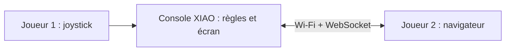
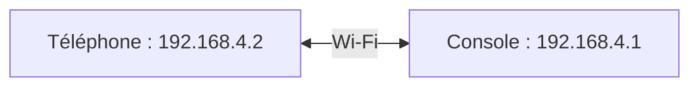
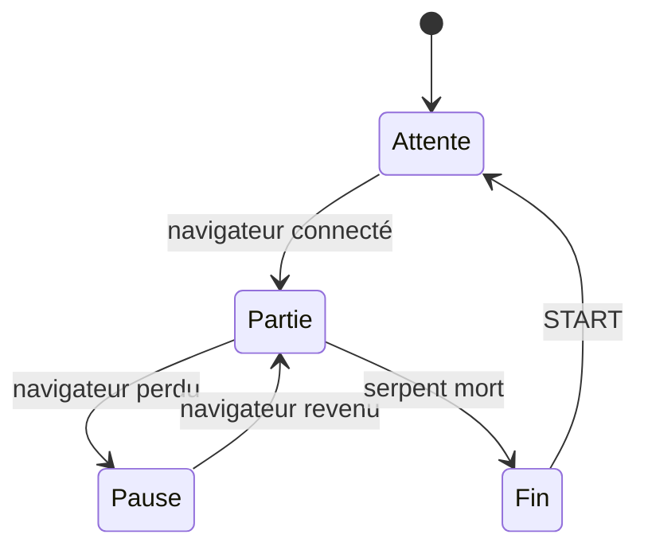

## Au programme

1. Le défi
2. Votre console
3. Le réseau
4. Votre organisation

<aside class="notes" markdown="1">
Séance P1 (3 h) : environ 45 min de présentation, avec l'activité « inventer un rôle » au milieu, puis le reste de la séance en binôme (repo, Snake et joueur 2 sur papier).
Message clé à faire passer : la console est prête depuis les TD, le projet porte sur le jeu, et il n'y a plus de pas à pas.
</aside>

---

## Ce que vous allez faire

### En binôme, pendant environ 24 h

- **concevoir et coder** un Snake sur la console soudée au TD4
- **inventer** un second joueur, dans un navigateur, qui ne joue pas au même jeu
- **documenter** le tout dans votre repo, et le **démontrer**

Tout ce qui vient des TD sert : la carte, la game loop, la machine à états, l'écran, le joystick.
{: .caption}

[Énoncé du projet](/workshops/microcontroleur/projet-snake/){: .doc-link}

---

<!-- .slide: class="slide-section" -->

## Le défi

Un Snake, deux joueurs, deux jeux

---

## Une console, un navigateur

Le **joueur 1** joue au Snake sur la console. Le **joueur 2** rejoint la partie depuis son téléphone, sur une page servie par la console elle-même.
{: .caption}

Les deux ne jouent **pas** au même jeu : c'est un multijoueur **asymétrique**.
{: .fragment .highlight-red}

[Énoncé du projet](/workshops/microcontroleur/projet-snake/){: .doc-link}

---

## Le joueur 1 : un vrai Snake

- {: .fragment} Le serpent avance **case par case**, à sa propre cadence
- {: .fragment} Quatre directions au joystick, **jamais** de demi-tour
- {: .fragment} Il mange, il grandit, le score monte
- {: .fragment} Un mur ou son propre corps : la partie s'arrête
- {: .fragment} Accueil, partie, fin : une **machine à états**
- {: .fragment} Pas de scintillement, aucun `delay()`

[Énoncé du projet](/workshops/microcontroleur/projet-snake/){: .doc-link}

---

## Le joueur 2 : un rôle à inventer

- **Le maître du jeu** pose nourriture et obstacles
- **Le saboteur** accélère le serpent, inverse ses commandes
- **L'allié** guide vers les bonus, sauve une fois
- **Le parieur** mise sur la chute du serpent

Des pistes, **pas** une liste : reprenez-en une, combinez-les, ou inventez la vôtre.

Une seule règle : ses actions doivent **changer vraiment** la partie.

[Énoncé du projet](/workshops/microcontroleur/projet-snake/){: .doc-link}

---

## Activité : inventez un rôle

<i class="fas fa-user-friends"></i>En binôme<i class="far fa-clock"></i>10 min<i class="fas fa-pen"></i>Sur papier

### Imaginez le rôle de votre joueur 2

1. Que voit-il dans sa page ?
2. Que peut-il faire, et à quelle fréquence ?
3. Comment gagne-t-il ? Comment perd-il ?
4. Jouez une partie **à la main** : l'un fait le serpent, l'autre le joueur 2

<aside class="notes" markdown="1">
Faire présenter deux ou trois idées à la classe. Relever les rôles où le joueur 2 n'a rien à faire la moitié du temps, ou où le serpent ne peut pas gagner : c'est la transition vers le slide suivant.
</aside>

[Énoncé du projet](/workshops/microcontroleur/projet-snake/){: .doc-link}

---

## Un bon rôle asymétrique

1

**Chaque joueur peut-il gagner ?** Un rôle trop puissant tue le jeu de l'autre.

2

**Les deux ont-ils toujours quelque chose à faire ?** Un joueur qui attend décroche.

Deux « oui », et votre idée tient. Gardez la trace de vos essais : ils justifient votre choix.
{: .fragment .caption}

[Énoncé du projet](/workshops/microcontroleur/projet-snake/){: .doc-link}

---

<!-- .slide: class="slide-section" -->

## Votre console

Prête depuis le TD4

---

## Ce que vous avez déjà

### Le matériel

- Une carte **conçue** par vous, puis **soudée** et testée
- Joystick, deux boutons, écran, XIAO
- Le brochage des TD, qui ne change plus

### Le logiciel

- Une **game loop** à 16 ms, sans `delay()`
- `justPressed()` et le joystick calibré
- Un affichage qui ne scintille pas
- Une **machine à états**

Le Snake repart de tout cela. Seuls la mécanique de jeu et le réseau sont neufs.
{: .caption}

[Le Pong sur la console](/workshops/microcontroleur/tutorials/collisions-fsm-pong/){: .doc-link} [Souder et tester la carte](/workshops/microcontroleur/tutorials/souder-tester-carte/){: .doc-link}

---

<!-- .slide: class="slide-section" -->

## Le réseau

Faire entrer un navigateur dans la partie

---

## La console crée son propre Wi-Fi

En **point d'accès**, la console crée son réseau : pas besoin du Wi-Fi de l'école, ni d'Internet. Le téléphone s'y connecte et ouvre `http://192.168.4.1/`.
{: .caption}

Donnez à votre réseau un nom **unique** dans la salle.
{: .fragment .highlight-red}

[Wi-Fi, HTTP et WebSocket](/docs/concepts/reseau-wifi-websocket/){: .doc-link}

---

## Deux serveurs, deux rôles

### HTTP, port 80

Envoie **la page** du joueur 2, une fois, à l'ouverture.

Le navigateur demande, la console répond, la connexion se ferme.

### WebSocket, port 81

Échange **les messages du jeu**, pendant toute la partie.

La ligne reste ouverte : chacun parle quand il veut.

[Wi-Fi, HTTP et WebSocket](/docs/concepts/reseau-wifi-websocket/){: .doc-link} [ESP32, Wi-Fi et WebSocket](/docs/tutorials/electronics/esp32-wifi-websocket/){: .doc-link}

---

## Votre protocole

| Sens | Message | Signification |
|---|---|---|
| Console → navigateur | `STATE:PLAYING` | La phase de jeu change |
| Console → navigateur | `SCORE:12` | Nouveau score |
| Navigateur → console | `FOOD:12,7` | Demande : une pomme en (12, 7) |
{: .table-dense}

- {: .fragment} Écrit **avant** le code, dans votre repo
- {: .fragment} La **console est l'arbitre** : le navigateur propose, la console décide
- {: .fragment} Un message invalide est ignoré, jamais un plantage

[Wi-Fi, HTTP et WebSocket](/docs/concepts/reseau-wifi-websocket/){: .doc-link}

---

## La déconnexion fait partie du jeu

Un téléphone qui se met en veille est un **événement** de la machine à états, pas une surprise.
{: .caption}

[Machine à états finis](/workshops/microcontroleur/concepts/machine-etats-finis/){: .doc-link}

---

<!-- .slide: class="slide-section" -->

## Votre organisation

Huit séances, cinq jalons

---

## Les séances

| Séance | Objectif |
|---|---|
| P1 | Lancement, repo, Snake et joueur 2 sur papier |
| P2 | Le Snake en solo : grille, déplacement |
| P3 | Le Snake en solo : croissance, collisions |
| P4 | Le réseau et le protocole |
| P5 | Le joueur 2 : sa page, son rôle |
| P6 | Le joueur 2 intégré au jeu |
| P7 | La robustesse et les tests |
| P8 | Finalisation et **démonstration** |
{: .table-dense}

[Syllabus de l'atelier](/workshops/microcontroleur/syllabus/){: .doc-link}

---

## Plus de pas à pas

Pour le Snake, **aucun tutoriel** ne vous guide ligne à ligne. C'est le cœur du projet : chercher, essayer, comparer, choisir.

- {: .fragment} Comment mémoriser un corps qui **grandit** ?
- {: .fragment} Comment avancer à **sa** cadence dans une game loop à 16 ms ?
- {: .fragment} Que **redessiner** quand le serpent avance d'une case ?

Du code trouvé ailleurs (en ligne, assistant IA) ? Permis, s'il est **compris** et **cité** dans votre journal de bord.
{: .fragment .caption}

[Énoncé du projet](/workshops/microcontroleur/projet-snake/){: .doc-link}

---

## Les livrables

| Dans le repo | Contenu |
|---|---|
| La carte | Reprise des TD3 et TD4 : schéma, routage, tests |
| Le firmware | Code en modules, machine à états, protocole |
| Les tests | Chaque exigence vérifiée, avec son résultat |
| Le journal de bord | Une entrée par séance, avec vos sources |
| La présentation | Une courte vidéo ou un poster |
{: .table-dense}

Et une **démonstration** en direct : une partie complète, déconnexion du navigateur comprise.
{: .caption}

[Énoncé du projet](/workshops/microcontroleur/projet-snake/){: .doc-link} [Méthodologie de projet](/workshops/methodologie-de-projet/){: .doc-link}

---

## L'évaluation

30 %

**les TD**, carte comprise, déjà validés en séance

70 %

**le projet** : jeu, joueur 2, code, repo et démo

Une note **commune au binôme** : chacun doit savoir expliquer tout le projet, y compris ce qu'il n'a pas codé.
{: .fragment .highlight-red}

[Évaluation de l'atelier](/workshops/microcontroleur/evaluation/){: .doc-link}

---

## À retenir

- {: .fragment} Le projet démarre sur **votre console** soudée, avec le Pong comme base
- {: .fragment} Le joueur 2 joue un **autre jeu**, depuis un navigateur
- {: .fragment} Console en point d'accès, WebSocket, protocole écrit d'abord
- {: .fragment} La console est l'**arbitre**, la déconnexion est prévue
- {: .fragment .highlight-red} Pas de pas à pas : vous concevez, vous justifiez, vous documentez

[Énoncé du projet](/workshops/microcontroleur/projet-snake/){: .doc-link}

---

## Pour la suite de la séance

<i class="fas fa-user-friends"></i>En binôme<i class="far fa-clock"></i>2 h

1. Créer votre **repo** depuis le template, et le partager à votre binôme
2. Lire l'**énoncé** en entier, et noter vos questions
3. Écrire votre idée de **joueur 2** dans le journal de bord
4. Sur papier : la **grille**, le **corps du serpent** et la **machine à états** du Snake

Objectif de la prochaine séance : un serpent qui avance sur la console.
{: .caption}

[Créer son repo depuis le template](/workshops/methodologie-de-projet/tutorials/creer-repo-template/){: .doc-link} [Énoncé du projet](/workshops/microcontroleur/projet-snake/){: .doc-link}
