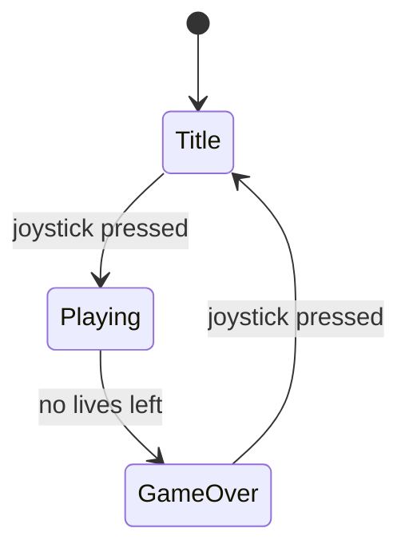

## A first game on the console

The board is soldered and tested: time to run a game on it. This Pong is played **alone**: the paddle at the bottom of the screen follows the joystick, the ball bounces off the three other walls, and each missed ball costs a life. It brings together everything the rest of the course will need: a **game loop** that never blocks, reliable **collisions**, a **display** that does not flicker, and a **state machine** for the welcome screen, the game and the end.

We start again from the test program of step 7 of Lab 2 ([The modules of the kit](/workshops/microcontroleur/tutorials/entrees-boutons-joystick/)): it already contains the game loop, the joystick reading, press detection and the display initialisation.

{% include step-tuto.html
greyBackground=true
title="Step 1: Group the game data"
content="A game handles many values: positions, speeds, score, lives, game phase. Rather than scattered global variables, they are grouped into **structures**: a `Paddle` for the paddle, a `Ball` for the ball, and a `Game` that holds the whole game.

Positions are `float` (the ball can move 2.4 pixels per frame) and refer to the object's **top-left corner**, as with `fillRect()`. The top of the screen is reserved for a 24-pixel bar for the score and the lives.

The game phase is an `enum class`: like the `enum` from Lecture 3, a type that can take **only** the listed values, but each value is written preceded by the type's name (`GameState::Title`). A `Title` or a `Playing` therefore cannot clash with another name in the program. The FSM concept and Lecture 3 call these states `MENU`, `PLAYING` and `GAME_OVER`; they are the same ones, named like the rest of the code."
%}


Add the game settings to `include/config.h`:

```cpp
constexpr int      SCREEN_WIDTH     = 240;
constexpr int      SCREEN_HEIGHT    = 320;
constexpr int      SCORE_BAR_HEIGHT = 24;    // score bar, at the top
constexpr uint32_t FRAME_TIME_MS    = 16;    // one frame every 16 ms

constexpr int   PADDLE_WIDTH     = 40;
constexpr int   PADDLE_HEIGHT    = 6;
constexpr int   PADDLE_MARGIN    = 10;       // distance from the bottom of the screen
constexpr float PADDLE_MAX_SPEED = 5.0f;     // pixels per frame

constexpr int      BALL_SIZE      = 6;
constexpr float    BALL_SPEED     = 3.0f;    // pixels per frame
constexpr uint32_t SERVE_DELAY_MS = 1000;    // pause before each serve
constexpr int      START_LIVES    = 3;
```

Then, in `src/main.cpp`:

```cpp
enum class GameState { Title, Playing, GameOver };

struct Paddle {
    float x;
    float y;
};

struct Ball {
    float x;
    float y;
    float vx;    // speed in pixels per frame
    float vy;
};

struct Game {
    GameState state;
    Paddle    paddle;
    Ball      ball;
    int       score;        // number of balls returned
    int       lives;
    uint32_t  serveTimeMs;  // time at which the ball will be launched
};

static Game game;
```





```cpp
static void movePaddle(Game& g, float joystickX) {
    g.paddle.x += joystickX * PADDLE_MAX_SPEED;
    g.paddle.x  = constrain(g.paddle.x, 0.0f, (float)(SCREEN_WIDTH - PADDLE_WIDTH));
}
```

In `setup()`: `game.paddle.y = SCREEN_HEIGHT - PADDLE_MARGIN - PADDLE_HEIGHT;`

The game functions receive the game **by reference** (`Game& g`) to modify it. The drawing functions, below, will receive it as a **const reference** (`const Game& g`): the compiler will refuse to let them modify it. The separation between logic and display is thus checked by the compiler.

{% include step-tuto.html
greyBackground=true
title="Step 3: The ball, the walls and the paddle"
content="At each frame, the speed is added to the position. On the left, right and top walls, the ball bounces: the speed component is inverted **and the ball is put back against the wall**. Without this repositioning, a ball that went 2 pixels past could still be outside at the next frame: its speed would be inverted a second time, and it would stay stuck to the wall.

The collision with the paddle is a **rectangle overlap** test: two rectangles overlap if they overlap both in x and in y. It is only done if the ball is **going down**, then the ball is put back above the paddle: otherwise, a ball still in contact at the next frame would keep bouncing inside it.

`moveBall()` returns `false` when the ball leaves through the bottom: the player missed it."
%}


```cpp
// True if the ball's rectangle overlaps the paddle's
static bool ballTouchesPaddle(const Ball& b, const Paddle& p) {
    return b.x < p.x + PADDLE_WIDTH  && b.x + BALL_SIZE > p.x &&
           b.y < p.y + PADDLE_HEIGHT && b.y + BALL_SIZE > p.y;
}

// Moves the ball forward by one frame. Returns false if it is lost.
static bool moveBall(Game& g) {
    Ball& b = g.ball;
    b.x += b.vx;
    b.y += b.vy;

    // Left and right walls
    if (b.x < 0) {
        b.x  = 0;
        b.vx = -b.vx;
    } else if (b.x + BALL_SIZE > SCREEN_WIDTH) {
        b.x  = SCREEN_WIDTH - BALL_SIZE;
        b.vx = -b.vx;
    }

    // Top wall (below the score bar)
    if (b.y < SCORE_BAR_HEIGHT) {
        b.y  = SCORE_BAR_HEIGHT;
        b.vy = -b.vy;
    }

    // Paddle, only if the ball is going down towards it
    if (b.vy > 0 && ballTouchesPaddle(b, g.paddle)) {
        b.y  = g.paddle.y - BALL_SIZE;
        b.vy = -b.vy;
        g.score++;
    }

    return b.y < SCREEN_HEIGHT;  // false: left through the bottom
}
```

{% include step-tuto.html
greyBackground=true
title="Step 4: The serve, the lives and the score"
content="At the start of the game, and after each lost ball, the ball is **served**: put back at the top of the screen, launched towards the player, after a one-second pause so that they can get ready.

This pause must not block the game with `delay(1000)`: the paddle must be able to move during that time. So the **serve time** is stored, and the ball stays still until it is reached: this is the comparison with `millis()` from the game loop."
%}

```cpp
static void serveBall(Game& g, uint32_t nowMs) {
    g.ball.x  = (SCREEN_WIDTH - BALL_SIZE) / 2.0f;
    g.ball.y  = SCORE_BAR_HEIGHT + 20;
    g.ball.vx = random(2) ? 0.6f * BALL_SPEED : -0.6f * BALL_SPEED;  // at an angle
    g.ball.vy = BALL_SPEED;                                        // towards the player
    g.serveTimeMs = nowMs + SERVE_DELAY_MS;
}
```

During the game, the paddle always moves, and the ball only after the serve:

```cpp
movePaddle(g, joystickX);

if (nowMs >= g.serveTimeMs && !moveBall(g)) {
    g.lives--;                            // missed ball
    if (g.lives == 0) {
        g.state = GameState::GameOver;
    } else {
        serveBall(g, nowMs);
    }
}
```

{% include step-tuto.html
greyBackground=true
title="Step 5: The state machine"
content="The game has three phases. Each `case` of the `switch` contains only the logic of **its** phase: the welcome screen and the end screen wait for a press on the joystick, the game moves the game forward (the code from step 4).

Transitions are triggered on a **press** (`justPressed()` from Lab 2, true only once), not on a **held** button. With `digitalRead() == LOW`, a slightly long press on the end screen would go back to the welcome screen, then immediately start a new game."
%}



```cpp
static void gameUpdate(Game& g, float joystickX, bool startPressed, uint32_t nowMs) {
    switch (g.state) {
        case GameState::Title:
            if (startPressed) {
                g.score    = 0;
                g.lives    = START_LIVES;
                g.paddle.x = (SCREEN_WIDTH - PADDLE_WIDTH) / 2.0f;
                serveBall(g, nowMs);
                g.state = GameState::Playing;
            }
            break;

        case GameState::Playing:
            // the code from step 4
            break;

        case GameState::GameOver:
            if (startPressed) {
                g.state = GameState::Title;
            }
            break;
    }
}
```

The `loop()` stays the one from Lab 2, with its three stages:

```cpp
void loop() {
    static uint32_t lastFrameMs = 0;
    uint32_t nowMs = millis();
    if (nowMs - lastFrameMs < FRAME_TIME_MS) {
        return;
    }
    lastFrameMs = nowMs;

    // 1. Read
    float joystickX   = normalizeJoystick(analogRead(PIN_JOYSTICK_X), joystickCenterX);
    bool startPressed = justPressed(selectButton);

    // 2. Compute
    gameUpdate(game, joystickX, startPressed, nowMs);

    // 3. Display
    rendererDraw(game);
}
```

`selectButton` is a `Button` (Lab 2) on `PIN_JOYSTICK_SELECT`; the stick connects its pin to GND, so `PRESSED_LEVEL` is `LOW`. In `setup()`, the game starts on the welcome screen: `game.state = GameState::Title;`.

{% include step-tuto.html
greyBackground=true
title="Step 6: Displaying without flicker"
content="Redrawing the whole screen at every frame (240 × 320 pixels sent over SPI, 60 times per second) would make it flicker. Two rules:

- a **full screen** (welcome, game, end) is drawn **only once**, when the phase changes;
- during the game, **only what moves** is redrawn: the paddle and the ball (erase the old position, draw the new one), and the bar only when the score or the lives change.

To know what has changed, the display stores what is **on the screen** (`drawnState`, `drawnBallX`...), like the dot from Lab 2 with `drawnX`."
%}

```cpp
static bool      screenIsValid = false;  // false: redraw everything
static GameState drawnState;
static int drawnPaddleX, drawnBallX, drawnBallY, drawnScore, drawnLives;

static void rendererDraw(const Game& g) {
    // Phase change: redraw the full screen, once
    if (!screenIsValid || g.state != drawnState) {
        switch (g.state) {
            case GameState::Title:    drawTitleScreen();      break;
            case GameState::Playing:  drawPlayingScreen(g);   break;
            case GameState::GameOver: drawGameOverScreen(g);  break;
        }
        drawnState    = g.state;
        screenIsValid = true;
        return;
    }

    // Same phase: only the game in progress moves
    if (g.state == GameState::Playing) {
        updatePlayingScreen(g);
    }
}
```

During the game, erasing the ball can dig a hole in the paddle when they touch: after erasing, the paddle is redrawn if the two rectangles overlap.

```cpp
static bool rectsOverlap(int x1, int y1, int w1, int h1, int x2, int y2, int w2, int h2) {
    return x1 < x2 + w2 && x1 + w1 > x2 && y1 < y2 + h2 && y1 + h1 > y2;
}

static void updatePlayingScreen(const Game& g) {
    int paddleY = (int)g.paddle.y;

    // The paddle, if it has moved
    int px = (int)g.paddle.x;
    if (px != drawnPaddleX) {
        tft.fillRect(drawnPaddleX, paddleY, PADDLE_WIDTH, PADDLE_HEIGHT, ST77XX_BLACK);
        tft.fillRect(px, paddleY, PADDLE_WIDTH, PADDLE_HEIGHT, ST77XX_WHITE);
        drawnPaddleX = px;
    }

    // The ball, if it has moved
    int bx = (int)g.ball.x;
    int by = (int)g.ball.y;
    if (bx != drawnBallX || by != drawnBallY) {
        tft.fillRect(drawnBallX, drawnBallY, BALL_SIZE, BALL_SIZE, ST77XX_BLACK);
        if (rectsOverlap(drawnBallX, drawnBallY, BALL_SIZE, BALL_SIZE,
                         drawnPaddleX, paddleY, PADDLE_WIDTH, PADDLE_HEIGHT)) {
            tft.fillRect(drawnPaddleX, paddleY, PADDLE_WIDTH, PADDLE_HEIGHT, ST77XX_WHITE);
        }
        tft.fillRect(bx, by, BALL_SIZE, BALL_SIZE, ST77XX_WHITE);
        drawnBallX = bx;
        drawnBallY = by;
    }

    // The bar, only if the score or the lives have changed
    if (g.score != drawnScore || g.lives != drawnLives) {
        drawScoreBar(g);
    }
}
```

What remains is to write the full screens, with centred text:

- `drawScoreBar()`: erases the bar, draws a separator line, writes `Score 12  Lives 3` (with `snprintf`), then updates `drawnScore` and `drawnLives`;
- `drawTitleScreen()`: `fillScreen`, the title, and "Press the joystick" on two lines;
- `drawGameOverScreen()`: the final score and the same prompt;
- `drawPlayingScreen()`: `fillScreen`, the bar, the paddle and the ball, and the initialisation of **all** the `drawn...` variables.

To centre a text, compute its width: the default font is 6 pixels wide per character, multiplied by the size chosen with `setTextSize()`.

In C++, a function must be declared **before** it is called: put the drawing functions above `rendererDraw()`, and `serveBall()`, `movePaddle()` and `moveBall()` above `gameUpdate()`.



## Expected result

A complete one-player Pong on the console: a welcome screen, a game with a paddle, a ball, a score and lives, an end screen, and a return to the welcome screen, all without `delay()` in the loop and without flicker.

## Going further

These improvements are independent. Pick the ones you like, in any order: they all prepare the project.

### Two players

The board has two buttons, SW1 (D5) and SW2 (D6). Replace the top wall with a second paddle, moved to the left **as long as** SW1 is held and to the right as long as SW2 is (here, we read the level, not the edge). The trick `(int)right - (int)left` gives the direction directly: -1, 0 or +1. The score becomes each player's, and the game is won in 7 points.

### A computer opponent

As long as nobody touches SW1 or SW2, the top paddle can be played by the computer: it follows the ball when the ball is going up, comes back to the centre otherwise, with a limited speed (a little slower than the player) so that it can be beaten.

### A bounce angle that depends on the impact

With `vy = -vy`, the ball always leaves at the same angle. Instead, compute the position of the impact $h$ on the paddle, between $-1$ (left edge) and $+1$ (right edge), then the angle $\theta = h \times 60°$, and split the speed: $v_x = v \sin\theta$ and $v_y = -v \cos\theta$. Also make the ball speed up a little at each return.

### The tunnelling effect

If the ball moves more than `BALL_SIZE + PADDLE_HEIGHT` pixels in one frame, it can go from one side of the paddle to the other without ever overlapping it. Forbid this setting at compile time, in `config.h`:

```cpp
static_assert(BALL_SPEED < BALL_SIZE + PADDLE_HEIGHT,
              "BALL_SPEED too large: the ball could go through the paddle");
```

### Splitting the program into modules

When `main.cpp` grows beyond a few hundred lines, organise it into modules: `input.h/.cpp` (reading the controls), `game.h/.cpp` (rules, without any drawing), `renderer.h/.cpp` (drawing, without any decision), and a `main.cpp` reduced to the game loop. Each `.h` declares what the module **offers**, each `.cpp` **how** it does it, with its internal functions as `static`. The Snake project will benefit greatly from starting this way: see the concept [Organising your code into modules](/workshops/microcontroleur/concepts/organiser-code-modules/).


