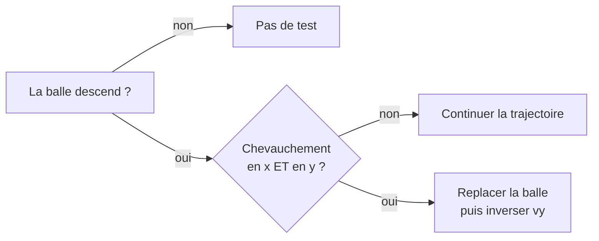
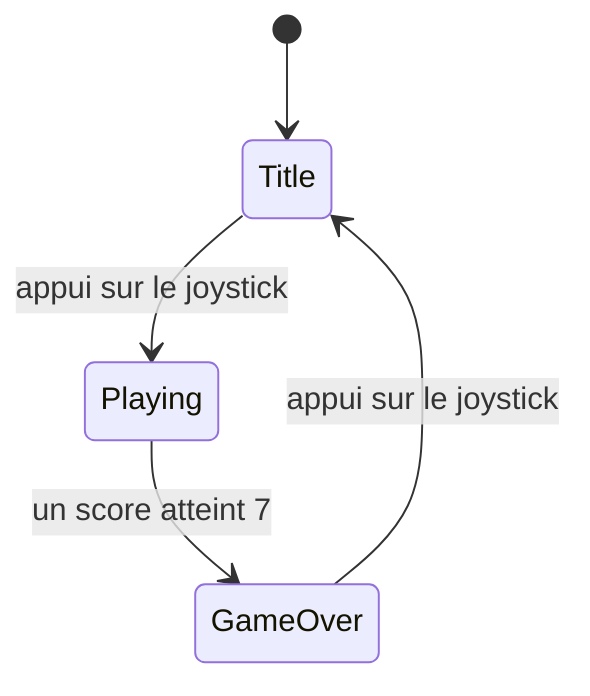

## Collisions, score et machine à états

Ce tutoriel part du programme du tutoriel [Écran SPI et game loop](/docs/tutorials/electronics/ecran-spi-game-loop/) : une raquette qui suit le joystick et une balle qui rebondit sur les bords, mais qui **traverse** la raquette en y laissant un trou. Il le transforme en un **Pong 2 joueurs complet**, avec un début et une fin. Aucun câblage supplémentaire n'est nécessaire.

À la fin, le programme est découpé en quatre modules, chacun avec une seule responsabilité :

| Fichier | Rôle |
|---|---|
| `config.h` | Brochage de la carte et réglages du jeu |
| `input.h/.cpp` | Lecture du joystick et des boutons → `InputState` (déjà écrit) |
| `game.h/.cpp` | Règles du jeu : positions, collisions, score. **Ne dessine rien** |
| `renderer.h/.cpp` | Dessin de l'état du jeu sur l'écran. **Ne décide rien** |
| `main.cpp` | Boucle principale : lire → calculer → afficher |

Les étapes 1 à 6 s'écrivent dans `main.cpp`, en séparant déjà les fonctions de jeu des fonctions de dessin. L'étape 7 les range dans leurs fichiers.

{% include step-tuto.html
greyBackground=true
title="Étape 1 : Regrouper les données du jeu"
content="Au tutoriel précédent, chaque objet était une série de variables globales (`paddleX`, `ballX`, `ballVX`...). Avec deux raquettes, deux scores et une phase de jeu, ces variables se multiplient. On les regroupe en **structures** : une `Paddle` par raquette, une `Ball`, et une `Game` qui contient tout l'état de la partie.

Toutes les positions désignent le **coin supérieur gauche** de l'objet, comme pour `fillRect()`. Le haut de l'écran est réservé à un bandeau de score de 24 pixels : le terrain commence en dessous."
%}

```cpp
// include/config.h : le terrain de jeu, sous le bandeau des scores
constexpr int SCORE_BAR_HEIGHT = 24;
constexpr int FIELD_TOP        = SCORE_BAR_HEIGHT;
constexpr int FIELD_BOTTOM     = SCREEN_HEIGHT;
constexpr int FIELD_LEFT       = 0;
constexpr int FIELD_RIGHT      = SCREEN_WIDTH;
```

```cpp
// src/main.cpp
struct Paddle {
    float x;
    float y;
    int   score;
};

struct Ball {
    float x;
    float y;
    float vx;     // vitesse en pixels par image
    float vy;
    float speed;  // norme de la vitesse
};

struct Game {
    Paddle   bottom;       // Joueur 1 (joystick)
    Paddle   top;          // Joueur 2 (boutons SW1 / SW2)
    Ball     ball;
    uint32_t serveTimeMs;  // Instant où la balle sera lancée
};

static Game game;
```

Les fonctions de jeu reçoivent la partie **par référence** (`Game& game`) pour pouvoir la modifier ; les fonctions de dessin la reçoivent en **référence constante** (`const Game& game`) : le compilateur refusera qu'elles la modifient. C'est la séparation jeu / affichage, vérifiée par le compilateur.

{% include step-tuto.html
greyBackground=true
title="Étape 2 : Ajouter la raquette du joueur 2"
content="La raquette du joueur 2 est en haut. Elle se déplace **tant que** SW1 (gauche) ou SW2 (droite) est maintenu : on utilise les niveaux `buttonLeft` / `buttonRight` de `InputState`, sans détection de front.

L'astuce `(int)buttonRight - (int)buttonLeft` donne directement le sens : -1 (gauche), +1 (droite), ou 0 si aucun bouton ou les deux sont enfoncés. La raquette du joueur 1 garde le déplacement proportionnel du tutoriel précédent."
%}

```cpp
// Position horizontale qui centre la raquette dans le terrain
static float paddleCenterX() {
    return (FIELD_LEFT + FIELD_RIGHT - PADDLE_WIDTH) / 2.0f;
}

// Empêche la raquette de sortir du terrain
static void clampPaddle(Paddle& paddle) {
    paddle.x = constrain(paddle.x, (float)FIELD_LEFT, (float)(FIELD_RIGHT - PADDLE_WIDTH));
}

// Raquette du bas : vitesse proportionnelle à l'inclinaison du joystick
static void moveBottomPaddle(Game& game, const InputState& input) {
    game.bottom.x += input.joystickX * PADDLE_MAX_SPEED;
    clampPaddle(game.bottom);
}

// Raquette du haut : vitesse fixe tant qu'un bouton est maintenu
static void moveTopPaddle(Game& game, const InputState& input) {
    int direction = (int)input.buttonRight - (int)input.buttonLeft;  // -1, 0 ou +1
    game.top.x += direction * PADDLE_MAX_SPEED;
    clampPaddle(game.top);
}
```

Les raquettes démarrent au centre, à `PADDLE_MARGIN` pixels de leur bord. Initialise-les dans `setup()` :

```cpp
game.bottom = { paddleCenterX(), FIELD_BOTTOM - PADDLE_MARGIN - PADDLE_HEIGHT, 0 };
game.top    = { paddleCenterX(), FIELD_TOP + PADDLE_MARGIN, 0 };
```

Côté affichage, `drawnPaddleX` du tutoriel précédent devient `drawnBottomX`, et `drawnTopX` mémorise la raquette du haut, dessinée et effacée de la même façon.



{% include step-tuto.html
greyBackground=true
title="Étape 3 : Détecter la collision balle/raquette"
content="La balle et les raquettes sont deux **rectangles alignés sur les axes** (*AABB*, *Axis-Aligned Bounding Box*). Deux tels rectangles se chevauchent si, et seulement si, ils se chevauchent **à la fois** sur l'axe horizontal et sur l'axe vertical. Sur un axe, deux segments se chevauchent quand chacun commence avant la fin de l'autre.

Deux précautions évitent la **balle collée**, un bug classique :

- on ne teste la raquette du bas que si la balle **descend** (`vy > 0`), et celle du haut que si elle **monte**. Sans ce test, une balle encore en contact à l'image suivante verrait sa vitesse inversée une deuxième fois, et resterait prise dans la raquette en tremblant ;
- après le rebond, on **replace** la balle contre la raquette, comme contre les murs au tutoriel précédent."
%}



```cpp
// Vrai si le rectangle de la balle chevauche celui de la raquette
static bool ballTouchesPaddle(const Ball& ball, const Paddle& paddle) {
    return ball.x < paddle.x + PADDLE_WIDTH  && ball.x + BALL_SIZE > paddle.x &&
           ball.y < paddle.y + PADDLE_HEIGHT && ball.y + BALL_SIZE > paddle.y;
}

static void moveBall(Game& game) {
    Ball& ball = game.ball;

    ball.x += ball.vx;
    ball.y += ball.vy;

    // Rebond sur les murs de gauche et de droite
    if (ball.x < FIELD_LEFT) {
        ball.x  = FIELD_LEFT;
        ball.vx = -ball.vx;
    } else if (ball.x + BALL_SIZE > FIELD_RIGHT) {
        ball.x  = FIELD_RIGHT - BALL_SIZE;
        ball.vx = -ball.vx;
    }

    // Rebond sur les raquettes, seulement si la balle va vers elles
    if (ball.vy > 0 && ballTouchesPaddle(ball, game.bottom)) {
        ball.y  = game.bottom.y - BALL_SIZE;
        ball.vy = -ball.vy;
    } else if (ball.vy < 0 && ballTouchesPaddle(ball, game.top)) {
        ball.y  = game.top.y + PADDLE_HEIGHT;
        ball.vy = -ball.vy;
    }
}
```

Le haut et le bas du terrain ne sont plus des murs : une balle qui les franchit fait marquer un point (étape 4).

Reste le **trou** que la balle laisse dans une raquette en passant. Côté affichage, après avoir effacé l'ancienne balle, on redessine toute raquette que ce carré noir a touchée. Le test est le même chevauchement de rectangles, appliqué aux positions **affichées** :

```cpp
// Vrai si deux rectangles se chevauchent
static bool rectsOverlap(int x1, int y1, int w1, int h1, int x2, int y2, int w2, int h2) {
    return x1 < x2 + w2 && x1 + w1 > x2 && y1 < y2 + h2 && y1 + h1 > y2;
}

static void drawBall(const Game& game) {
    int newX = (int)game.ball.x;
    int newY = (int)game.ball.y;
    if (newX == drawnBallX && newY == drawnBallY) {
        return;
    }

    // 1. Effacer l'ancienne balle
    tft.fillRect(drawnBallX, drawnBallY, BALL_SIZE, BALL_SIZE, COLOR_BACKGROUND);

    // 2. Réparer les raquettes que l'effacement a pu abîmer
    if (rectsOverlap(drawnBallX, drawnBallY, BALL_SIZE, BALL_SIZE,
                     drawnBottomX, game.bottom.y, PADDLE_WIDTH, PADDLE_HEIGHT)) {
        tft.fillRect(drawnBottomX, game.bottom.y, PADDLE_WIDTH, PADDLE_HEIGHT, COLOR_FOREGROUND);
    }
    if (rectsOverlap(drawnBallX, drawnBallY, BALL_SIZE, BALL_SIZE,
                     drawnTopX, game.top.y, PADDLE_WIDTH, PADDLE_HEIGHT)) {
        tft.fillRect(drawnTopX, game.top.y, PADDLE_WIDTH, PADDLE_HEIGHT, COLOR_FOREGROUND);
    }

    // 3. Dessiner la nouvelle balle
    tft.fillRect(newX, newY, BALL_SIZE, BALL_SIZE, COLOR_FOREGROUND);
    drawnBallX = newX;
    drawnBallY = newY;
}
```

`drawnBottomX`, `drawnTopX`, `drawnBallX` et `drawnBallY` mémorisent ce qui est **affiché**, comme `drawnPaddleX` au tutoriel précédent. Les couleurs sont nommées une fois pour toutes : `COLOR_BACKGROUND` (`ST77XX_BLACK`), `COLOR_FOREGROUND` (`ST77XX_WHITE`) et `COLOR_HIGHLIGHT` (`ST77XX_YELLOW`).



{% include step-tuto.html
greyBackground=true
title="Étape 4 : Marquer des points et servir"
content="Quand la balle franchit le haut du terrain, le joueur 1 marque ; quand elle franchit le bas, le joueur 2 marque. La balle est alors replacée au centre et **servie** vers le joueur qui vient de perdre le point, après une pause d'une seconde pour que chacun se prépare.

Cette pause ne doit pas bloquer le jeu avec `delay(1000)` : les raquettes doivent pouvoir bouger pendant ce temps. On mémorise donc **l'instant du service** (`serveTimeMs`), et la balle reste immobile tant qu'il n'est pas atteint. C'est encore la comparaison avec `millis()` de la game loop."
%}

```cpp
// include/config.h
constexpr float    BALL_START_SPEED = 3.0f;   // En pixels par image
constexpr uint32_t SERVE_DELAY_MS   = 1000;   // Pause avant chaque service
constexpr int      WINNING_SCORE    = 7;
```

```cpp
// Place la balle au centre et programme son lancement vers le haut
// (direction = -1) ou vers le bas (direction = +1)
static void serveBall(Game& game, int direction, uint32_t nowMs) {
    Ball& ball = game.ball;

    ball.x     = (FIELD_LEFT + FIELD_RIGHT - BALL_SIZE) / 2.0f;
    ball.y     = (FIELD_TOP + FIELD_BOTTOM - BALL_SIZE) / 2.0f;
    ball.speed = BALL_START_SPEED;
    ball.vx    = random(-150, 151) / 100.0f;  // Légère inclinaison aléatoire
    ball.vy    = direction * BALL_START_SPEED;

    game.serveTimeMs = nowMs + SERVE_DELAY_MS;
}

// Vérifie si la balle a franchi le haut ou le bas du terrain
static void checkPointScored(Game& game, uint32_t nowMs) {
    const Ball& ball = game.ball;
    int serveDirection;

    if (ball.y < FIELD_TOP) {
        game.bottom.score++;
        serveDirection = -1;  // La balle repart vers celui qui a perdu le point
    } else if (ball.y + BALL_SIZE > FIELD_BOTTOM) {
        game.top.score++;
        serveDirection = +1;
    } else {
        return;  // Balle toujours en jeu
    }

    serveBall(game, serveDirection, nowMs);
}
```

Dans `update()`, les raquettes bougent toujours, la balle seulement après le service :

```cpp
moveBottomPaddle(game, input);
moveTopPaddle(game, input);

if (nowMs >= game.serveTimeMs) {
    moveBall(game);
    checkPointScored(game, nowMs);
}
```

Côté affichage, le score n'est redessiné **que lorsqu'il change** : effacer et réécrire du texte à chaque image le ferait clignoter.

```cpp
static void drawScoreBar(const Game& game) {
    tft.fillRect(0, 0, SCREEN_WIDTH, SCORE_BAR_HEIGHT, COLOR_BACKGROUND);
    tft.drawFastHLine(0, SCORE_BAR_HEIGHT - 2, SCREEN_WIDTH, COLOR_FOREGROUND);

    // Score du joueur du haut à gauche, celui du joueur du bas à droite
    char text[24];
    snprintf(text, sizeof(text), "J2 %d - %d J1", game.top.score, game.bottom.score);
    drawCenteredText(text, 4, 2, COLOR_FOREGROUND);

    drawnBottomScore = game.bottom.score;
    drawnTopScore    = game.top.score;
}

// Dans la mise à jour de l'écran de jeu :
if (game.bottom.score != drawnBottomScore || game.top.score != drawnTopScore) {
    drawScoreBar(game);
}
```

`snprintf` écrit le texte dans un tableau de taille fixe sans jamais déborder. `drawCenteredText()` calcule la largeur du texte (6 pixels par caractère, multipliés par la taille) pour le centrer :

```cpp
static void drawCenteredText(const char* text, int y, int size, uint16_t color) {
    int width = strlen(text) * 6 * size;
    tft.setTextSize(size);
    tft.setTextColor(color);
    tft.setCursor((SCREEN_WIDTH - width) / 2, y);
    tft.print(text);
}
```



## La machine à états du jeu

Le jeu a maintenant besoin d'un début et d'une fin. Avant de coder, dessine la machine sur papier (voir l'exercice du concept [Machine à états finis (FSM)](/workshops/microcontroleur/concepts/machine-etats-finis/)) : quels sont les états, quels événements déclenchent les transitions ?



Le concept et le cours CM3 appellent ces états `MENU`, `PARTIE` et `GAME_OVER` : ce sont les mêmes, nommés en anglais comme le reste du code du Pong.

{% include step-tuto.html
greyBackground=true
title="Étape 5 : Implémenter la FSM avec enum class + switch"
content="La phase de jeu est un `enum class` : un type qui ne peut prendre **que** les valeurs listées. Il remplace avantageusement des booléens comme `enPartie` ou `gameOver`, qui pourraient être vrais en même temps.

Chaque `case` du `switch` contient la logique de **son** état, et rien d'autre. Le menu et l'écran de fin attendent un appui ; la partie fait avancer le jeu et bascule en fin de partie quand un joueur atteint 7 points."
%}

```cpp
enum class GameState {
    Title,     // Ecran d'accueil
    Playing,   // Partie en cours
    GameOver,  // Un joueur a gagné
};
```

Ajoute un champ `GameState state;` au début de la structure `Game`. `gameInit()` met tout le jeu dans son état initial : appelle-la dans `setup()`, et place-la **avant** `gameUpdate()`, qui l'utilise.

```cpp
static void gameInit(Game& game) {
    game.state  = GameState::Title;
    game.bottom = { paddleCenterX(), FIELD_BOTTOM - PADDLE_MARGIN - PADDLE_HEIGHT, 0 };
    game.top    = { paddleCenterX(), FIELD_TOP + PADDLE_MARGIN, 0 };
    serveBall(game, 1, 0);  // balle au centre, prête pour l'affichage
}

static void startMatch(Game& game, uint32_t nowMs) {
    game.bottom.score = 0;
    game.top.score    = 0;
    game.bottom.x     = paddleCenterX();
    game.top.x        = paddleCenterX();
    game.state        = GameState::Playing;

    serveBall(game, random(2) ? 1 : -1, nowMs);
}

static void gameUpdate(Game& game, const InputState& input, uint32_t nowMs) {
    switch (game.state) {
        case GameState::Title:
            if (input.startPressed) {
                startMatch(game, nowMs);
            }
            break;

        case GameState::Playing:
            moveBottomPaddle(game, input);
            moveTopPaddle(game, input);
            if (nowMs >= game.serveTimeMs) {
                moveBall(game);
                checkPointScored(game, nowMs);
            }
            break;

        case GameState::GameOver:
            if (input.startPressed) {
                gameInit(game);  // retour à l'écran d'accueil
            }
            break;
    }
}
```

Dans `checkPointScored()`, la fin de partie remplace le service :

```cpp
if (game.bottom.score >= WINNING_SCORE || game.top.score >= WINNING_SCORE) {
    game.state = GameState::GameOver;
} else {
    serveBall(game, serveDirection, nowMs);
}
```

{% include message.html title="Un front, pas un niveau" message="Les transitions utilisent `input.startPressed`, vrai **une seule fois par appui** (le front construit au tutoriel [Boutons, joystick et moniteur série](/workshops/microcontroleur/tutorials/entrees-boutons-joystick/)). Avec `digitalRead(PIN_JOYSTICK_SELECT) == LOW`, qui reste vrai tant que le doigt est posé, un seul appui sur l'écran de fin ferait Title puis Playing dans la foulée : une nouvelle partie démarrerait sans qu'on l'ait demandé." status="is-warning" icon="fas fa-exclamation-triangle" %}



{% include step-tuto.html
greyBackground=true
title="Étape 6 : Afficher selon l'état"
content="Chaque phase a son écran. La tentation est d'appeler `drawTitleScreen()` à chaque image dans le menu : l'écran serait effacé puis réécrit 60 fois par seconde, et clignoterait.

On dessine donc un écran **complet une seule fois**, au moment où l'état change. Ensuite, seule la partie en cours a besoin d'être mise à jour, et seulement pour ce qui a bougé. Pour savoir si l'état a changé, le rendu mémorise l'état **affiché** (`drawnState`), exactement comme il mémorise les positions affichées."
%}

```cpp
static bool      screenIsValid = false;  // false = tout redessiner
static GameState drawnState;

static void rendererDraw(const Game& game) {
    // Changement d'écran : on redessine tout
    if (!screenIsValid || game.state != drawnState) {
        switch (game.state) {
            case GameState::Title:    drawTitleScreen();        break;
            case GameState::Playing:  drawPlayingScreen(game);  break;
            case GameState::GameOver: drawGameOverScreen(game); break;
        }
        drawnState    = game.state;
        screenIsValid = true;
        return;
    }

    // Même écran : seule la partie en cours a besoin d'être mise à jour
    if (game.state == GameState::Playing) {
        updatePlayingScreen(game);
    }
}
```

- `drawTitleScreen()` : `fillScreen`, puis le titre et les commandes avec `drawCenteredText()`.
- `drawGameOverScreen()` : le gagnant et le score final.
- `drawPlayingScreen()` : bandeau de score, raquettes et balle, et initialisation de toutes les variables `drawn...`.
- `updatePlayingScreen()` : ce que faisait `draw()` jusqu'ici (raquettes, balle, score si changé).



{% include step-tuto.html
greyBackground=true
title="Étape 7 : Découper le programme en modules"
content="`main.cpp` fait maintenant plusieurs centaines de lignes. On le découpe comme le module `input`, en séparant ce que chaque module **offre** (le `.h`) de **comment** il le fait (le `.cpp`) :

- `include/game.h` : les types `GameState`, `Paddle`, `Ball`, `Game` et deux fonctions, `gameInit()` et `gameUpdate()` ;
- `src/game.cpp` : toutes les fonctions de jeu des étapes 2 à 5, en `static` sauf les deux fonctions publiques. Ce fichier n'inclut **pas** la bibliothèque de l'écran ;
- `include/renderer.h` : `rendererBegin()` (initialisation de l'écran, l'ancien `setup()` du tutoriel précédent) et `rendererDraw()` ;
- `src/renderer.cpp` : l'objet `tft`, les couleurs, les variables `drawn...` et toutes les fonctions de dessin, en `static`."
%}

```cpp
// include/game.h : état et règles du jeu
#pragma once

#include <stdint.h>
#include "input.h"

enum class GameState { Title, Playing, GameOver };

struct Paddle {
    float x;
    float y;
    int   score;
};

struct Ball {
    float x;
    float y;
    float vx;
    float vy;
    float speed;
};

struct Game {
    GameState state;
    Paddle    bottom;       // Joueur 1 (joystick)
    Paddle    top;          // Joueur 2 (boutons SW1 / SW2)
    Ball      ball;
    uint32_t  serveTimeMs;  // Instant où la balle sera lancée
};

// Met le jeu dans son état initial (écran d'accueil)
void gameInit(Game& game);

// Fait avancer le jeu d'une image en fonction des commandes
void gameUpdate(Game& game, const InputState& input, uint32_t nowMs);
```

```cpp
// include/renderer.h : affichage du jeu sur l'écran TFT
#pragma once

#include "game.h"

// Initialise le bus SPI et l'écran
void rendererBegin();

// Met à jour l'écran pour qu'il corresponde à l'état du jeu
void rendererDraw(const Game& game);
```

Il ne reste dans `main.cpp` que l'assemblage :

```cpp
// src/main.cpp : Pong sur XIAO ESP32-S3 et écran TFT ST7789 240x320
#include <Arduino.h>

#include "config.h"
#include "input.h"
#include "game.h"
#include "renderer.h"

static Game game;

void setup() {
    inputBegin();
    rendererBegin();
    gameInit(game);
}

void loop() {
    // Le jeu avance à vitesse constante : une image toutes les FRAME_TIME_MS
    static uint32_t lastFrameMs = 0;
    uint32_t nowMs = millis();
    if (nowMs - lastFrameMs < FRAME_TIME_MS) {
        return;
    }
    lastFrameMs = nowMs;

    InputState input = inputRead();     // 1. Lire les commandes
    gameUpdate(game, input, nowMs);     // 2. Calculer la nouvelle image
    rendererDraw(game);                 // 3. L'afficher
}
```





## Résultat attendu

Un **Pong 2 joueurs complet**, organisé en modules : écran d'accueil, partie avec deux raquettes, balle, collisions, service et score, écran de fin à 7 points avec retour à l'accueil.

## Pour aller plus loin

Ces améliorations figurent dans la version de référence du Pong. Elles sont indépendantes : choisis-les dans l'ordre que tu veux.

### Un angle de rebond qui dépend de l'impact

Avec `vy = -vy`, la balle repart toujours avec le même angle et le joueur n'a aucun contrôle. Dans le vrai Pong, une balle qui touche le **bord** de la raquette repart en biais. On calcule la position de l'impact $h$, entre $-1$ (bord gauche) et $+1$ (bord droit), puis l'angle $\theta = h \times 60°$. La vitesse est ensuite décomposée :

$$v_x = v \sin\theta \qquad v_y = \pm\, v \cos\theta$$

```cpp
static void bounceOnPaddle(Ball& ball, const Paddle& paddle, int direction) {
    float ballCenter   = ball.x + BALL_SIZE / 2.0f;
    float paddleCenter = paddle.x + PADDLE_WIDTH / 2.0f;

    float hitPosition = (ballCenter - paddleCenter) / (PADDLE_WIDTH / 2.0f);
    hitPosition = constrain(hitPosition, -1.0f, 1.0f);

    float angle = radians(hitPosition * BALL_MAX_ANGLE);

    ball.speed = min(ball.speed + BALL_SPEED_UP, BALL_MAX_SPEED);
    ball.vx    = ball.speed * sinf(angle);
    ball.vy    = direction * ball.speed * cosf(angle);
}
```

Dans `moveBall()`, remplace `ball.vy = -ball.vy` par `bounceOnPaddle(ball, game.bottom, -1)` (vers le haut) et `bounceOnPaddle(ball, game.top, +1)` (vers le bas). La balle accélère aussi à chaque renvoi : `BALL_MAX_ANGLE = 60.0f`, `BALL_SPEED_UP = 0.25f` et `BALL_MAX_SPEED = 8.0f` vont dans `config.h`.

### L'effet tunnel, vérifié par le compilateur

Si la balle avance de plus de `BALL_SIZE + PADDLE_HEIGHT` pixels en une image, elle peut se trouver juste avant la raquette à une image et juste après à la suivante, sans jamais la chevaucher : elle la **traverse**. On interdit ce réglage dès la compilation, dans `config.h` :

```cpp
static_assert(BALL_MAX_SPEED < BALL_SIZE + PADDLE_HEIGHT,
              "BALL_MAX_SPEED trop grand : la balle pourrait traverser les raquettes");
```

Essaie `BALL_MAX_SPEED = 15.0f` : le projet ne compile plus, avec ton message.

### Un ordinateur comme adversaire

Tant que personne ne touche SW1 ou SW2, la raquette du haut peut être jouée par l'ordinateur : il suit la balle quand elle monte vers lui, revient au centre sinon, et sa vitesse est limitée (`AI_MAX_SPEED = 3.2f`, plus lent que le joueur) pour qu'il reste battable. Un champ `bool topIsHuman` dans `Game` passe à `true` au premier appui, et le bandeau affiche alors `J2` au lieu de `CPU`. Pratique pour tester seul.

```cpp
static void moveAiPaddle(Game& game) {
    float target;
    if (game.ball.vy < 0) {
        target = game.ball.x + BALL_SIZE / 2.0f - PADDLE_WIDTH / 2.0f;
    } else {
        target = paddleCenterX();
    }

    float step = constrain(target - game.top.x, -AI_MAX_SPEED, AI_MAX_SPEED);
    game.top.x += step;
}
```

### Ne redessiner que la bande qui a bougé

Une raquette qui avance de 3 pixels est aujourd'hui entièrement effacée puis redessinée : 480 pixels envoyés, et un léger scintillement. Il suffit pourtant d'effacer une bande de 3 pixels à l'arrière et d'en dessiner une à l'avant :

```cpp
static void movePaddle(int y, int oldX, int newX) {
    if (newX == oldX) {
        return;
    }

    int distance = min(abs(newX - oldX), PADDLE_WIDTH);

    if (newX > oldX) {
        // Vers la droite : on efface à gauche et on dessine à droite
        tft.fillRect(oldX, y, distance, PADDLE_HEIGHT, COLOR_BACKGROUND);
        tft.fillRect(newX + PADDLE_WIDTH - distance, y, distance, PADDLE_HEIGHT, COLOR_FOREGROUND);
    } else {
        // Vers la gauche : on efface à droite et on dessine à gauche
        tft.fillRect(oldX + PADDLE_WIDTH - distance, y, distance, PADDLE_HEIGHT, COLOR_BACKGROUND);
        tft.fillRect(newX, y, distance, PADDLE_HEIGHT, COLOR_FOREGROUND);
    }
}
```

### Un filet au milieu du terrain

Une ligne pointillée horizontale au milieu du terrain, dessinée avec `drawPlayingScreen()`. Comme les raquettes, la balle l'efface en passant : ajoute-la aux éléments réparés par `drawBall()`, avec le même test `rectsOverlap()`.

{% include message.html title="Une autre façon de détecter le front" message="La version de référence détecte l'appui sur le joystick sans anti-rebond temporisé : elle compare simplement la lecture à celle de l'image précédente. Comme `inputRead()` n'est appelée que toutes les 16 ms, plus longtemps que la plupart des rebonds mécaniques, ceux-ci passent inaperçus. Les deux solutions sont valables : celle du tutoriel des entrées fonctionne quelle que soit la fréquence de lecture, celle-ci est plus courte mais dépend de la game loop." status="is-info" icon="fas fa-lightbulb" %}


