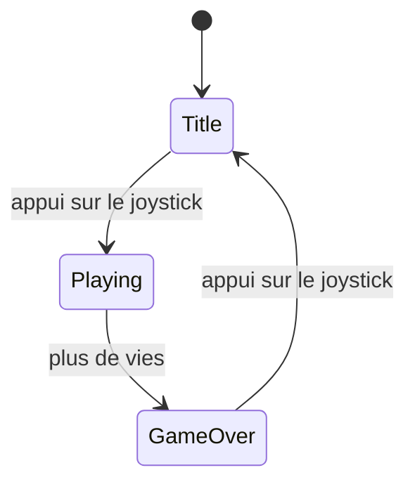

## Un premier jeu sur la console

La carte est soudée et testée : il est temps d'y faire tourner un jeu. Ce Pong se joue **seul** : la raquette en bas de l'écran suit le joystick, la balle rebondit sur les trois autres murs, et chaque balle manquée coûte une vie. Il réunit tout ce que la suite demandera : une **game loop** qui ne bloque jamais, des **collisions** fiables, un **affichage** qui ne scintille pas, et une **machine à états** pour l'accueil, la partie et la fin.

On repart du programme de test de l'étape 7 du TD2 ([Les modules de la malette](/workshops/microcontroleur/tutorials/entrees-boutons-joystick/)) : il contient déjà la game loop, la lecture du joystick, la détection d'appui et l'initialisation de l'écran.

{% include step-tuto.html
greyBackground=true
title="Étape 1 : Regrouper les données du jeu"
content="Un jeu manipule beaucoup de valeurs : positions, vitesses, score, vies, phase de jeu. Plutôt que des variables globales éparpillées, on les regroupe dans des **structures** : une `Paddle` pour la raquette, une `Ball` pour la balle, et une `Game` qui contient toute la partie.

Les positions sont des `float` (la balle peut avancer de 2,4 pixels par image) et désignent le **coin supérieur gauche** de l'objet, comme pour `fillRect()`. Le haut de l'écran est réservé à un bandeau de 24 pixels pour le score et les vies.

La phase de jeu est un `enum class` : un type qui ne peut prendre **que** les valeurs listées. Le concept FSM et le CM3 nomment ces états `MENU`, `PARTIE` et `GAME_OVER` ; ce sont les mêmes, nommés en anglais comme le reste du code."
%}

Ajoutez les réglages du jeu à `include/config.h` :

```cpp
constexpr int      SCREEN_WIDTH     = 240;
constexpr int      SCREEN_HEIGHT    = 320;
constexpr int      SCORE_BAR_HEIGHT = 24;    // bandeau du score, en haut
constexpr uint32_t FRAME_TIME_MS    = 16;    // une image toutes les 16 ms

constexpr int   PADDLE_WIDTH     = 40;
constexpr int   PADDLE_HEIGHT    = 6;
constexpr int   PADDLE_MARGIN    = 10;       // distance au bas de l'écran
constexpr float PADDLE_MAX_SPEED = 5.0f;     // pixels par image

constexpr int      BALL_SIZE      = 6;
constexpr float    BALL_SPEED     = 3.0f;    // pixels par image
constexpr uint32_t SERVE_DELAY_MS = 1000;    // pause avant chaque service
constexpr int      START_LIVES    = 3;
```

Puis, dans `src/main.cpp` :

```cpp
enum class GameState { Title, Playing, GameOver };

struct Paddle {
    float x;
    float y;
};

struct Ball {
    float x;
    float y;
    float vx;    // vitesse en pixels par image
    float vy;
};

struct Game {
    GameState state;
    Paddle    paddle;
    Ball      ball;
    int       score;        // nombre de balles renvoyées
    int       lives;
    uint32_t  serveTimeMs;  // instant où la balle sera lancée
};

static Game game;
```





```cpp
static void movePaddle(Game& g, float joystickX) {
    g.paddle.x += joystickX * PADDLE_MAX_SPEED;
    g.paddle.x  = constrain(g.paddle.x, 0.0f, (float)(SCREEN_WIDTH - PADDLE_WIDTH));
}
```

Dans `setup()` : `game.paddle.y = SCREEN_HEIGHT - PADDLE_MARGIN - PADDLE_HEIGHT;`

Les fonctions de jeu reçoivent la partie **par référence** (`Game& g`) pour la modifier. Les fonctions de dessin, plus bas, la recevront en **référence constante** (`const Game& g`) : le compilateur refusera qu'elles la modifient. La séparation entre logique et affichage est ainsi vérifiée par le compilateur.

{% include step-tuto.html
greyBackground=true
title="Étape 3 : La balle, les murs et la raquette"
content="À chaque image, la vitesse s'ajoute à la position. Sur les murs de gauche, de droite et du haut, la balle rebondit : on inverse la composante de vitesse **et on replace la balle contre le mur**. Sans ce replacement, une balle qui a dépassé de 2 pixels pourrait encore être dehors à l'image suivante : sa vitesse s'inverserait une seconde fois, et elle resterait collée au mur.

La collision avec la raquette est un test de **chevauchement de rectangles** : deux rectangles se chevauchent s'ils se chevauchent à la fois en x et en y. On ne le fait que si la balle **descend**, puis on la replace au-dessus de la raquette : sinon, une balle encore en contact à l'image suivante rebondirait en boucle à l'intérieur.

`moveBall()` renvoie `false` quand la balle sort par le bas : le joueur l'a manquée."
%}

```cpp
// Vrai si le rectangle de la balle chevauche celui de la raquette
static bool ballTouchesPaddle(const Ball& b, const Paddle& p) {
    return b.x < p.x + PADDLE_WIDTH  && b.x + BALL_SIZE > p.x &&
           b.y < p.y + PADDLE_HEIGHT && b.y + BALL_SIZE > p.y;
}

// Fait avancer la balle d'une image. Renvoie false si elle est perdue.
static bool moveBall(Game& g) {
    Ball& b = g.ball;
    b.x += b.vx;
    b.y += b.vy;

    // Murs de gauche et de droite
    if (b.x < 0) {
        b.x  = 0;
        b.vx = -b.vx;
    } else if (b.x + BALL_SIZE > SCREEN_WIDTH) {
        b.x  = SCREEN_WIDTH - BALL_SIZE;
        b.vx = -b.vx;
    }

    // Mur du haut (sous le bandeau du score)
    if (b.y < SCORE_BAR_HEIGHT) {
        b.y  = SCORE_BAR_HEIGHT;
        b.vy = -b.vy;
    }

    // Raquette, seulement si la balle descend vers elle
    if (b.vy > 0 && ballTouchesPaddle(b, g.paddle)) {
        b.y  = g.paddle.y - BALL_SIZE;
        b.vy = -b.vy;
        g.score++;
    }

    return b.y < SCREEN_HEIGHT;  // false : sortie par le bas
}
```

{% include step-tuto.html
greyBackground=true
title="Étape 4 : Le service, les vies et le score"
content="Au début de la partie, et après chaque balle perdue, la balle est **servie** : replacée en haut de l'écran, lancée vers le joueur, après une pause d'une seconde pour qu'il se prépare.

Cette pause ne doit pas bloquer le jeu avec `delay(1000)` : la raquette doit pouvoir bouger pendant ce temps. On mémorise donc l'**instant du service**, et la balle reste immobile tant qu'il n'est pas atteint : c'est la comparaison avec `millis()` de la game loop."
%}

```cpp
static void serveBall(Game& g, uint32_t nowMs) {
    g.ball.x  = (SCREEN_WIDTH - BALL_SIZE) / 2.0f;
    g.ball.y  = SCORE_BAR_HEIGHT + 20;
    g.ball.vx = random(2) ? 0.6f * BALL_SPEED : -0.6f * BALL_SPEED;  // en biais
    g.ball.vy = BALL_SPEED;                                        // vers le joueur
    g.serveTimeMs = nowMs + SERVE_DELAY_MS;
}
```

Pendant la partie, la raquette bouge toujours, et la balle seulement après le service :

```cpp
movePaddle(g, joystickX);

if (nowMs >= g.serveTimeMs && !moveBall(g)) {
    g.lives--;                            // balle manquée
    if (g.lives == 0) {
        g.state = GameState::GameOver;
    } else {
        serveBall(g, nowMs);
    }
}
```

{% include step-tuto.html
greyBackground=true
title="Étape 5 : La machine à états"
content="Le jeu a trois phases. Chaque `case` du `switch` ne contient que la logique de **sa** phase : l'accueil et l'écran de fin attendent un appui sur le joystick, la partie fait avancer le jeu (le code de l'étape 4).

Les transitions se déclenchent sur un **appui** (`justPressed()` du TD2, vrai une seule fois), pas sur un bouton **enfoncé**. Avec `digitalRead() == LOW`, un appui un peu long sur l'écran de fin renverrait à l'accueil, puis lancerait aussitôt une nouvelle partie."
%}



```cpp
static void gameUpdate(Game& g, float joystickX, bool startPressed, uint32_t nowMs) {
    switch (g.state) {
        case GameState::Title:
            if (startPressed) {
                g.score    = 0;
                g.lives    = START_LIVES;
                g.paddle.x = (SCREEN_WIDTH - PADDLE_WIDTH) / 2.0f;
                serveBall(g, nowMs);
                g.state = GameState::Playing;
            }
            break;

        case GameState::Playing:
            // le code de l'étape 4
            break;

        case GameState::GameOver:
            if (startPressed) {
                g.state = GameState::Title;
            }
            break;
    }
}
```

La `loop()` reste celle du TD2, avec ses trois temps :

```cpp
void loop() {
    static uint32_t lastFrameMs = 0;
    uint32_t nowMs = millis();
    if (nowMs - lastFrameMs < FRAME_TIME_MS) {
        return;
    }
    lastFrameMs = nowMs;

    // 1. Lire
    float joystickX   = normalizeJoystick(analogRead(PIN_JOYSTICK_X), joystickCenterX);
    bool startPressed = justPressed(selectButton);

    // 2. Calculer
    gameUpdate(game, joystickX, startPressed, nowMs);

    // 3. Afficher
    rendererDraw(game);
}
```

`selectButton` est un `Button` (TD2) sur `PIN_JOYSTICK_SELECT` ; le stick relie sa broche à GND, donc `PRESSED_LEVEL` vaut `LOW`. Dans `setup()`, la partie commence à l'accueil : `game.state = GameState::Title;`.

{% include step-tuto.html
greyBackground=true
title="Étape 6 : Afficher sans scintiller"
content="Redessiner tout l'écran à chaque image (240 × 320 pixels envoyés en SPI, 60 fois par seconde) le ferait scintiller. Deux règles :

- un **écran complet** (accueil, partie, fin) se dessine **une seule fois**, au moment où la phase change ;
- pendant la partie, on ne redessine **que ce qui bouge** : la raquette et la balle (effacer l'ancienne position, dessiner la nouvelle), et le bandeau seulement quand le score ou les vies changent.

Pour savoir ce qui a changé, l'affichage mémorise ce qui est **à l'écran** (`drawnState`, `drawnBallX`...), comme le point du TD2 avec `drawnX`."
%}

```cpp
static bool      screenIsValid = false;  // false : tout redessiner
static GameState drawnState;
static int drawnPaddleX, drawnBallX, drawnBallY, drawnScore, drawnLives;

static void rendererDraw(const Game& g) {
    // Changement de phase : on redessine l'écran complet, une fois
    if (!screenIsValid || g.state != drawnState) {
        switch (g.state) {
            case GameState::Title:    drawTitleScreen();      break;
            case GameState::Playing:  drawPlayingScreen(g);   break;
            case GameState::GameOver: drawGameOverScreen(g);  break;
        }
        drawnState    = g.state;
        screenIsValid = true;
        return;
    }

    // Même phase : seule la partie en cours bouge
    if (g.state == GameState::Playing) {
        updatePlayingScreen(g);
    }
}
```

Pendant la partie, effacer la balle peut creuser un trou dans la raquette quand elles se touchent : après l'effacement, on redessine la raquette si les deux rectangles se chevauchent.

```cpp
static bool rectsOverlap(int x1, int y1, int w1, int h1, int x2, int y2, int w2, int h2) {
    return x1 < x2 + w2 && x1 + w1 > x2 && y1 < y2 + h2 && y1 + h1 > y2;
}

static void updatePlayingScreen(const Game& g) {
    int paddleY = (int)g.paddle.y;

    // La raquette, si elle a bougé
    int px = (int)g.paddle.x;
    if (px != drawnPaddleX) {
        tft.fillRect(drawnPaddleX, paddleY, PADDLE_WIDTH, PADDLE_HEIGHT, ST77XX_BLACK);
        tft.fillRect(px, paddleY, PADDLE_WIDTH, PADDLE_HEIGHT, ST77XX_WHITE);
        drawnPaddleX = px;
    }

    // La balle, si elle a bougé
    int bx = (int)g.ball.x;
    int by = (int)g.ball.y;
    if (bx != drawnBallX || by != drawnBallY) {
        tft.fillRect(drawnBallX, drawnBallY, BALL_SIZE, BALL_SIZE, ST77XX_BLACK);
        if (rectsOverlap(drawnBallX, drawnBallY, BALL_SIZE, BALL_SIZE,
                         drawnPaddleX, paddleY, PADDLE_WIDTH, PADDLE_HEIGHT)) {
            tft.fillRect(drawnPaddleX, paddleY, PADDLE_WIDTH, PADDLE_HEIGHT, ST77XX_WHITE);
        }
        tft.fillRect(bx, by, BALL_SIZE, BALL_SIZE, ST77XX_WHITE);
        drawnBallX = bx;
        drawnBallY = by;
    }

    // Le bandeau, seulement si le score ou les vies ont changé
    if (g.score != drawnScore || g.lives != drawnLives) {
        drawScoreBar(g);
    }
}
```

Reste à écrire les écrans complets, avec le texte centré :

- `drawScoreBar()` : efface le bandeau, trace une ligne de séparation, écrit `Score 12  Vies 3` (avec `snprintf`), puis met à jour `drawnScore` et `drawnLives` ;
- `drawTitleScreen()` : `fillScreen`, le titre, et « Appuyez sur le joystick » sur deux lignes ;
- `drawGameOverScreen()` : le score final et la même invitation ;
- `drawPlayingScreen()` : `fillScreen`, le bandeau, la raquette et la balle, et l'initialisation de **toutes** les variables `drawn...`.

Pour centrer un texte, calculez sa largeur : la police par défaut fait 6 pixels de large par caractère, multipliés par la taille choisie avec `setTextSize()`.

En C++, une fonction doit être déclarée **avant** d'être appelée : placez les fonctions de dessin au-dessus de `rendererDraw()`, et `serveBall()`, `movePaddle()` et `moveBall()` au-dessus de `gameUpdate()`.



## Résultat attendu

Un Pong à un joueur complet sur la console : un écran d'accueil, une partie avec raquette, balle, score et vies, un écran de fin, et un retour à l'accueil, le tout sans `delay()` dans la boucle et sans scintillement.

## Pour aller plus loin

Ces améliorations sont indépendantes. Choisissez celles qui vous tentent, dans l'ordre que vous voulez : elles préparent toutes le projet.

### Deux joueurs

La carte a deux boutons, SW1 (D5) et SW2 (D6). Remplacez le mur du haut par une seconde raquette, déplacée vers la gauche **tant que** SW1 est enfoncé et vers la droite tant que SW2 l'est (ici, on lit le niveau, pas le front). L'astuce `(int)droite - (int)gauche` donne directement le sens : -1, 0 ou +1. Le score devient celui de chaque joueur, et la partie se gagne en 7 points.

### Un ordinateur comme adversaire

Tant que personne ne touche SW1 ou SW2, la raquette du haut peut être jouée par l'ordinateur : elle suit la balle quand celle-ci monte, revient au centre sinon, avec une vitesse limitée (un peu plus lente que le joueur) pour rester battable.

### Un angle de rebond qui dépend de l'impact

Avec `vy = -vy`, la balle repart toujours avec le même angle. Calculez plutôt la position de l'impact $h$ sur la raquette, entre $-1$ (bord gauche) et $+1$ (bord droit), puis l'angle $\theta = h \times 60°$, et décomposez la vitesse : $v_x = v \sin\theta$ et $v_y = -v \cos\theta$. Faites aussi accélérer la balle un peu à chaque renvoi.

### L'effet tunnel

Si la balle avance de plus de `BALL_SIZE + PADDLE_HEIGHT` pixels en une image, elle peut passer d'un côté à l'autre de la raquette sans jamais la chevaucher. Interdisez ce réglage dès la compilation, dans `config.h` :

```cpp
static_assert(BALL_SPEED < BALL_SIZE + PADDLE_HEIGHT,
              "BALL_SPEED trop grand : la balle pourrait traverser la raquette");
```

### Découper le programme en modules

Quand `main.cpp` dépasse quelques centaines de lignes, rangez-le en modules : `input.h/.cpp` (lecture des commandes), `game.h/.cpp` (règles, sans aucun dessin), `renderer.h/.cpp` (dessin, sans aucune décision), et un `main.cpp` réduit à la game loop. Chaque `.h` déclare ce que le module **offre**, chaque `.cpp` **comment** il le fait, avec ses fonctions internes en `static`. Le projet Snake gagnera beaucoup à démarrer ainsi.


