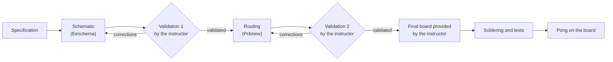
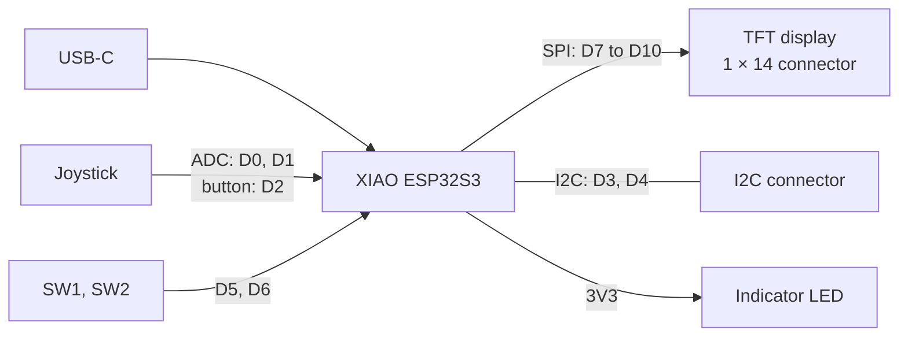

## The approach

In Lab 2, the modules of the kit lived on a breadboard. In Lab 3, they move onto a **printed circuit board** (PCB): no more wires coming loose, a console that fits in your hand. You design **your** board in KiCad, in two steps validated by the instructor during the session; then, in Lab 4, you solder the final board provided and run the Pong on it:



## The specification

The board must be **compatible with the Lab 2 code**: a program that works on the breadboard must work as is on the board. The pinout is therefore imposed; the rest is to be designed and justified.

### The functions

| Function | Imposed component | To design |
|---|---|---|
| Microcontroller | Seeed Studio XIAO ESP32S3, on its headers | |
| Display | 14-pin SPI TFT display module, plugged into a 1 × 14 connector at a 2.54 mm pitch | Wiring of the connector (see below) |
| Player 1 control | SparkFun analog joystick (*thumb joystick*), soldered on the board | |
| Player 2 control | Two 6 × 6 mm SMD push buttons | Protection of pin D6 |
| Extension | 4-pin I2C connector (3V3, SDA, SCL, GND) | Bus pull-up resistors |
| Indicator | An LED that lights up when the board is powered | Series resistor |
| Power | Through the XIAO's USB-C, distributed at 3.3 V | Decoupling |

### The imposed pinout

This is the Lab 2 wiring (without the buzzer, which is not on the board); it must not change.

| XIAO pin | Signal |
|---|---|
| D0 | Joystick, X axis |
| D1 | Joystick, Y axis |
| D2 | Joystick, button (pressing the stick) |
| D3 | I2C: SDA |
| D4 | I2C: SCL |
| D5 | Button SW1 (left), to GND |
| D6 | Button SW2 (right), to GND |
| D7 | Display: RESET |
| D8 | Display: DC |
| D9 | Display: SCK |
| D10 | Display: MOSI |

The display connector follows the standard pinout of 14-pin SPI TFT modules. **Check it against your module's silkscreen** before drawing the schematic:

| Module pin | Signal | Connect to |
|---|---|---|
| 1 | VCC | 3V3 |
| 2 | GND | GND |
| 3 | CS | GND (the display is alone on the SPI bus) |
| 4 | RESET | D7 |
| 5 | DC | D8 |
| 6 | SDI (MOSI) | D10 |
| 7 | SCK | D9 |
| 8 | LED (backlight) | 3V3 |
| 9 | SDO (MISO) | Not connected |
| 10 to 14 | Touch panel (T_CLK, T_CS, T_DIN, T_DO, T_IRQ) | Not connected |

### The points to design (and justify)

Each of these choices must appear in your schematic, with its justification in the board's documentation:

- **Pin D6** is also UART0's TX output: the chip sends messages on it at boot. What happens if SW2 connects it directly to GND during that time, and how do you avoid it? (See the concept [GPIO & the digital world](/workshops/microcontroleur/concepts/gpio-monde-numerique/).)
- **The buttons** do not need an external pull-up resistor: why? (See the tutorial [The modules of the kit](/workshops/microcontroleur/tutorials/entrees-boutons-joystick/).)
- **The I2C bus** needs pull-up resistors: where, and of what value? (See the concept [Communication buses](/workshops/microcontroleur/concepts/bus-communication/).)
- **The indicator LED**: which resistor for a current of a few mA at 3.3 V? (The calculator in the GPIO concept helps you.)
- **Decoupling**: which capacitors, and where should they go to be useful?
- **The joystick** is powered at 3V3, never at 5 V: why? (See the concept [ADC & PWM](/workshops/microcontroleur/concepts/adc-pwm/).)

### The manufacturing constraints

| Constraint | Value |
|---|---|
| Dimensions | 90 × 50 mm |
| Layers | 2 (copper top and bottom) |
| Mounting | 4 M3 mounting holes, one in each corner |
| SMD components | **1206** package at the smallest (hand soldering) |
| Track width | 0.2 mm minimum; wider for power |
| Clearance between tracks | 0.2 mm minimum |
| Vias | 0.7 mm diameter, 0.3 mm drill |

These are the limits of a manufacturer such as AISLER, which publishes its design rules for KiCad: you can import them into your project's design rules.

{% include step-tuto.html
greyBackground=true
title="Step 1: Create the project and import the libraries"
content="Create a KiCad project in the folder of your repo intended for the board. The XIAO and the joystick are not part of KiCad's standard libraries:

- **XIAO ESP32S3**: the [Seeed Studio KiCad library](https://github.com/Seeed-Studio/OPL_Kicad_Library), XIAO series folder;
- **Joystick**: the [SparkFun KiCad libraries](https://github.com/sparkfun/SparkFun-KiCad-Libraries), which can also be installed from KiCad's *Plugin and Content Manager*;
- **Common components** (1206 resistors and capacitors, buttons): KiCad's standard libraries, or the [MakerSpace library](/docs/tutorials/software/kicad/kicad-import-librairies/).

Add them **to the project** (not to your installation): the project then stays self-contained, and opens on another computer without installing anything. The method is detailed in [KiCad: importing libraries](/docs/tutorials/software/kicad/kicad-import-librairies/)."
%}

{% include step-tuto.html
greyBackground=true
title="Step 2: Draw the schematic"
content="Start with a **block diagram** on paper: the XIAO in the middle, the display, the controls, the I2C connector and the power supply around it. Then, in Eeschema:

- place the symbols, starting with the XIAO and the connectors;
- connect the signals with **labels** (`SCK`, `MOSI`, `SDA`...) rather than long wires: the schematic stays readable;
- place the power symbols (`+3V3`, `GND`) and the elements of your design choices (resistors, LED, capacitors);
- give each component a **value**, then annotate the schematic (R1, C1, SW1...);
- fill in the **title block**: title, your names, date, revision.

The basics are in [KiCad Eeschema: the basics](/docs/tutorials/software/kicad/kicad-eeschema-bases/)."
%}



### Checklist for validation 1

- [ ] The ERC reports no error (the remaining warnings are understood and justified)
- [ ] The XIAO pinout is exactly the one in the specification
- [ ] The display connector matches the silkscreen of **your** module
- [ ] Each design choice (D6, I2C, LED, decoupling) is present and justified in writing
- [ ] Each component has a value and a footprint (1206 package for SMD parts)
- [ ] The title block is filled in, the schematic PDF is in the repo

{% include step-tuto.html
greyBackground=true
title="Step 4: Prepare the routing"
content="Once the schematic is validated, update the PCB from the schematic (the footprints arrive in a heap, connected by the **ratsnest**). Then:

- draw the board **outline** (90 × 50 mm) on the `Edge.Cuts` layer;
- place the 4 M3 **mounting holes** in the corners;
- set the **design rules** (widths, clearances, vias) according to the specification;
- **place** the components before drawing a single track: this is the step that decides the quality of the routing.

For the placement, think about how it is used: the console is held with both hands. The joystick under one thumb, the buttons under the other, the display visible between the two, the XIAO's USB-C connector accessible from an edge. Check your display module's datasheet for its real footprint: it must cover neither the joystick nor the buttons. KiCad's 3D viewer helps a lot to judge the result."
%}

{% include step-tuto.html
greyBackground=true
title="Step 5: Route the board"
content="Draw the tracks following the ratsnest:

- the **decoupling capacitors** as close as possible to the power pins they protect;
- the **power tracks** wider than the signal tracks;
- **short and direct** tracks for the display's SPI bus (the fastest signals on the board);
- 45° angles rather than 90°;
- a **ground plane** (copper zone connected to GND) on the back side, or even on both sides, once the tracks are laid.

Add useful **silkscreen**: button names (SW1, SW2), pin 1 of each connector, your names and the board revision. The basics are in [KiCad Pcbnew: the basics](/docs/tutorials/software/kicad/kicad-pcbnew-bases/)."
%}



### Checklist for validation 2

- [ ] The DRC reports no error, and no connection is left unrouted
- [ ] The board measures 90 × 50 mm, with an M3 hole in each corner
- [ ] The placement is ergonomic: joystick and buttons under the thumbs, display visible, USB-C accessible
- [ ] The decoupling capacitors are as close as possible to their pins
- [ ] The power tracks are wider than the signal tracks
- [ ] A ground plane is in place
- [ ] The silkscreen shows SW1, SW2, pin 1 of the connectors, your names and the revision
- [ ] The KiCad files and screenshots (2D and 3D) are in the repo

## Documenting the board

The board is documented in your repo just like the firmware: schematic as PDF, screenshots of the routing and the 3D view, pinout table, and above all **the justification of your design choices**. The tutorial [Documenting a circuit board](/workshops/methodologie-de-projet/tutorials/documenter-carte-electronique/) details what is expected.


