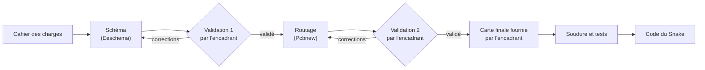

## La démarche

Pendant les TD, la console vivait sur une breadboard. Pour le projet, elle passe sur un **circuit imprimé** (PCB) : plus de fils qui se débranchent, une console qui tient dans la main. C'est la **première étape du projet** : chaque binôme conçoit **sa** carte sous KiCad, en deux étapes validées par l'encadrant, puis soude la carte finale fournie avant d'écrire le code du Snake :

{% include message.html title="Pourquoi une carte fournie ?" message="Fabriquer un PCB chez un fournisseur prend une à trois semaines, souvent plus que la durée du projet. Une fois votre routage validé, l'encadrant vous remet donc **sa** carte finale, déjà fabriquée selon le même cahier des charges, que vous souderez avant d'écrire le code du projet. Votre conception reste un livrable à part entière : elle est évaluée, et comparée à la carte finale lors de la revue." status="is-info" icon="fas fa-info-circle" %}

## Le cahier des charges

La carte doit être **compatible avec le code des TD** : un programme qui fonctionne sur la breadboard doit fonctionner tel quel sur la carte. Le brochage est donc imposé ; le reste est à concevoir et à justifier.

### Les fonctions

| Fonction | Composant imposé | À concevoir |
|---|---|---|
| Microcontrôleur | Seeed Studio XIAO ESP32S3, sur ses barrettes | |
| Affichage | Module écran TFT SPI 14 broches, branché sur un connecteur 1 × 14 au pas de 2,54 mm | Câblage du connecteur (voir plus bas) |
| Commande du joueur 1 | Joystick analogique SparkFun (*thumb joystick*), à souder sur la carte | |
| Commande du joueur 2 | Deux boutons poussoirs CMS 6 × 6 mm | Protection de la broche D6 |
| Extension | Connecteur I2C 4 broches (3V3, SDA, SCL, GND) | Résistances de tirage du bus |
| Témoin | Une LED qui s'allume quand la carte est alimentée | Résistance série |
| Alimentation | Par l'USB-C de la XIAO, distribuée en 3,3 V | Découplage |

### Le brochage imposé

C'est le câblage des TD ; il ne doit pas changer.

| Broche XIAO | Signal |
|---|---|
| D0 | Joystick, axe X |
| D1 | Joystick, axe Y |
| D2 | Joystick, bouton (appui sur le stick) |
| D3 | I2C : SDA |
| D4 | I2C : SCL |
| D5 | Bouton SW1 (gauche), vers GND |
| D6 | Bouton SW2 (droite), vers GND |
| D7 | Écran : RESET |
| D8 | Écran : DC |
| D9 | Écran : SCK |
| D10 | Écran : MOSI |

Le connecteur de l'écran suit le brochage standard des modules TFT SPI 14 broches. **Vérifiez-le sur la sérigraphie de votre module** avant de dessiner le schéma :

| Broche du module | Signal | À relier à |
|---|---|---|
| 1 | VCC | 3V3 |
| 2 | GND | GND |
| 3 | CS | GND (l'écran est seul sur le bus SPI) |
| 4 | RESET | D7 |
| 5 | DC | D8 |
| 6 | SDI (MOSI) | D10 |
| 7 | SCK | D9 |
| 8 | LED (rétroéclairage) | 3V3 |
| 9 | SDO (MISO) | Non connecté |
| 10 à 14 | Dalle tactile (T_CLK, T_CS, T_DIN, T_DO, T_IRQ) | Non connectés |

### Les points à concevoir (et à justifier)

Chacun de ces choix doit apparaître dans votre schéma, avec sa justification dans la documentation de la carte :

- **La broche D6** est aussi la sortie TX de l'UART0 : la puce y émet des messages au démarrage. Que se passe-t-il si SW2 la relie directement à GND pendant ce temps, et comment l'éviter ? (Voir le concept [GPIO & monde numérique](/workshops/microcontroleur/concepts/gpio-monde-numerique/).)
- **Les boutons** n'ont pas besoin de résistance de tirage externe : pourquoi ? (Voir le tutoriel [Boutons, joystick et moniteur série](/workshops/microcontroleur/tutorials/entrees-boutons-joystick/).)
- **Le bus I2C** a besoin de résistances de tirage : où, et de quelle valeur ? (Voir le concept [Les bus de communication](/workshops/microcontroleur/concepts/bus-communication/).)
- **La LED témoin** : quelle résistance pour un courant de quelques mA sous 3,3 V ? (Le calculateur du concept GPIO vous aide.)
- **Le découplage** : quels condensateurs, et où les placer pour qu'ils soient utiles ?
- **Le joystick** est alimenté en 3V3, jamais en 5 V : pourquoi ? (Voir le concept [ADC & PWM](/workshops/microcontroleur/concepts/adc-pwm/).)

### Les contraintes de fabrication

| Contrainte | Valeur |
|---|---|
| Dimensions | 90 × 50 mm |
| Couches | 2 (cuivre dessus et dessous) |
| Fixation | 4 trous de montage M3, un dans chaque coin |
| Composants CMS | Boîtier **1206** au minimum (soudure au fer) |
| Largeur de piste | 0,2 mm minimum ; plus large pour l'alimentation |
| Isolement entre pistes | 0,2 mm minimum |
| Vias | Diamètre 0,7 mm, perçage 0,3 mm |

Ce sont les limites d'un fabricant comme AISLER, qui publie ses règles de vérification pour KiCad : vous pouvez les importer dans les règles de conception de votre projet.

{% include step-tuto.html
greyBackground=true
title="Étape 1 : Créer le projet et importer les librairies"
content="Créez un projet KiCad dans le dossier de votre repo prévu pour la carte. La XIAO et le joystick ne font pas partie des librairies standard de KiCad :

- **XIAO ESP32S3** : la librairie KiCad officielle de Seeed Studio (symbole et empreintes de la série XIAO) ;
- **Joystick** : les librairies KiCad de SparkFun, installables depuis le gestionnaire de plugins et contenus de KiCad (*Plugin and Content Manager*) ou depuis leur dépôt GitHub ;
- **Composants courants** (résistances et condensateurs 1206, boutons) : les librairies standard de KiCad, ou la [librairie du MakerSpace](/docs/tutorials/software/kicad/kicad-import-librairies/).

Ajoutez-les **au projet** (et non à votre installation) : le repo reste alors autonome, et votre binôme l'ouvre sans rien installer. La méthode est détaillée dans [KiCAD : importer des librairies](/docs/tutorials/software/kicad/kicad-import-librairies/)."
%}

{% include step-tuto.html
greyBackground=true
title="Étape 2 : Dessiner le schéma"
content="Commencez par un **schéma bloc** sur papier : la XIAO au centre, l'écran, les commandes, le connecteur I2C et l'alimentation autour. Puis, dans Eeschema :

- placez les symboles, en commençant par la XIAO et les connecteurs ;
- reliez les signaux avec des **étiquettes** (`SCK`, `MOSI`, `SDA`...) plutôt qu'avec de longs fils : le schéma reste lisible ;
- placez les symboles d'alimentation (`+3V3`, `GND`) et les éléments de vos choix de conception (résistances, LED, condensateurs) ;
- donnez une **valeur** à chaque composant, puis annotez le schéma (R1, C1, SW1...) ;
- remplissez le **cartouche** : titre, binôme, date, révision.

Les bases sont dans [KiCAD Eeschema : les bases](/docs/tutorials/software/kicad/kicad-eeschema-bases/)."
%}

{% include step-tuto.html
greyBackground=true
title="Étape 3 : Vérifier puis faire valider le schéma"
content="Lancez la **vérification des règles électriques** (ERC) et corrigez chaque erreur : broche non connectée, alimentation non pilotée (ajoutez un symbole `PWR_FLAG` là où l'alimentation entre sur la carte), conflit de sorties. Une broche volontairement libre (les broches tactiles de l'écran) reçoit un marqueur de non-connexion.

Exportez ensuite le schéma en PDF et présentez-le à l'encadrant avec votre liste de contrôle remplie."
%}

### Liste de contrôle pour la validation 1

- [ ] L'ERC ne signale aucune erreur (les avertissements restants sont compris et justifiés)
- [ ] Le brochage de la XIAO est exactement celui du cahier des charges
- [ ] Le connecteur de l'écran correspond à la sérigraphie de **votre** module
- [ ] Chaque choix de conception (D6, I2C, LED, découplage) est présent et justifié par écrit
- [ ] Chaque composant a une valeur et une empreinte (boîtier 1206 pour les CMS)
- [ ] Le cartouche est rempli, le PDF du schéma est dans le repo

{% include step-tuto.html
greyBackground=true
title="Étape 4 : Préparer le routage"
content="Une fois le schéma validé, mettez à jour le PCB depuis le schéma (les empreintes arrivent en vrac, reliées par le **chevelu**). Puis :

- dessinez le **contour** de la carte (90 × 50 mm) sur la couche `Edge.Cuts` ;
- placez les 4 **trous de montage** M3 dans les coins ;
- réglez les **règles de conception** (largeurs, isolements, vias) selon le cahier des charges ;
- **placez** les composants avant de tracer la moindre piste : c'est l'étape qui décide de la qualité du routage.

Pour le placement, pensez à l'usage : la console se tient à deux mains. Le joystick sous un pouce, les boutons sous l'autre, l'écran visible entre les deux, le connecteur USB-C de la XIAO accessible depuis un bord. Vérifiez sur la fiche de votre module écran son encombrement réel : il ne doit recouvrir ni le joystick ni les boutons. Le visualiseur 3D de KiCad aide beaucoup à juger le résultat."
%}

{% include step-tuto.html
greyBackground=true
title="Étape 5 : Router la carte"
content="Tracez les pistes en suivant le chevelu :

- les **condensateurs de découplage** au plus près des broches d'alimentation qu'ils protègent ;
- les **pistes d'alimentation** plus larges que les pistes de signal ;
- des pistes **courtes et directes** pour le bus SPI de l'écran (les signaux les plus rapides de la carte) ;
- des angles à 45° plutôt qu'à 90° ;
- un **plan de masse** (zone de cuivre reliée à GND) sur la face arrière, voire sur les deux faces, une fois les pistes posées.

Ajoutez une **sérigraphie** utile : nom des boutons (SW1, SW2), broche 1 de chaque connecteur, nom du binôme et révision de la carte. Les bases sont dans [KiCAD Pcbnew : les bases](/docs/tutorials/software/kicad/kicad-pcbnew-bases/)."
%}



### Liste de contrôle pour la validation 2

- [ ] Le DRC ne signale aucune erreur, et plus aucune connexion n'est en attente
- [ ] La carte mesure 90 × 50 mm, avec un trou M3 dans chaque coin
- [ ] Le placement est ergonomique : joystick et boutons sous les pouces, écran visible, USB-C accessible
- [ ] Les condensateurs de découplage sont au plus près de leurs broches
- [ ] Les pistes d'alimentation sont plus larges que les pistes de signal
- [ ] Un plan de masse est en place
- [ ] La sérigraphie indique SW1, SW2, la broche 1 des connecteurs, le binôme et la révision
- [ ] Les fichiers KiCad et des captures (2D et 3D) sont dans le repo

## Documenter la carte

La carte se documente dans votre repo comme le firmware : schéma en PDF, captures du routage et de la vue 3D, tableau du brochage, et surtout **la justification de vos choix de conception**. Le tutoriel [Documenter une carte électronique](/workshops/methodologie-de-projet/tutorials/documenter-carte-electronique/) détaille ce qui est attendu.


