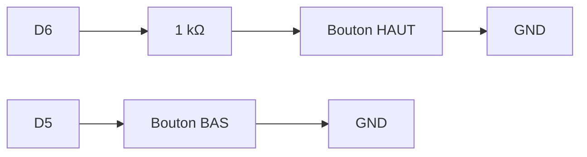
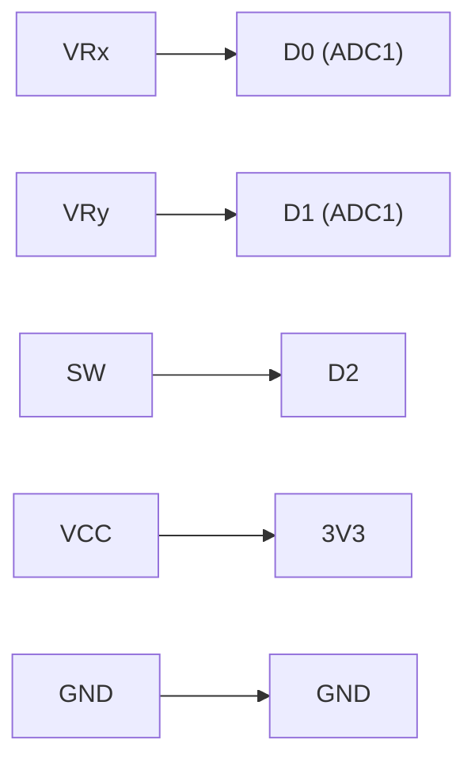

## Entrées : boutons + joystick + série

Ce tutoriel ajoute les **entrées** du montage Pong : les deux boutons du joueur 1, et le joystick du joueur 2 (qui sert aussi de bouton START/RETRY pour le menu du jeu). Le câblage posé ici est **figé** : il ne change plus jusqu'au projet.

### Numérique vs analogique, en un coup d'œil

Ce tutoriel manipule les deux natures de signal qu'une broche sait lire : le **tout-ou-rien** des boutons et la **valeur continue** du joystick.

| | Numérique | Analogique |
|---|---|---|
| Valeurs possibles | 2 (`LOW` / `HIGH`) | continues (0 à 3,3 V) |
| Fonction Arduino | `digitalRead` | `analogRead` (ADC) |
| Exemple ici | les boutons | les axes du joystick |

### Câblage figé de l'atelier

Les broches sont désignées par leur nom sérigraphié sur la XIAO (`D0` à `D10`), que le code accepte tel quel. Le numéro de GPIO correspondant est donné entre parenthèses (voir la fiche [XIAO ESP32S3](/docs/references/hardware/xiao-esp32s3/)).

| Rôle | Broche | Type |
|---|---|---|
| Bouton joueur 1 : HAUT | D6 (GPIO43), via 1 kΩ | `INPUT_PULLUP` |
| Bouton joueur 1 : BAS | D5 (GPIO6) | `INPUT_PULLUP` |
| Joystick joueur 2 : X | D0 (GPIO1, **ADC1**) | `analogRead` |
| Joystick joueur 2 : Y | D1 (GPIO2, **ADC1**) | `analogRead` |
| Bouton du joystick (START/RETRY) | D2 (GPIO3) | `INPUT_PULLUP` |

C'est le câblage du PCB du projet : en le respectant dès la breadboard, ton code fonctionnera sans modification sur la carte soudée.



### Pourquoi INPUT_PULLUP plutôt qu'une résistance externe ?

Trois modes existent pour configurer une broche en entrée :

| Mode | Comportement au repos | Câblage requis |
|---|---|---|
| `INPUT` | flottant (valeur indéterminée) | résistance externe obligatoire |
| `INPUT_PULLUP` | HIGH (tiré vers 3,3 V en interne) | bouton vers GND : **notre cas** |
| `INPUT_PULLDOWN` | LOW (tiré vers GND en interne) | bouton vers 3,3 V |

`INPUT_PULLUP` évite toute soudure de résistance sur les 3 boutons du montage. C'est pour ça que le tableau ci-dessus ne mentionne pas de résistance de rappel sur les lignes D5, D6 et D2. La résistance de 1 kΩ sur D6 joue un autre rôle, expliqué à l'étape 1.

{% include step-tuto.html
greyBackground=true
title="1 - Câbler les deux boutons du joueur 1"
content="Relie chaque bouton entre sa broche et la **masse (GND)**. Pas besoin de résistance de rappel : on active le **pull-up interne** de l'ESP32-S3 par logiciel.

Le bouton HAUT passe en plus par une **résistance de 1 kΩ** en série. D6 est aussi la broche TX de l'UART0 : au démarrage, avant ton programme, la puce y **émet** ses messages de boot. Si le bouton était enfoncé à ce moment-là, cette sortie serait court-circuitée à la masse ; la résistance limite le courant à quelques mA. Une fois ton programme lancé, D6 est une entrée et la résistance ne gêne pas la lecture (1 kΩ face aux ~45 kΩ du pull-up : la broche lit bien `LOW`)."
%}



```cpp
#include <Arduino.h>

#define BTN_HAUT D6   // GPIO43
#define BTN_BAS  D5   // GPIO6

void setup() {
  Serial.begin(115200);
  pinMode(BTN_HAUT, INPUT_PULLUP);
  pinMode(BTN_BAS, INPUT_PULLUP);
}
```

{% include step-tuto.html
greyBackground=true
title="2 - Détecter un appui, une seule fois"
content="Avec `INPUT_PULLUP`, la logique est **inversée** : la broche lit `LOW` quand le bouton est pressé.

Lire simplement `digitalRead(pin) == LOW` ne suffit pas, pour deux raisons :

- tant que le doigt reste sur le bouton, la condition est vraie à **chaque tour** de `loop()` : un seul appui afficherait des centaines de lignes ;
- un appui mécanique produit des **rebonds** (plusieurs transitions HIGH/LOW parasites en quelques millisecondes, visibles à l'oscilloscope) : un seul appui ressemblerait à plusieurs.

On ne cherche donc pas *« le bouton est-il enfoncé ? »* mais *« le bouton vient-il d'être enfoncé ? »* : c'est la détection de **front**. Et on ne valide ce front que si le signal est resté stable pendant 30 ms : c'est l'**anti-rebond**."
%}

```cpp
const unsigned long ANTIREBOND = 30;  // ms

struct Bouton {
  int pin;
  int etatStable;                     // dernier état confirmé (HIGH = relâché)
  int dernierLu;                      // dernière lecture brute
  unsigned long dernierChangement;    // date du dernier mouvement du signal
};

Bouton btnHaut = {BTN_HAUT, HIGH, HIGH, 0};
Bouton btnBas  = {BTN_BAS,  HIGH, HIGH, 0};

// Renvoie true une seule fois par appui, au moment où il est confirmé
bool vientDEtrePresse(Bouton &b) {
  int lu = digitalRead(b.pin);
  if (lu != b.dernierLu) {            // le signal bouge : rebond ou vrai changement
    b.dernierLu = lu;
    b.dernierChangement = millis();
  }
  if (millis() - b.dernierChangement > ANTIREBOND && lu != b.etatStable) {
    b.etatStable = lu;                // stable depuis 30 ms : changement confirmé
    return b.etatStable == LOW;       // vrai sur l'appui, faux sur le relâchement
  }
  return false;
}

void loop() {
  if (vientDEtrePresse(btnHaut)) {
    Serial.println("Joueur 1 : HAUT");
  }
  if (vientDEtrePresse(btnBas)) {
    Serial.println("Joueur 1 : BAS");
  }
}
```

Chaque bouton garde sa propre mémoire (la `struct Bouton`) : c'est ce qui permet de savoir s'il **vient** de changer. La fonction ne bloque jamais : pas de `delay()`, seulement une comparaison avec `millis()`, comme dans le concept [Du matériel au logiciel](/workshops/microcontroleur/concepts/du-materiel-au-logiciel/).

{% include message.html title="Pourquoi pas un simple delay(20) ?" message="On voit souvent un anti-rebond écrit avec `delay(20)` après la première lecture. Il fige tout le programme pendant 20 ms à chaque appui, et ne règle pas la répétition quand le bouton reste enfoncé. Avec un écran à rafraîchir 60 fois par seconde (tutoriel [Écran SPI et game loop](/docs/tutorials/electronics/ecran-spi-game-loop/)), ces 20 ms se verraient : la version ci-dessus est celle que tu réutiliseras jusqu'au projet." status="is-info" icon="fas fa-info-circle" %}









Contrairement aux boutons (`0` ou `1`), les axes du joystick renvoient une **valeur continue** convertie en nombre par l'ADC 12 bits de l'ESP32-S3, soit $2^{12} = 4096$ valeurs possibles :

| Position du stick | Tension | Valeur ADC |
|---|---|---|
| Butée gauche/bas | 0 V | 0 |
| Centre (repos) | 1,65 V | ≈ 2048 |
| Butée droite/haut | 3,3 V | 4095 |

Ce programme de test remplace temporairement le précédent :

```cpp
#include <Arduino.h>

#define JOY_X   D0   // GPIO1
#define JOY_Y   D1   // GPIO2
#define JOY_BTN D2   // GPIO3

void setup() {
  Serial.begin(115200);
  pinMode(JOY_BTN, INPUT_PULLUP);
  // JOY_X et JOY_Y n'ont pas besoin de pinMode : analogRead() les configure.
}

void loop() {
  int x = analogRead(JOY_X);   // 0 à 4095
  int y = analogRead(JOY_Y);   // 0 à 4095
  bool pressed = digitalRead(JOY_BTN) == LOW;

  Serial.printf("x=%d y=%d btn=%d\n", x, y, pressed);
  delay(100);                  // programme de test : on ralentit l'affichage
}
```





```cpp
enum Direction { CENTRE, HAUT, BAS, GAUCHE, DROITE };

Direction lireDirection() {
  int x = analogRead(JOY_X);
  int y = analogRead(JOY_Y);

  const int SEUIL_BAS  = 1500;
  const int SEUIL_HAUT = 2500;

  if (x < SEUIL_BAS)       return GAUCHE;
  if (x > SEUIL_HAUT)      return DROITE;
  if (y < SEUIL_BAS)       return BAS;
  if (y > SEUIL_HAUT)      return HAUT;
  return CENTRE;
}

// Un enum est un nombre : cette fonction le traduit en texte pour l'affichage
const char* nomDirection(Direction d) {
  switch (d) {
    case HAUT:   return "HAUT";
    case BAS:    return "BAS";
    case GAUCHE: return "GAUCHE";
    case DROITE: return "DROITE";
    default:     return "CENTRE";
  }
}

void loop() {
  static Direction precedente = CENTRE;   // static : garde sa valeur d'un tour à l'autre

  Direction d = lireDirection();
  if (d != precedente) {
    Serial.printf("Joystick : %s\n", nomDirection(d));
    precedente = d;
  }
}
```

Les seuils `1500` et `2500` découpent la plage `0-4095` en trois zones, centrées sur la valeur de repos (≈2048) :

| Zone | Plage | Direction |
|---|---|---|
| Butée basse | `0` – `1499` | GAUCHE (X) / BAS (Y) |
| **Zone morte** | `1500` – `2500` | CENTRE |
| Butée haute | `2501` – `4095` | DROITE (X) / HAUT (Y) |

La zone morte `1500`-`2500` (large de 1000 sur les 4096 valeurs) absorbe le bruit électrique et l'imprécision mécanique du potentiomètre autour de la position de repos, sans réduire perceptiblement la course utile du stick.





```cpp
#include <Arduino.h>

#define BTN_HAUT D6   // GPIO43
#define BTN_BAS  D5   // GPIO6
#define JOY_X    D0   // GPIO1
#define JOY_Y    D1   // GPIO2
#define JOY_BTN  D2   // GPIO3

const unsigned long ANTIREBOND = 30;  // ms

struct Bouton {
  int pin;
  int etatStable;
  int dernierLu;
  unsigned long dernierChangement;
};

Bouton btnHaut = {BTN_HAUT, HIGH, HIGH, 0};
Bouton btnBas  = {BTN_BAS,  HIGH, HIGH, 0};
Bouton btnJoy  = {JOY_BTN,  HIGH, HIGH, 0};

bool vientDEtrePresse(Bouton &b) {
  int lu = digitalRead(b.pin);
  if (lu != b.dernierLu) {
    b.dernierLu = lu;
    b.dernierChangement = millis();
  }
  if (millis() - b.dernierChangement > ANTIREBOND && lu != b.etatStable) {
    b.etatStable = lu;
    return b.etatStable == LOW;
  }
  return false;
}

enum Direction { CENTRE, HAUT, BAS, GAUCHE, DROITE };

Direction lireDirection() {
  int x = analogRead(JOY_X);
  int y = analogRead(JOY_Y);

  const int SEUIL_BAS  = 1500;
  const int SEUIL_HAUT = 2500;

  if (x < SEUIL_BAS)  return GAUCHE;
  if (x > SEUIL_HAUT) return DROITE;
  if (y < SEUIL_BAS)  return BAS;
  if (y > SEUIL_HAUT) return HAUT;
  return CENTRE;
}

const char* nomDirection(Direction d) {
  switch (d) {
    case HAUT:   return "HAUT";
    case BAS:    return "BAS";
    case GAUCHE: return "GAUCHE";
    case DROITE: return "DROITE";
    default:     return "CENTRE";
  }
}

void setup() {
  Serial.begin(115200);
  pinMode(BTN_HAUT, INPUT_PULLUP);
  pinMode(BTN_BAS, INPUT_PULLUP);
  pinMode(JOY_BTN, INPUT_PULLUP);
}

void loop() {
  if (vientDEtrePresse(btnHaut)) Serial.println("Joueur 1 : HAUT");
  if (vientDEtrePresse(btnBas))  Serial.println("Joueur 1 : BAS");
  if (vientDEtrePresse(btnJoy))  Serial.println("Joueur 2 : START/RETRY");

  static Direction precedente = CENTRE;
  Direction d = lireDirection();
  if (d != precedente) {
    Serial.printf("Joueur 2 : %s\n", nomDirection(d));
    precedente = d;
  }
}
```

La `loop()` ne contient plus aucun `delay()` : elle tourne des dizaines de milliers de fois par seconde et ne rate aucun appui, et le moniteur série n'affiche une ligne que lorsqu'il se passe quelque chose.

## Résultat attendu

À la fin de ce tutoriel, le moniteur série affiche en temps réel, sans répétition parasite :

- `Joueur 1 : HAUT` / `Joueur 1 : BAS`, une fois par appui sur les boutons du joueur 1 ;
- `Joueur 2 : GAUCHE`, `DROITE`, `HAUT`, `BAS` ou `CENTRE`, à chaque changement de direction du joystick ;
- `Joueur 2 : START/RETRY`, une fois par appui sur le bouton du joystick.


