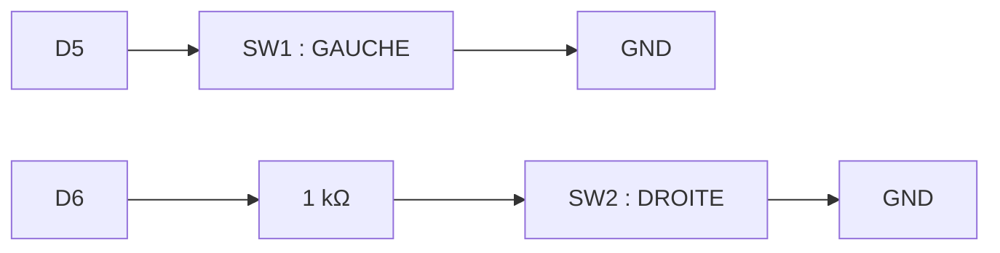
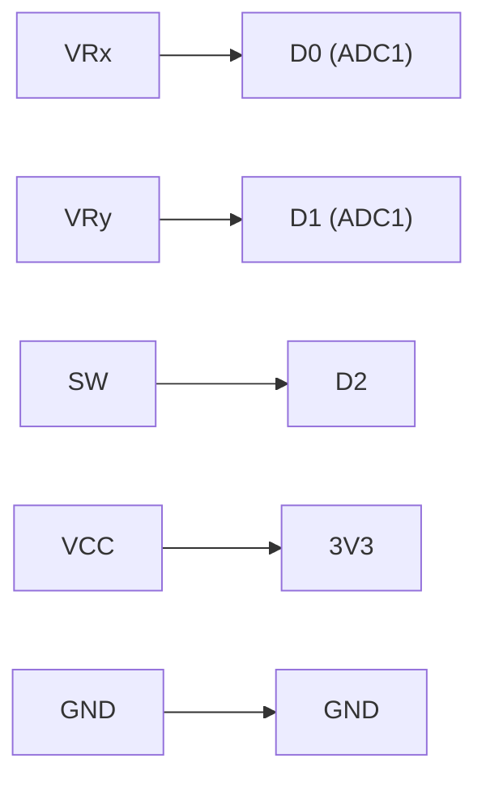

## Entrées : boutons + joystick + série

Ce tutoriel ajoute les **entrées** du montage Pong : le joystick du joueur 1 (qui sert aussi de bouton START pour le menu du jeu) et les deux boutons du joueur 2. Le câblage posé ici est **figé** : il ne change plus jusqu'au projet.

À la fin, toute la lecture des commandes tient dans un **module** `input` (un fichier `.h` et un fichier `.cpp`) : c'est le premier des quatre modules du Pong final.

### Numérique vs analogique, en un coup d'œil

Ce tutoriel manipule les deux natures de signal qu'une broche sait lire : le **tout-ou-rien** des boutons et la **valeur continue** du joystick.

| | Numérique | Analogique |
|---|---|---|
| Valeurs possibles | 2 (`LOW` / `HIGH`) | continues (0 à 3,3 V) |
| Fonction Arduino | `digitalRead` | `analogRead` (ADC) |
| Exemple ici | les boutons | les axes du joystick |

### Câblage figé de l'atelier

Les broches sont désignées par leur nom sérigraphié sur la XIAO (`D0` à `D10`), que le code accepte tel quel. Le numéro de GPIO correspondant est donné entre parenthèses (voir la fiche [XIAO ESP32S3](/docs/references/hardware/xiao-esp32s3/)).

| Rôle | Broche | Type |
|---|---|---|
| Joystick joueur 1 : axe X | D0 (GPIO1, **ADC1**) | `analogRead` |
| Joystick : axe Y (inutilisé par le Pong) | D1 (GPIO2, **ADC1**) | `analogRead` |
| Bouton du joystick (START) | D2 (GPIO3) | `INPUT_PULLUP` |
| Bouton joueur 2 : GAUCHE (SW1) | D5 (GPIO6) | `INPUT_PULLUP` |
| Bouton joueur 2 : DROITE (SW2) | D6 (GPIO43), via 1 kΩ | `INPUT_PULLUP` |

C'est le câblage du PCB du projet : en le respectant dès la breadboard, ton code fonctionnera sans modification sur la carte soudée. Dans le Pong, l'écran est tenu en portrait : les raquettes sont en bas (joueur 1) et en haut (joueur 2) et se déplacent de gauche à droite. Seul l'axe X du joystick sert donc au jeu ; l'axe Y servira au Snake du projet.



### Pourquoi INPUT_PULLUP plutôt qu'une résistance externe ?

Trois modes existent pour configurer une broche en entrée :

| Mode | Comportement au repos | Câblage requis |
|---|---|---|
| `INPUT` | flottant (valeur indéterminée) | résistance externe obligatoire |
| `INPUT_PULLUP` | HIGH (tiré vers 3,3 V en interne) | bouton vers GND : **notre cas** |
| `INPUT_PULLDOWN` | LOW (tiré vers GND en interne) | bouton vers 3,3 V |

`INPUT_PULLUP` évite toute soudure de résistance sur les 3 boutons du montage. C'est pour ça que le tableau ci-dessus ne mentionne pas de résistance de rappel sur les lignes D5, D6 et D2. La résistance de 1 kΩ sur D6 joue un autre rôle, expliqué à l'étape 1.

{% include step-tuto.html
greyBackground=true
title="Étape 1 : Câbler les deux boutons du joueur 2"
content="Relie chaque bouton entre sa broche et la **masse (GND)**. Pas besoin de résistance de rappel : on active le **pull-up interne** de l'ESP32-S3 par logiciel.

Le bouton DROITE (SW2) passe en plus par une **résistance de 1 kΩ** en série. D6 est aussi la broche TX de l'UART0 : au démarrage, avant ton programme, la puce y **émet** ses messages de boot. Si le bouton était enfoncé à ce moment-là, cette sortie serait court-circuitée à la masse ; la résistance limite le courant à quelques mA. Une fois ton programme lancé, D6 est une entrée et la résistance ne gêne pas la lecture (1 kΩ face aux ~45 kΩ du pull-up : la broche lit bien `LOW`)."
%}



```cpp
#include <Arduino.h>

constexpr int PIN_BUTTON_LEFT  = D5;  // SW1 (GPIO6)
constexpr int PIN_BUTTON_RIGHT = D6;  // SW2 (GPIO43)

void setup() {
    Serial.begin(115200);
    pinMode(PIN_BUTTON_LEFT, INPUT_PULLUP);
    pinMode(PIN_BUTTON_RIGHT, INPUT_PULLUP);
}
```

`constexpr int` déclare une constante typée : le compilateur la remplace par sa valeur, comme un `#define`, mais vérifie son type et respecte la portée des variables. C'est la forme utilisée dans tout le Pong.

{% include step-tuto.html
greyBackground=true
title="Étape 2 : Détecter un appui, une seule fois"
content="Avec `INPUT_PULLUP`, la logique est **inversée** : la broche lit `LOW` quand le bouton est pressé.

Dans le Pong, les boutons du joueur 2 déplacent sa raquette **tant qu'ils sont maintenus** : lire le niveau avec `digitalRead(pin) == LOW` suffit. Le bouton START, lui, doit déclencher une action **une seule fois** par appui, et le niveau ne suffit plus, pour deux raisons :

- tant que le doigt reste sur le bouton, la condition est vraie à **chaque tour** de `loop()` : un seul appui afficherait des centaines de lignes ;
- un appui mécanique produit des **rebonds** (plusieurs transitions HIGH/LOW parasites en quelques millisecondes, visibles à l'oscilloscope) : un seul appui ressemblerait à plusieurs.

On ne cherche donc pas *« le bouton est-il enfoncé ? »* mais *« le bouton vient-il d'être enfoncé ? »* : c'est la détection de **front**. Et on ne valide ce front que si le signal est resté stable pendant 30 ms : c'est l'**anti-rebond**. Teste-le ici sur les deux boutons du joueur 2."
%}

```cpp
constexpr unsigned long DEBOUNCE_MS = 30;

struct Button {
    int pin;
    int stableLevel;                // dernier état confirmé (HIGH = relâché)
    int lastRead;                   // dernière lecture brute
    unsigned long lastChangeMs;     // date du dernier mouvement du signal
};

Button buttonLeft  = {PIN_BUTTON_LEFT,  HIGH, HIGH, 0};
Button buttonRight = {PIN_BUTTON_RIGHT, HIGH, HIGH, 0};

// Renvoie true une seule fois par appui, au moment où il est confirmé
bool justPressed(Button& b) {
    int level = digitalRead(b.pin);
    if (level != b.lastRead) {      // le signal bouge : rebond ou vrai changement
        b.lastRead = level;
        b.lastChangeMs = millis();
    }
    if (millis() - b.lastChangeMs > DEBOUNCE_MS && level != b.stableLevel) {
        b.stableLevel = level;      // stable depuis 30 ms : changement confirmé
        return b.stableLevel == LOW;  // vrai sur l'appui, faux sur le relâchement
    }
    return false;
}

void loop() {
    if (justPressed(buttonLeft)) {
        Serial.println("Joueur 2 : GAUCHE");
    }
    if (justPressed(buttonRight)) {
        Serial.println("Joueur 2 : DROITE");
    }
}
```

Chaque bouton garde sa propre mémoire (la `struct Button`) : c'est ce qui permet de savoir s'il **vient** de changer. La fonction ne bloque jamais : pas de `delay()`, seulement une comparaison avec `millis()`, comme dans le concept [Du matériel au logiciel](/workshops/microcontroleur/concepts/du-materiel-au-logiciel/).











Contrairement aux boutons (`0` ou `1`), les axes du joystick renvoient une **valeur continue** convertie en nombre par l'ADC 12 bits de l'ESP32-S3, soit $2^{12} = 4096$ valeurs possibles :

| Position du stick | Tension | Valeur ADC |
|---|---|---|
| Butée gauche/bas | 0 V | 0 |
| Centre (repos) | ≈ 1,65 V | ≈ 2048, rarement exactement |
| Butée droite/haut | 3,3 V | 4095 |

Ce programme de test remplace temporairement le précédent :

```cpp
#include <Arduino.h>

constexpr int PIN_JOYSTICK_X      = D0;  // GPIO1
constexpr int PIN_JOYSTICK_Y      = D1;  // GPIO2
constexpr int PIN_JOYSTICK_SELECT = D2;  // GPIO3

void setup() {
    Serial.begin(115200);
    pinMode(PIN_JOYSTICK_SELECT, INPUT_PULLUP);
    analogReadResolution(12);  // lectures entre 0 et 4095
    // Les axes n'ont pas besoin de pinMode : analogRead() configure la broche.
}

void loop() {
    int x = analogRead(PIN_JOYSTICK_X);
    int y = analogRead(PIN_JOYSTICK_Y);
    bool pressed = digitalRead(PIN_JOYSTICK_SELECT) == LOW;

    Serial.printf("x=%d y=%d select=%d\n", x, y, pressed);
    delay(100);  // programme de test : on ralentit l'affichage
}
```



{% include step-tuto.html
greyBackground=true
title="Étape 4 : Calibrer et normaliser le joystick"
content="Le jeu ne veut pas un nombre entre 0 et 4095 : il veut savoir **dans quel sens et de combien** le joueur pousse le stick. On convertit donc la lecture en une valeur entre **-1,0** (à fond à gauche) et **+1,0** (à fond à droite), qui vaut **0** au repos. Dans le Pong, la raquette ira d'autant plus vite que le stick est incliné.

Trois précautions rendent cette conversion fiable :

- **calibrer** : au démarrage, on mesure la position de repos (moyenne de 16 lectures) au lieu de supposer 2048. Le joystick ne doit pas être touché à ce moment-là ;
- **zone morte** : autour du centre, une petite variation est du bruit, pas une intention du joueur. En dessous de 300 (sur 4095), on renvoie 0 ;
- **course asymétrique** : si le centre est à 1900, il reste 1900 pas vers la gauche mais 2195 vers la droite. On divise par la course disponible **du côté où se trouve le stick**, pour que les deux butées donnent bien -1 et +1."
%}

```cpp
constexpr int JOYSTICK_DEADZONE = 300;  // sur 4095

int joystickCenterX = 2048;  // remplacé par la calibration

// Moyenne de plusieurs lectures au repos
void calibrateJoystick() {
    const int samples = 16;
    long sum = 0;
    for (int i = 0; i < samples; i++) {
        sum += analogRead(PIN_JOYSTICK_X);
        delay(2);
    }
    joystickCenterX = sum / samples;
}

// Convertit une lecture brute (0..4095) en valeur entre -1.0 et +1.0
float normalizeJoystick(int raw, int center) {
    int offset = raw - center;

    if (abs(offset) < JOYSTICK_DEADZONE) {
        return 0.0f;
    }

    int range = (offset > 0) ? (4095 - center) : center;
    return constrain((float)offset / range, -1.0f, 1.0f);
}

void setup() {
    Serial.begin(115200);
    analogReadResolution(12);
    calibrateJoystick();
}

void loop() {
    float x = normalizeJoystick(analogRead(PIN_JOYSTICK_X), joystickCenterX);
    Serial.printf("centre=%d x=%.2f\n", joystickCenterX, x);
    delay(100);
}
```

Le `(float)` force une division **décimale** : sans lui, `offset / range` serait une division entière entre deux `int`, qui donnerait toujours 0 (sauf en butée).





{% include step-tuto.html
greyBackground=true
title="Étape 5 : Regrouper les entrées dans un module"
content="Le jeu n'a pas besoin de savoir **comment** on lit les boutons : il veut une photo des commandes à un instant donné. On regroupe donc tout ce qui précède derrière deux fonctions, `inputBegin()` (à appeler une fois dans `setup()`) et `inputRead()` (qui renvoie une `struct InputState`).

Le projet est découpé en trois fichiers, rangés dans les dossiers créés par PlatformIO :

- `include/config.h` : le brochage et les réglages, en un seul endroit ;
- `include/input.h` : ce que le module **offre** au reste du programme (la structure et les deux fonctions) ;
- `src/input.cpp` : **comment** il le fait. Les fonctions et variables internes y sont déclarées `static` : elles restent invisibles depuis les autres fichiers."
%}

```cpp
// include/config.h : brochage de la carte et réglages
#pragma once

#include <Arduino.h>

// Joystick analogique (SW5)
constexpr int PIN_JOYSTICK_X      = D0;  // Axe horizontal
constexpr int PIN_JOYSTICK_Y      = D1;  // Axe vertical (non utilisé par le Pong)
constexpr int PIN_JOYSTICK_SELECT = D2;  // Appui sur le joystick (actif à l'état bas)

// Boutons poussoirs (actifs à l'état bas, reliés à GND)
constexpr int PIN_BUTTON_LEFT  = D5;  // SW1
constexpr int PIN_BUTTON_RIGHT = D6;  // SW2

// Zone morte autour du centre du joystick (sur 4095), pour ignorer le bruit
constexpr int JOYSTICK_DEADZONE = 300;

// Mettre à true si la valeur est positive quand on pousse le joystick à gauche
constexpr bool JOYSTICK_INVERT_X = true;

// Délai de stabilité de l'anti-rebond du bouton START
constexpr unsigned long DEBOUNCE_MS = 30;
```

```cpp
// include/input.h : lecture du joystick et des boutons
#pragma once

// Etat des commandes à un instant donné
struct InputState {
    float joystickX;     // De -1.0 (gauche) à +1.0 (droite), 0 au repos
    bool  buttonLeft;    // true tant que SW1 est maintenu
    bool  buttonRight;   // true tant que SW2 est maintenu
    bool  startPressed;  // true une seule fois par appui sur le joystick
};

// Configure les broches et calibre le centre du joystick.
// Le joystick ne doit pas être touché pendant l'appel.
void inputBegin();

// Lit l'état actuel des commandes
InputState inputRead();
```

```cpp
// src/input.cpp : lecture du joystick et des boutons
#include "input.h"
#include "config.h"

struct Button {
    int pin;
    int stableLevel;
    int lastRead;
    unsigned long lastChangeMs;
};

static Button selectButton = {PIN_JOYSTICK_SELECT, HIGH, HIGH, 0};
static int joystickCenterX = 2048;

// Les boutons relient la broche à GND : appuyé = niveau bas
static bool isPressed(int pin) {
    return digitalRead(pin) == LOW;
}

static bool justPressed(Button& b) {
    int level = digitalRead(b.pin);
    if (level != b.lastRead) {
        b.lastRead = level;
        b.lastChangeMs = millis();
    }
    if (millis() - b.lastChangeMs > DEBOUNCE_MS && level != b.stableLevel) {
        b.stableLevel = level;
        return b.stableLevel == LOW;
    }
    return false;
}

static float normalizeJoystick(int raw, int center) {
    int offset = raw - center;
    if (abs(offset) < JOYSTICK_DEADZONE) {
        return 0.0f;
    }
    int range = (offset > 0) ? (4095 - center) : center;
    return constrain((float)offset / range, -1.0f, 1.0f);
}

void inputBegin() {
    pinMode(PIN_JOYSTICK_SELECT, INPUT_PULLUP);
    pinMode(PIN_BUTTON_LEFT, INPUT_PULLUP);
    pinMode(PIN_BUTTON_RIGHT, INPUT_PULLUP);

    analogReadResolution(12);

    const int samples = 16;
    long sum = 0;
    for (int i = 0; i < samples; i++) {
        sum += analogRead(PIN_JOYSTICK_X);
        delay(2);
    }
    joystickCenterX = sum / samples;
}

InputState inputRead() {
    InputState input;

    input.joystickX = normalizeJoystick(analogRead(PIN_JOYSTICK_X), joystickCenterX);
    if (JOYSTICK_INVERT_X) {
        input.joystickX = -input.joystickX;
    }

    input.buttonLeft   = isPressed(PIN_BUTTON_LEFT);    // niveau : maintenu ou non
    input.buttonRight  = isPressed(PIN_BUTTON_RIGHT);
    input.startPressed = justPressed(selectButton);     // front : une fois par appui

    return input;
}
```

Il ne reste dans `src/main.cpp` que le programme de test, qui n'affiche une ligne que lorsque quelque chose change :

```cpp
// src/main.cpp
#include <Arduino.h>
#include "input.h"

void setup() {
    Serial.begin(115200);
    inputBegin();
}

void loop() {
    static float lastX = 0;
    static bool lastLeft = false, lastRight = false;

    InputState input = inputRead();

    if (input.startPressed) {
        Serial.println("START");
    }
    if (input.joystickX != lastX || input.buttonLeft != lastLeft || input.buttonRight != lastRight) {
        Serial.printf("J1 x=%+.2f | J2 gauche=%d droite=%d\n",
                      input.joystickX, input.buttonLeft, input.buttonRight);
        lastX = input.joystickX;
        lastLeft = input.buttonLeft;
        lastRight = input.buttonRight;
    }
}
```



## Résultat attendu

Le moniteur série affiche en temps réel, sans répétition parasite :

- la valeur normalisée du joystick (`x=+0.00` au repos, de `-1.00` à `+1.00` aux butées, dans le bon sens) ;
- `gauche=1` / `droite=1` tant que SW1 / SW2 est maintenu ;
- `START` **une seule fois** par appui sur le joystick, même maintenu.

Ton projet contient maintenant `include/config.h`, `include/input.h` et `src/input.cpp` : ces trois fichiers seront repris **sans modification** dans le Pong final.


