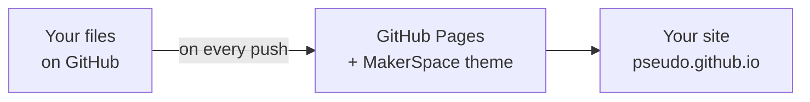
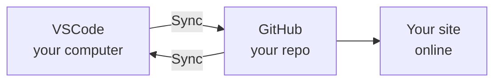

## On the agenda

1. What will this portfolio be for?
2. What we will build in four sessions
3. How to put your pages online
4. Your turn: create your site

<aside class="notes" markdown="1">
Plan: 30 min of presentation (parts 1 to 3), then 1 h 30 on PC with tutorials 1 to 3. Goal for the end of the session: site online, cloned in VSCode, a first commit, URL posted on Moodle.
</aside>

---

<!-- .slide: class="slide-section" -->

## Why a portfolio

A place to present your projects and what you learned from them

---

## What would you like to show a recruiter?

<i class="fas fa-user-friends"></i>In pairs<i class="far fa-clock"></i>3 min<i class="fas fa-pen"></i>No PC

Imagine a recruiter opens your site before an interview.

- Which **project** would you like to present?
- What could you **show**: a photo, a diagram, a demo?
- What would you like them to remember about **your work**?

<aside class="notes" markdown="1">
Allow two minutes of discussion, then one minute to hear a few answers. A course project or a personal project is perfectly fine. Use an example from the group to show what the portfolio adds to the CV.
</aside>

---

## An example to complement your CV

### On your CV

- "Design of a temperature sensor"
- The tools used: CAD, electronics
- A few lines summing up the project

### In your portfolio

- A photo of the sensor and its casing
- The schematic and the measurements
- What **you** did and learned

The portfolio gives you something to discuss in an interview.
{: .highlight-red}

---

## What your site will contain

| Page | What it shows |
|---|---|
| **Home** | Your name, your photo, your links, your latest projects |
| **About me** | Your background, what you are looking for, your CV |
| **Projects** | What you built, your role and the results |
| **Blog** | Your progress, your trials and the difficulties you met |
| **Docs** | Technical pages: a tutorial, a procedure |
{: .table-dense}

Here is what it can look like, with a fictitious profile. **↓** to visit the site.
{: .caption}

<!-- .down -->

## The example site

<iframe class="page-preview" data-src="https://makerspace-amiens.fr/portfolio-theme/" title="Portfolio example site"></iframe>

`makerspace-amiens.fr/portfolio-theme/`
{: .caption}

---

## Something to tell your progress

- **From I1 on**, you have course projects to present
- **Project after project**, keep photos and note your choices
- **After an internship**, tell what you learned
- **When applying**, add the link to your CV or LinkedIn

A few notes taken now will save you from rebuilding everything in six months.
{: .caption}

---

<!-- .slide: class="slide-section" -->

## The four sessions

We start from a template, then you add your background and your projects

---

## The programme

| Session | Content | At the end |
|---|---|---|
| **1** | Create the site and put it online | Your link on Moodle |
| **2** | Add your introduction and your CV | A site in your name |
| **3** | Present your work on a project | A complete project page |
| **4** | Explain a method and keep a logbook | A doc, two logbook entries |
{: .table-dense}

Then you update it **project after project** throughout the year.
{: .caption}

[Engineer's Portfolio](/workshops/portfolio-ingenieur/){: .doc-link}

---

<!-- .slide: class="slide-section" -->

## How your site works

Your pages start as simple text files

---

## From text to site

- Your texts and images are in a **GitHub repository**, or *repo*
- You write in **Markdown**: for instance, `**hello**` gives **hello**
- The **theme** handles the layout. GitHub Pages publishes your changes after a short delay

[Publishing your site with GitHub Pages](/workshops/methodologie-de-projet/tutorials/publier-son-site/?project=portfolio-ingenieur){: .doc-link}

---

## How to edit a page

1. Before you start, **sync** to get the latest version
2. Edit your page in **VSCode** and look at the preview
3. Make a **commit**: a saved version with a message
4. **Sync** again to send your changes to GitHub

[Git and GitHub with VSCode](/workshops/methodologie-de-projet/tutorials/git-github-desktop-vscode/?project=portfolio-ingenieur){: .doc-link}

---

## What you choose to make public

- Your address will be **`pseudo.github.io`**: choose a username you can put on your CV
- Keep your **home address**, phone number and date of birth to yourself
- Use your own **images**, or images whose author allows reuse, with credit
- For an **internship project**, check with the company what you may show

Before publishing, ask yourself whether you are comfortable with anyone reading it.
{: .highlight-red}

---

<!-- .slide: class="slide-section" -->

## Your turn

Today, you leave with a site online

---

## The three tutorials of the session

<i class="fas fa-user"></i>Individual<i class="fas fa-laptop"></i>With PC

1. **Create** your `pseudo.github.io` repo from the provided template
2. **Publish** your site with GitHub Pages
3. **Clone** the repo: get it in VSCode, then make your first commit

In each tutorial, choose the **Portfolio** tab.
{: .caption}

[Creating your repo from the template](/workshops/methodologie-de-projet/tutorials/creer-repo-template/?project=portfolio-ingenieur){: .doc-link} [Publishing your site](/workshops/methodologie-de-projet/tutorials/publier-son-site/?project=portfolio-ingenieur){: .doc-link} [Git and GitHub with VSCode](/workshops/methodologie-de-projet/tutorials/git-github-desktop-vscode/?project=portfolio-ingenieur){: .doc-link}

<aside class="notes" markdown="1">
Walk around while the repos are being created. Check with the students that the name is their GitHub username followed by `.github.io`. Point out that the site still shows the example profile: customisation comes in session 2.
</aside>

---

## Before you leave

- You can open your site at `https://pseudo.github.io`
- You find its files in VSCode and have pushed **a first commit**
- You have posted **your site's link on Moodle**

If you are stuck, call me. The **Troubleshooting** section of each tutorial can help too.
{: .caption}

---

## Next time

**Session 2**: we replace the example profile with yours.

- You will format your texts with **Markdown**
- You will add your name, your photo and your links
- You will write your **About me** page and add your CV

[Markdown syntax](/workshops/methodologie-de-projet/tutorials/syntaxe-markdown/?project=portfolio-ingenieur){: .doc-link} [Customising your portfolio](/workshops/portfolio-ingenieur/tutorials/personnaliser-portfolio/){: .doc-link}
