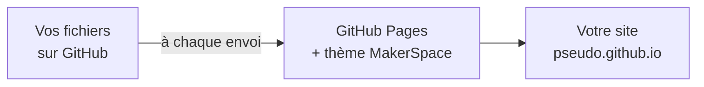
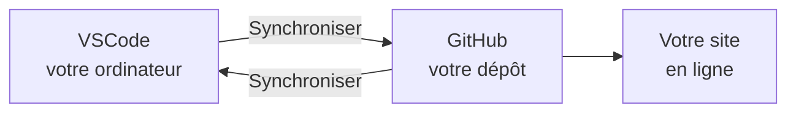

## Au programme

1. À quoi va vous servir ce portfolio ?
2. Ce qu’on va construire en quatre séances
3. Comment mettre vos pages en ligne
4. À vous de créer votre site

<aside class="notes" markdown="1">
Déroulé : 30 min de présentation (parties 1 à 3), puis 1 h 30 sur PC avec les tutoriels 1 à 3. Objectif de sortie : site en ligne, cloné dans VSCode, un premier commit, URL déposée sur Moodle.
</aside>

---

<!-- .slide: class="slide-section" -->

## Pourquoi un portfolio

Un endroit pour présenter vos projets et ce que vous y avez appris

---

## Qu’aimeriez-vous montrer à un recruteur ?

<i class="fas fa-user-friends"></i>En binôme<i class="far fa-clock"></i>3 min<i class="fas fa-pen"></i>Sans PC

Imaginez qu’un recruteur ouvre votre site avant un entretien.

- Quel **projet** auriez-vous envie de lui présenter ?
- Qu’auriez-vous à lui **montrer** : une photo, un schéma, une démo ?
- Que voudriez-vous qu’il retienne de **votre travail** ?

<aside class="notes" markdown="1">
Laisser deux minutes d’échange, puis prendre une minute pour écouter quelques réponses. Un projet de cours ou un projet personnel convient très bien. Reprendre un exemple du groupe pour montrer ce que le portfolio ajoute au CV.
</aside>

---

## Un exemple pour compléter votre CV

### Sur votre CV

- « Conception d’un capteur de température »
- Les outils utilisés : CAO, électronique
- Quelques lignes pour résumer le projet

### Dans votre portfolio

- Une photo du capteur et de son boîtier
- Le schéma et les mesures obtenues
- Ce que **vous** avez réalisé et appris

Le portfolio donne de quoi discuter de votre travail en entretien.
{: .highlight-red}

---

## Ce que contiendra votre site

| Page | Ce qu'elle montre |
|---|---|
| **Accueil** | Votre nom, votre photo, vos liens, vos derniers projets |
| **Qui suis-je** | Votre parcours, ce que vous cherchez, votre CV |
| **Projets** | Ce que vous avez réalisé, votre rôle et les résultats |
| **Blog** | Vos avancées, vos essais et les difficultés rencontrées |
| **Docs** | Des pages techniques : un tutoriel, une procédure |
{: .table-dense}

Voici à quoi cela peut ressembler, avec un profil fictif. **↓** pour visiter le site.
{: .caption}

<!-- .down -->

## Le site exemple

<iframe class="page-preview" data-src="https://makerspace-amiens.fr/portfolio-theme/" title="Site exemple du portfolio"></iframe>

`makerspace-amiens.fr/portfolio-theme/`
{: .caption}

---

## De quoi raconter vos progrès

- **Dès l’I1**, vous avez des projets de cours à présenter
- **Au fil des projets**, gardez des photos et notez vos choix
- **Après un stage**, racontez ce que vous avez appris
- **Pour candidater**, ajoutez le lien à votre CV ou à LinkedIn

Quelques notes prises maintenant vous éviteront de tout reconstituer dans six mois.
{: .caption}

---

<!-- .slide: class="slide-section" -->

## Les quatre séances

On part d’un modèle, puis vous y ajoutez votre parcours et vos projets

---

## Le programme

| Séance | Contenu | À la fin |
|---|---|---|
| **1** | Créer le site et le mettre en ligne | Votre lien sur Moodle |
| **2** | Ajouter votre présentation et votre CV | Un site à votre nom |
| **3** | Présenter votre travail sur un projet | Une page projet complète |
| **4** | Expliquer une méthode et tenir un journal | Une doc, deux entrées de journal |
{: .table-dense}

Ensuite, vous le mettez à jour **au fil des projets** de l'année.
{: .caption}

[Portfolio de l'ingénieur](/workshops/portfolio-ingenieur/){: .doc-link}

---

<!-- .slide: class="slide-section" -->

## Comment fonctionne votre site

Vos pages partent de simples fichiers texte

---

## Du texte au site

- Vos textes et vos images sont dans un **dépôt GitHub**, aussi appelé *repo*
- Vous écrivez en **Markdown** : par exemple, `**bonjour**` donne **bonjour**
- Le **thème** gère la mise en page. GitHub Pages publie vos modifications après un court délai

[Publier son site avec GitHub Pages](/workshops/methodologie-de-projet/tutorials/publier-son-site/?project=portfolio-ingenieur){: .doc-link}

---

## Comment modifier une page

1. Avant de commencer, **synchronisez** pour récupérer la dernière version
2. Modifiez votre page dans **VSCode** et regardez l’aperçu
3. Faites un **commit** : une version enregistrée avec un message
4. **Synchronisez** à nouveau pour envoyer vos changements sur GitHub

[Git et GitHub avec VSCode](/workshops/methodologie-de-projet/tutorials/git-github-desktop-vscode/?project=portfolio-ingenieur){: .doc-link}

---

## Ce que vous choisissez de rendre public

- Votre adresse sera **`pseudo.github.io`** : choisissez un pseudo que vous pourrez mettre sur votre CV
- Gardez pour vous votre **adresse personnelle**, votre téléphone et votre date de naissance
- Utilisez vos propres **images** ou celles dont l’auteur autorise la réutilisation, en le citant
- Pour un **projet de stage**, vérifiez avec l’entreprise ce que vous pouvez montrer

Avant de publier, demandez-vous si vous êtes à l’aise avec le fait que tout le monde puisse le lire.
{: .highlight-red}

---

<!-- .slide: class="slide-section" -->

## À vous

Aujourd’hui, vous repartez avec un site en ligne

---

## Les trois tutoriels de la séance

<i class="fas fa-user"></i>Individuel<i class="fas fa-laptop"></i>Avec PC

1. **Créez** votre dépôt `pseudo.github.io` à partir du modèle fourni
2. **Publiez** votre site avec GitHub Pages
3. **Clonez** le dépôt : récupérez-le dans VSCode, puis faites votre premier commit

Dans chaque tutoriel, choisissez l'onglet **Portfolio**.
{: .caption}

[Créer son repo depuis le template](/workshops/methodologie-de-projet/tutorials/creer-repo-template/?project=portfolio-ingenieur){: .doc-link} [Publier son site](/workshops/methodologie-de-projet/tutorials/publier-son-site/?project=portfolio-ingenieur){: .doc-link} [Git et GitHub avec VSCode](/workshops/methodologie-de-projet/tutorials/git-github-desktop-vscode/?project=portfolio-ingenieur){: .doc-link}

<aside class="notes" markdown="1">
Passer dans les rangs pendant la création du dépôt. Vérifier avec les étudiants que le nom reprend bien leur identifiant GitHub, suivi de `.github.io`. Préciser que le site contient encore le profil d’exemple : la personnalisation se fera en séance 2.
</aside>

---

## Avant de partir

- Vous pouvez ouvrir votre site à l’adresse `https://pseudo.github.io`
- Vous retrouvez ses fichiers dans VSCode et avez envoyé **un premier commit**
- Vous avez déposé **le lien de votre site sur Moodle**

Si vous bloquez, appelez-moi. La section **Résolution de problèmes** de chaque tutoriel peut aussi vous aider.
{: .caption}

---

## La prochaine fois

**Séance 2** : on remplace le profil d’exemple par le vôtre.

- Vous mettrez vos textes en forme avec **Markdown**
- Vous ajouterez votre nom, votre photo et vos liens
- Vous rédigerez votre page **Qui suis-je** et ajouterez votre CV

[Syntaxe Markdown](/workshops/methodologie-de-projet/tutorials/syntaxe-markdown/?project=portfolio-ingenieur){: .doc-link} [Personnaliser son portfolio](/workshops/portfolio-ingenieur/tutorials/personnaliser-portfolio/){: .doc-link}
