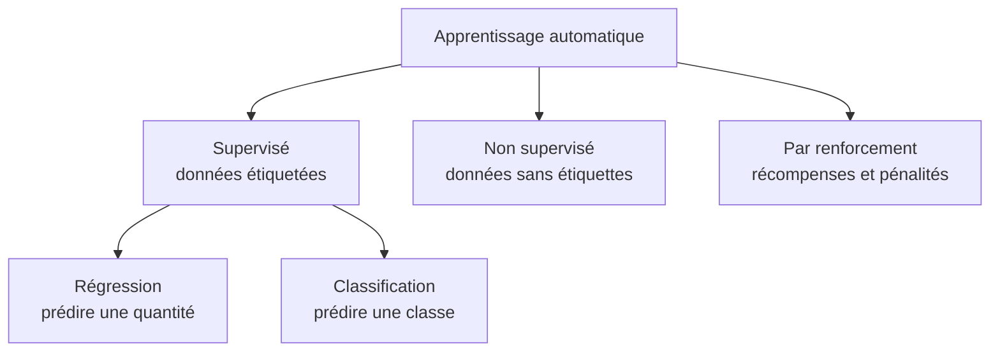
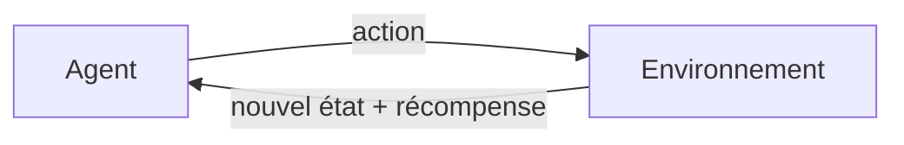
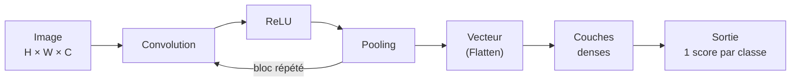



## L'intelligence artificielle

L'**intelligence artificielle** (IA) regroupe les techniques qui permettent à une machine d'effectuer des tâches qui demandent habituellement des capacités humaines : reconnaître une image, comprendre une question, faire une prédiction.

| Domaine | Exemple |
|---|---|
| Santé | Détecter une anomalie dans une image médicale |
| Industrie | Repérer une panne avant qu'elle ne survienne |
| Transport | Aider un véhicule à reconnaître un obstacle |
| Vie quotidienne | Recommander un film, un plat |
| Langage naturel | Traduction automatique, chatbots |
| Vision par ordinateur | Reconnaissance faciale, détection d'objets |
| Reconnaissance vocale | Assistants vocaux, transcription de la parole |

### Soixante-dix ans d'histoire

L'IA n'est pas née avec ChatGPT. Elle a connu plusieurs approches successives, qui coexistent encore aujourd'hui :

| Approche | Émergence | Exemple marquant |
|---|---|---|
| IA symbolique | 1956 aux années 1980 | *Logic Theorist*, un programme qui démontre des théorèmes |
| IA connexionniste, apprentissage automatique | fin des années 1980 | Le réseau de neurones de Yann LeCun qui lit les codes postaux manuscrits (1989) |
| Apprentissage profond | 2010 à 2012 | AlexNet, qui classe des images (2012) |
| IA générative | 2020 à 2022 | GPT-3 puis ChatGPT, qui génèrent du texte |
| Agents IA | depuis 2023 | Un assistant qui planifie plusieurs étapes et utilise des outils |

L'IA symbolique applique des règles écrites à la main. Toutes les approches suivantes **apprennent à partir de données** : c'est ce qui nous intéresse ici.

## L'apprentissage automatique

L'**apprentissage automatique** (*machine learning*) est la branche de l'IA qui permet à une machine d'apprendre à partir de données, sans qu'on programme chaque règle. Il existe trois grandes méthodes :

### L'apprentissage supervisé

Le modèle apprend à partir de données **associées à leur réponse**. Il étudie par exemple des images étiquetées « chat » ou « chien », puis apprend à reconnaître la catégorie d'une image qu'il n'a jamais vue. Selon ce qu'on cherche à prédire, on distingue deux types de problèmes.

**La régression** prédit une **quantité** : le prix d'une maison, la durée d'un trajet, une température, un poids. À partir de maisons dont on connaît la surface et le prix, le modèle trace une droite qui résume la relation, puis l'utilise pour une maison nouvelle :

| Maison | Surface | Prix |
|---|---|---|
| Exemple 1 | 80 m² | 210 000 € |
| Exemple 2 | 120 m² | 320 000 € |
| Exemple 3 | 180 m² | 450 000 € |
| **Nouvelle maison** | **105 m²** | **≈ 285 000 €** (prédit) |

**La classification** prédit une **classe** : un animal, un état de santé, une couleur, un type de véhicule. À partir d'animaux dont on connaît la taille, le poids et l'espèce, le modèle trace une frontière entre les chats et les chiens. Un nouvel animal tombe d'un côté ou de l'autre de cette frontière : c'est sa prédiction.

C'est un problème de classification que l'on résout dans cet atelier : une image en entrée, « chat » ou « chien » en sortie.

### L'apprentissage non supervisé

Le modèle analyse des données **sans réponse indiquée**, et regroupe celles qui se ressemblent. Il peut par exemple réunir des animaux de taille et de poids similaires sans savoir à l'avance s'il s'agit de chats ou de chiens : il découvre lui-même des groupes, qu'un humain nomme ensuite. On parle de **regroupement** (*clustering*).

### L'apprentissage par renforcement

Un **agent** apprend à choisir les meilleures actions en interagissant avec un **environnement** : chaque action lui rapporte une **récompense** ou une **pénalité**, et il cherche à maximiser ses récompenses au fil des essais. C'est ainsi qu'on entraîne un programme à jouer à un jeu ou un robot à marcher.

## L'apprentissage profond

L'**apprentissage profond** (*deep learning*) est une branche de l'apprentissage automatique qui utilise des **réseaux de neurones à plusieurs couches**. Ces couches apprennent seules des caractéristiques de plus en plus complexes à partir des données, sans qu'on ait à les décrire.

| Architecture | Données traitées |
|---|---|
| **CNN** (réseau convolutif) | Images et vidéos |
| **RNN**, **LSTM** | Données séquentielles : parole, séries temporelles |
| **Transformers** | Langage, données multimodales |
| **DNN**, **MLP** (réseaux denses) | Données structurées, en tableau |

Pour reconnaître des chats et des chiens, on utilise un CNN.

## Une image, pour un ordinateur

Une image numérique est une grille de **pixels**. En niveaux de gris, chaque pixel est un nombre de 0 (noir) à 255 (blanc). En couleur, chaque pixel est un triplet de trois nombres : son **rouge**, son **vert** et son **bleu** (RGB). Une image couleur de 96 × 96 pixels, comme celles de l'atelier, est donc un tableau de 96 × 96 × 3 = 27 648 nombres.

La **vision par ordinateur** est la discipline qui permet à une machine d'analyser ces tableaux de nombres, images ou vidéos.

## Le réseau de neurones convolutif

Le **CNN** (*Convolutional Neural Network*) est un réseau spécialisé dans l'analyse d'images. Il fait glisser de petits **filtres** sur l'image pour y repérer des caractéristiques visuelles : d'abord des contours, puis des formes, puis des objets entiers. Ces filtres ne sont pas écrits à la main : ils sont **appris** pendant l'entraînement.

On les trouve dans les voitures autonomes, l'imagerie médicale, la vidéosurveillance ou la reconnaissance d'objets.

### La convolution

Un filtre est une petite matrice, souvent 3 × 3. Il glisse sur l'image : à chaque position, on multiplie case par case les valeurs du filtre et celles de l'image en dessous, puis on additionne. Chaque position donne un nombre, et l'ensemble de ces nombres forme une **carte de caractéristiques** (*feature map*).

Dans cet exemple, chaque ligne du filtre vaut `[1 0 -1]` : il soustrait la colonne de droite de la colonne de gauche, donc il réagit aux **contours verticaux**. Pour la première position : $(3+1+2) - (1+8+2) = -5$.

Deux propriétés rendent la convolution économe :

- **champ récepteur local** : chaque valeur de sortie ne dépend que d'une petite zone de l'image ;
- **partage des poids** : le même filtre sert partout dans l'image. Un filtre 3 × 3 n'a donc que **9 poids**, quelle que soit la taille de l'image.

### Paramètres et hyperparamètres

- Les **paramètres** sont les valeurs apprises par le réseau pendant l'entraînement : les poids des filtres et leurs biais.
- Les **hyperparamètres** sont les réglages choisis **avant** l'entraînement : la taille et le nombre de filtres, le pas (*stride*), la bordure (*padding*).

Pendant l'entraînement, la **rétropropagation** calcule dans quel sens corriger chaque poids pour réduire l'erreur du réseau, et la **descente de gradient** applique ces corrections, petit pas par petit pas.

### Padding et stride

- Le **padding** ajoute une bordure de pixels, souvent des zéros, autour de l'image avant la convolution. Il permet de traiter les bords et peut conserver la taille de l'image en sortie.
- Le **stride** est le pas de déplacement du filtre : de combien de cases il avance à chaque fois. Un stride de 2 divise environ par deux la taille de la sortie.

La taille de la carte obtenue se calcule ainsi, pour une image de côté $n$, un padding $p$, un filtre de côté $f$ et un stride $s$ :

$$\text{taille de sortie} = \left\lfloor \frac{n + 2p - f}{s} \right\rfloor + 1$$

Vérification sur l'exemple de la convolution : $\lfloor (6 + 0 - 3) / 1 \rfloor + 1 = 4$, d'où la carte 4 × 4.

### Images couleur et filtres multiples

Une image couleur a trois canaux, R, G et B. Un filtre couvre alors les trois canaux à la fois : pour une image 6 × 6 × 3, il mesure 3 × 3 × 3, soit 27 poids. Les résultats obtenus sur les trois canaux sont additionnés pour donner **une seule** carte de caractéristiques.

Une couche utilise plusieurs filtres, et chacun détecte un motif différent. Les cartes produites sont empilées : avec 8 filtres, la sortie a 8 canaux. C'est le cas de la première couche du modèle de l'atelier.

### La fonction d'activation ReLU

Après chaque convolution, la fonction **ReLU** (*Rectified Linear Unit*) transforme chaque valeur $x$ :

$$\text{ReLU}(x) = \max(0, x)$$

Une valeur négative devient 0, une valeur positive est conservée. Ce simple seuil apporte la **non-linéarité** sans laquelle empiler des couches ne servirait à rien : une suite d'opérations linéaires reste une opération linéaire. Grâce à ReLU, le réseau peut apprendre des motifs complexes.

### Le pooling

Le **pooling** (sous-échantillonnage) réduit la taille de chaque carte de caractéristiques en conservant l'information importante. Il s'applique en général entre deux couches de convolution, séparément sur chaque carte.

- **Max pooling** : chaque zone est remplacée par sa valeur maximale.
- **Average pooling** : chaque zone est remplacée par la moyenne de ses valeurs.

Le pooling n'a **aucun paramètre appris** : on choisit seulement la taille de la fenêtre et le pas. En réduisant les cartes, il diminue les calculs des couches suivantes et aide à limiter le **surapprentissage** (un modèle qui apprend ses exemples par cœur au lieu de généraliser).

### La couche dense et la sortie

À la fin du réseau, des couches **entièrement connectées** (*dense*) utilisent les caractéristiques extraites pour décider de la classe :

1. les cartes de caractéristiques sont transformées en un **vecteur** à une dimension, par aplatissement (*Flatten*) ou par un résumé de chaque carte (*Global Average Pooling*) ;
2. la couche dense combine ces informations ;
3. une fonction de sortie transforme le résultat en score :
   - **softmax** choisit une classe parmi plusieurs et donne un score par classe, dont la somme vaut 1 (par exemple chat 0,06 et chien 0,94) ;
   - **sigmoïde** donne un score entre 0 et 1 pour chaque sortie. Elle sert à la classification binaire, ou quand plusieurs classes peuvent être présentes en même temps.

Le modèle de l'atelier utilise un **seul neurone de sortie à activation sigmoïde** : son score est la probabilité que l'image montre un chien.

### L'architecture complète

Une image traverse le réseau dans cet ordre. Le bloc convolution, ReLU, pooling est répété plusieurs fois : à chaque bloc, les cartes rapetissent et les motifs détectés se complexifient.

| Étape | Rôle |
|---|---|
| Image d'entrée | Le tableau de pixels, de taille hauteur × largeur × canaux |
| Convolution | Applique des filtres et produit des cartes de caractéristiques |
| ReLU | Élimine les valeurs négatives, apporte la non-linéarité |
| Pooling | Réduit la taille des cartes, limite les calculs et le surapprentissage |
| Flatten | Transforme les cartes en un vecteur, seule entrée possible des couches denses |
| Couches denses | Combinent les caractéristiques et réalisent la tâche finale : classification ou régression |

Le tutoriel [Modélisation](/workshops/tinyml/tutorials/modelisation/) construit exactement ce réseau avec Keras : quatre blocs de convolution (8, 16, 32 puis 64 filtres 3 × 3), puis une couche dense et une sortie sigmoïde.

## Pourquoi le TinyML ?

Les grands modèles d'IA tournent le plus souvent dans le **cloud**. Cela entraîne :

- une **dépendance à Internet** ;
- un **délai** entre l'envoi des données et la réponse ;
- l'envoi de **données sensibles** vers des serveurs distants ;
- une consommation de **bande passante** et d'**énergie**.

Le **TinyML** (*Tiny Machine Learning*) exécute le modèle directement sur un petit appareil, comme un microcontrôleur, qui dispose de peu de mémoire et d'énergie. L'appareil analyse ses données localement, sans dépendre du cloud. Le concept [Qu'est-ce que le TinyML ?](/workshops/tinyml/concepts/qu-est-ce-que-le-tinyml/) détaille la différence entre entraînement et inférence.

| Domaine | Exemple d'application |
|---|---|
| Santé | Analyse du rythme cardiaque, détection de signes de stress |
| Industrie | Détection précoce d'anomalies dans une machine, par ses vibrations ou son bruit |
| Agriculture | Surveillance de l'humidité du sol, détection de maladies des plantes |
| Maison | Reconnaissance d'un mot-clé ou d'un son, sans rien envoyer au cloud |
| Environnement | Mesure de la qualité de l'air, détection d'incendie |

### Avantages et limites

**Avantages**

- **Efficacité énergétique** : des appareils intelligents qui tiennent sur batterie.
- **Faible latence** : la décision se prend sur l'appareil, sans attendre le réseau.
- **Protection des données** : les données sensibles ne quittent pas l'appareil.
- **Bande passante réduite** : moins de données transmises, moins de coûts, et un fonctionnement possible là où la connexion est faible.

**Limites**

- Mémoire et puissance de calcul limitées.
- Les modèles doivent être optimisés et souvent réduits, ce qui peut affecter leur précision.
- Tous les modèles et toutes les tâches ne peuvent pas être embarqués.
- Il faut vérifier la compatibilité entre le modèle, les outils et le matériel.

## Optimiser un modèle

Un réseau de neurones est fait de couches de neurones reliées entre elles : chaque neurone a un **biais** et chaque connexion un **poids**. Un modèle de classification d'images courant compte facilement **1,6 million de paramètres**, chacun stocké en nombre décimal sur 32 bits : plus de 6 Mo, quand la XIAO ESP32S3 offre 512 Ko de RAM.

**Optimiser** un modèle, dans le contexte du TinyML, vise donc à :

- réduire les ressources nécessaires : mémoire, calcul et énergie ;
- accélérer l'inférence ;
- préserver au mieux la précision.

### Les méthodes de compression

| Méthode | Principe |
|---|---|
| **Élagage** (*pruning*) | Supprimer les poids les moins importants du réseau |
| **Regroupement des poids** (*weight clustering*) | Remplacer des poids proches par une même valeur commune |
| **Distillation de connaissances** | Entraîner un petit modèle à reproduire les prédictions d'un grand |
| **Quantification** | Représenter les valeurs du modèle avec moins de bits |

### La quantification

La **quantification** représente les valeurs du modèle avec moins de bits, par exemple en passant de `float32` (nombre décimal sur 32 bits) à `int8` (entier sur 8 bits, de -128 à 127). Chaque valeur réelle $x$ est convertie en entier $q$ à l'aide d'une **échelle** $S$ et d'un **point zéro** $Z$, puis arrondie :

$$q = \text{arrondi}\left(\frac{x}{S}\right) + Z \qquad x \approx S \times (q - Z)$$

Un poids qui occupait 4 octets n'en occupe plus qu'un : les poids prennent environ **quatre fois moins de place**. Selon le matériel, les calculs peuvent aussi être plus rapides, car les opérations sur des entiers coûtent moins cher. En contrepartie, l'arrondi fait perdre un peu de précision : il faut la **mesurer** après conversion.

Dans le tutoriel [Quantification](/workshops/tinyml/tutorials/quantification/), le modèle de l'atelier passe de 109,47 Ko à 36,1 Ko. Le gain est un peu inférieur à quatre, car le fichier ne contient pas que des poids : il décrit aussi la structure du réseau et les paramètres de quantification.

## Quiz express

**1. Prédire la durée d'un trajet, est-ce une régression ou une classification ?**

Voir la réponse
Une régression : on prédit une quantité (une durée), pas une catégorie.

**2. Combien de poids compte un filtre 3 × 3 appliqué à une image couleur ?**

Voir la réponse
27 : le filtre couvre les trois canaux R, G et B, il mesure donc 3 × 3 × 3.

**3. Quelle taille de sortie donne une image 96 × 96, un filtre 3 × 3, sans padding et avec un stride de 1 ?**

Voir la réponse
94 × 94, car ⌊(96 + 0 − 3) / 1⌋ + 1 = 94.

**4. Que renvoie un max pooling 2 × 2 sur la zone (1, 3, 5, 6) ?**

Voir la réponse
6, la valeur maximale de la zone.

**5. Combien d'octets occupe un poids en float32, puis en int8 ?**

Voir la réponse
4 octets en float32, 1 octet en int8.

## Résumé

- L'**apprentissage automatique** apprend une règle à partir de données. Il est **supervisé** (régression ou classification), **non supervisé** (regroupement) ou **par renforcement** (récompenses).
- L'**apprentissage profond** empile des couches de neurones ; le **CNN** est l'architecture des images.
- Un CNN enchaîne des blocs **convolution, ReLU, pooling**, puis des couches **denses** et une sortie **softmax** ou **sigmoïde**.
- La taille d'une carte de sortie vaut $\lfloor (n + 2p - f)/s \rfloor + 1$.
- Le **TinyML** exécute le modèle sur l'appareil : faible latence, faible consommation, données protégées, mais des ressources très limitées.
- Pour y tenir, le modèle est **compressé** : élagage, regroupement, distillation ou **quantification** en `int8`.

---

Cours et schémas : Lina Abousalama (LARI, Université Mohammed Premier, Oujda), sous la direction de Jérôme Gorin (UniLaSalle Amiens).
{: .is-size-7 .has-text-grey }
