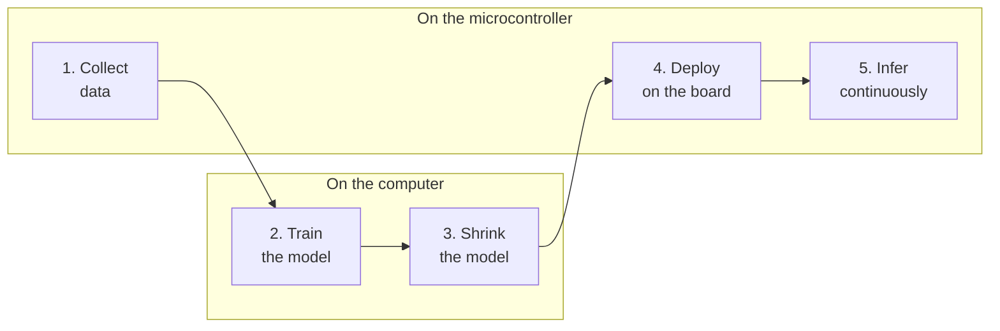

## A rule or an example?

For a console to detect a joystick pushed to the right, you write a rule: `if (x > 2500)`. But how do you write the rule that recognises a circle drawn with the joystick, a spoken word or a machine that starts to vibrate abnormally? The signals vary from one person to another, and from one time to the next: no series of `if` statements will do.

**Machine learning** turns the problem around: instead of writing the rule, you show the program **labelled examples** ("this is a circle", "this is a back-and-forth"), and an algorithm works out by itself a **model** able to classify new examples.

**TinyML** (*tiny machine learning*) means running this model on a microcontroller: a few hundred kilobytes of memory, a few milliwatts, and no Internet connection.

## Written program or trained model

| | Written program | Trained model |
|---|---|---|
| Who sets the rule? | The developer, line by line | An algorithm, from examples |
| What you have to provide | Code | Labelled data |
| When it is the right choice | The rule is simple and known | The rule is fuzzy or too complex to write |
| How you check it | You reread the code | You measure the rate of correct answers on examples never seen before |

The two combine: a model recognises the gesture, and ordinary code decides what to do with it (turn on an LED, send a message).

## Train, then infer

A model lives through two very different moments:

- **training**: the algorithm adjusts thousands of parameters so that the model answers correctly on the examples. It is long and resource-hungry: it is done on a **computer**;
- **inference**: the trained model receives a new measurement and returns its prediction. It is fast and cheap: **only this part** runs on the microcontroller.

## What fits in a microcontroller

A model must fit in the memory of the board and answer fast enough:

| | Laptop | XIAO ESP32S3 |
|---|---|---|
| RAM | 8 to 32 GB | 512 KB (and 8 MB of external PSRAM) |
| Program storage | hundreds of GB | 8 MB of Flash |
| Processor | several GHz, several cores | 240 MHz, 2 cores |
| Power consumption | tens of watts | a few hundred milliwatts when computing |

To fit, the model is **quantised**: its parameters, computed as 32-bit floating-point numbers (`float`), are converted into 8-bit integers (`int8`). The model becomes about **four times smaller** and faster, at the cost of a slight loss of accuracy, which is measured.



## Why on the board, and not in the cloud?

Sending every measurement to a server for it to classify is possible, but:

- **latency**: the network round trip takes tens of milliseconds, sometimes more;
- **energy**: the radio uses far more than local computation; a battery-powered sensor would not last;
- **privacy**: a microphone that sends everything it hears is a problem; a microphone that only transmits "keyword detected" is much less of one;
- **availability**: without a network, the device keeps working.

## Examples around you

| Application | Sensor | What the model recognises |
|---|---|---|
| Voice assistant | Microphone | The word that wakes the device ("Ok...") |
| Smartwatch | Accelerometer | A fall, a type of activity |
| Machine maintenance | Accelerometer, microphone | An abnormal vibration, before the breakdown |
| Agriculture | Camera | A diseased leaf, an insect |

## Quick quiz

**1. Which stage is done on the computer, and which on the microcontroller?**

Show the answer
Training is done on the computer; inference (the prediction on a new measurement) is done on the microcontroller.

**2. What do you gain by quantising a model to `int8`?**

Show the answer
A model about four times smaller and faster, at the cost of a slight loss of accuracy.

**3. Give one reason to classify the data on the board rather than in the cloud.**

Show the answer
Latency, the energy saved on the radio, data privacy or operation without a network.

## Summary

- A machine learning model learns a rule from **labelled examples**, instead of having it written.
- **Training** is done on a computer; only **inference** runs on the microcontroller.
- To fit in a few hundred kilobytes, the model is **quantised** to 8-bit integers.
- TinyML targets specific tasks, without a network: fast, frugal and privacy-friendly.
