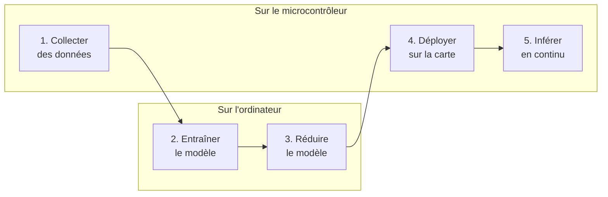

<!-- RÉDACTION : le corps commence toujours par un titre ## (jamais #), car le titre de
la page est déjà affiché à partir du front matter. On ouvre sur une situation concrète,
avant toute définition. -->

## Une règle ou un exemple ?

Pour qu'une console détecte un joystick poussé vers la droite, on écrit une règle : `if (x > 2500)`. Mais comment écrire la règle qui reconnaît un cercle dessiné avec le joystick, un mot prononcé ou une machine qui commence à vibrer anormalement ? Les signaux varient d'une personne à l'autre, d'une fois à l'autre : aucune suite de `if` ne tient.

L'**apprentissage automatique** (*machine learning*) prend le problème à l'envers : au lieu d'écrire la règle, on montre au programme des **exemples étiquetés** (« ceci est un cercle », « ceci est un va-et-vient »), et un algorithme en déduit lui-même un **modèle** capable de classer de nouveaux exemples.

Le **TinyML** (*tiny machine learning*), c'est faire tourner ce modèle sur un microcontrôleur : quelques centaines de kilo-octets de mémoire, quelques milliwatts, et aucune connexion à Internet.

<!-- RÉDACTION : un tableau compare deux choses mieux qu'un long paragraphe. Garder des
cellules courtes. -->

## Programme écrit ou modèle entraîné

| | Programme écrit | Modèle entraîné |
|---|---|---|
| Qui fixe la règle ? | Le développeur, ligne par ligne | Un algorithme, à partir d'exemples |
| Ce qu'il faut fournir | Du code | Des données étiquetées |
| Quand c'est le bon choix | La règle est simple et connue | La règle est floue ou trop complexe à écrire |
| Comment on le vérifie | On relit le code | On mesure le taux de bonnes réponses sur des exemples jamais vus |

Les deux se combinent : un modèle reconnaît le geste, du code ordinaire décide quoi en faire (allumer une LED, envoyer un message).

## Entraîner, puis inférer

Un modèle vit deux moments très différents :

- l'**entraînement** : l'algorithme ajuste des milliers de paramètres pour que le modèle réponde juste sur les exemples. C'est long et gourmand : il se fait sur un **ordinateur** ;
- l'**inférence** : le modèle entraîné reçoit une nouvelle mesure et rend sa prédiction. C'est rapide et peu coûteux : c'est **cette partie seulement** qui tourne sur le microcontrôleur.

<!-- RÉDACTION : pour un enchaînement d'étapes, un diagramme Mermaid se lit plus vite que du
texte. Il s'écrit dans un bloc ```mermaid! (avec le point d'exclamation). -->



## Ce qui tient dans un microcontrôleur

Un modèle doit tenir dans la mémoire de la carte et répondre assez vite :

| | Ordinateur portable | XIAO ESP32S3 |
|---|---|---|
| Mémoire vive | 8 à 32 Go | 512 Ko (et 8 Mo de PSRAM externe) |
| Stockage du programme | des centaines de Go | 8 Mo de Flash |
| Processeur | plusieurs GHz, plusieurs cœurs | 240 MHz, 2 cœurs |
| Consommation | des dizaines de watts | quelques centaines de milliwatts en calcul |

Pour y entrer, le modèle est **quantifié** : ses paramètres, calculés en nombres à virgule sur 32 bits (`float`), sont convertis en entiers sur 8 bits (`int8`). Le modèle devient environ **quatre fois plus petit** et plus rapide, au prix d'une légère perte de précision, qu'on mesure.



## Pourquoi sur la carte, et pas dans le cloud ?

Envoyer chaque mesure à un serveur pour qu'il la classe est possible, mais :

- la **latence** : l'aller-retour réseau prend des dizaines de millisecondes, parfois plus ;
- l'**énergie** : la radio consomme bien plus que le calcul local ; un capteur sur pile ne tiendrait pas ;
- la **confidentialité** : un micro qui envoie tout ce qu'il entend pose problème ; un micro qui ne transmet que « mot-clé détecté », beaucoup moins ;
- la **disponibilité** : sans réseau, l'appareil continue de fonctionner.

## Des exemples autour de vous

| Application | Capteur | Ce que le modèle reconnaît |
|---|---|---|
| Assistant vocal | Micro | Le mot qui réveille l'appareil (« Ok... ») |
| Montre connectée | Accéléromètre | Une chute, un type d'activité |
| Maintenance d'une machine | Accéléromètre, micro | Une vibration anormale, avant la panne |
| Agriculture | Caméra | Une feuille malade, un insecte |

<!-- RÉDACTION : le quiz utilise <details> : la réponse reste cachée jusqu'au clic. -->

## Quiz express

**1. Quelle étape se fait sur l'ordinateur, et laquelle sur le microcontrôleur ?**

<details><summary>Voir la réponse</summary>L'entraînement se fait sur l'ordinateur ; l'inférence (la prédiction sur une nouvelle mesure) se fait sur le microcontrôleur.</details>

**2. Que gagne-t-on à quantifier un modèle en `int8` ?**

<details><summary>Voir la réponse</summary>Un modèle environ quatre fois plus petit et plus rapide, au prix d'une légère perte de précision.</details>

**3. Donnez une raison de classer les données sur la carte plutôt que dans le cloud.**

<details><summary>Voir la réponse</summary>La latence, l'énergie économisée sur la radio, la confidentialité des données ou le fonctionnement sans réseau.</details>

## Résumé

- Un modèle d'apprentissage automatique apprend une règle à partir d'**exemples étiquetés**, au lieu qu'on l'écrive.
- L'**entraînement** se fait sur un ordinateur ; seule l'**inférence** tourne sur le microcontrôleur.
- Pour tenir dans quelques centaines de kilo-octets, le modèle est **quantifié** en entiers sur 8 bits.
- Le TinyML vise des tâches ciblées, sans réseau : rapide, économe et respectueux de la vie privée.
