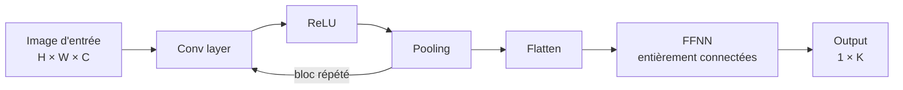

## Plan

1. Introduction : l'intelligence artificielle
     - C'est quoi l'IA ?
     - Histoire de l’IA
     - Machine learning
     - Deep learning
     - Limite de l’IA
2. Tiny Machine Learning
     - C’est quoi le TinyML
     - Avantages et limites
     - Méthodes de compression

<aside class="notes" markdown="1">
La version rédigée du cours est la page concept « De l'intelligence artificielle au TinyML ». Fil rouge de l'atelier : reconnaître un chat ou un chien sur une image, avec une XIAO ESP32S3 et sa caméra.
</aside>

---

<!-- .slide: class="slide-section" -->

## Introduction : l'intelligence artificielle

C'est quoi l'IA ? · Histoire de l'IA · Machine learning · Deep learning · Limite de l'IA

---

## C'est quoi l'IA ?

L'**intelligence artificielle** (IA) regroupe des techniques qui permettent à une machine d'effectuer des tâches nécessitant habituellement des capacités humaines :

- **reconnaître** une image
- **comprendre** une question
- faire une **prédiction**

[De l'IA au TinyML](/workshops/tinyml/concepts/de-l-ia-au-tinyml/){: .doc-link}

---

## Domaines et cas d'application

| Domaine | Exemple |
|---|---|
| Santé | Détecter une anomalie dans une image médicale |
| Industrie | Repérer une panne avant qu'elle ne survienne |
| Transport | Aider un véhicule à reconnaître un obstacle |
| Vie quotidienne | Proposer des films, des repas |
| Traitement du langage naturel | Traduction automatique, chatbots |
| Vision par ordinateur | Reconnaissance faciale, détection d'objets |
| Reconnaissance vocale | Assistants vocaux, parole convertie en texte |
{: .table-dense}

[De l'IA au TinyML](/workshops/tinyml/concepts/de-l-ia-au-tinyml/){: .doc-link}

---

## Histoire de l'IA

| Paradigme d'IA | Émergence | Exemple |
|---|---|---|
| IA symbolique (*Old AI*) | 1956 – années 1980 | *Logic Theorist* démontre des théorèmes |
| IA connexionniste, *machine learning* | fin des années 1980 | LeCun lit les codes postaux (1989) |
| IA prédictive, *deep learning* | 2010 – 2012 | AlexNet classe des images |
| IA générative | 2020 – 2022 | GPT-3, ChatGPT génèrent du texte |
| Agents IA (*agentic AI*) | 2023 | Un assistant planifie et utilise des outils |
{: .table-dense}

[De l'IA au TinyML](/workshops/tinyml/concepts/de-l-ia-au-tinyml/){: .doc-link}

<aside class="notes" markdown="1">
L'IA symbolique applique des règles écrites à la main. Toutes les approches suivantes apprennent à partir de données. Agent IA : un assistant qui planifie plusieurs étapes et utilise des outils pour accomplir une tâche.
</aside>

---

## Le machine learning

Le *machine learning* est une branche de l'IA qui permet aux machines d'**apprendre à partir de données**, sans programmer explicitement chaque règle. Il existe trois grandes méthodes d'apprentissage :

- {: .highlight-red} L'apprentissage supervisé
- L'apprentissage non supervisé
- L'apprentissage par renforcement

[De l'IA au TinyML](/workshops/tinyml/concepts/de-l-ia-au-tinyml/){: .doc-link}

---

## L'apprentissage supervisé

Le modèle apprend à partir de données **associées à leurs réponses**. Par exemple, il étudie des images étiquetées « chat » ou « chien », puis apprend à reconnaître la catégorie d'une nouvelle image.

{: style="max-height: 150px"}

**Chat**
{: .caption}

{: style="max-height: 150px"}

**Chien**
{: .caption}

{: style="max-height: 150px"}

**? ? ?**
{: .caption .highlight-red}

Deux types de problèmes : les **régressions** et les **classifications**.

[De l'IA au TinyML](/workshops/tinyml/concepts/de-l-ia-au-tinyml/){: .doc-link}

---

## Les régressions

{: style="max-height: 360px"}

La régression, c'est quand on cherche à prédire une **quantité** : le prix d'une maison, la durée d'un trajet, une température, un poids...
{: .caption}

[De l'IA au TinyML](/workshops/tinyml/concepts/de-l-ia-au-tinyml/){: .doc-link}

---

## Les classifications

{: style="max-height: 360px"}

La classification, c'est quand on cherche à prédire une **classe** : un animal, un état de santé, une couleur, un type de véhicule...
{: .caption}

[De l'IA au TinyML](/workshops/tinyml/concepts/de-l-ia-au-tinyml/){: .doc-link} 

---

## Le machine learning

Le *machine learning* est une branche de l'IA qui permet aux machines d'**apprendre à partir de données**, sans programmer explicitement chaque règle. Il existe trois grandes méthodes d'apprentissage :

- L'apprentissage supervisé
- {: .highlight-red} L'apprentissage non supervisé
- L'apprentissage par renforcement

[De l'IA au TinyML](/workshops/tinyml/concepts/de-l-ia-au-tinyml/){: .doc-link}

---

## L'apprentissage non supervisé

{: style="max-height: 360px"}

Le modèle analyse des données **sans réponses indiquées** et regroupe celles qui se ressemblent : des animaux de taille et de poids proches, sans savoir à l'avance s'il s'agit de chats ou de chiens.
{: .caption}

[De l'IA au TinyML](/workshops/tinyml/concepts/de-l-ia-au-tinyml/){: .doc-link}

---

## Le machine learning

Le *machine learning* est une branche de l'IA qui permet aux machines d'**apprendre à partir de données**, sans programmer explicitement chaque règle. Il existe trois grandes méthodes d'apprentissage :

- L'apprentissage supervisé
- L'apprentissage non supervisé
- {: .highlight-red} L'apprentissage par renforcement

[De l'IA au TinyML](/workshops/tinyml/concepts/de-l-ia-au-tinyml/){: .doc-link}

---

## L'apprentissage par renforcement

{: style="max-height: 360px"}

Un **agent** apprend à choisir les meilleures actions en interagissant avec un environnement et en recevant des **récompenses** ou des **pénalités**.
{: .caption}

[De l'IA au TinyML](/workshops/tinyml/concepts/de-l-ia-au-tinyml/){: .doc-link}

---

## Le deep learning

Une branche du machine learning qui utilise des **réseaux de neurones à plusieurs couches**. Ces couches apprennent automatiquement des caractéristiques complexes à partir des données.

| Architecture | Usage |
|---|---|
| **CNN** | Analyse des images et des vidéos |
| **RNN** et **LSTM** | Données séquentielles : parole, séries temporelles |
| **Transformers** | Langage et données multimodales : texte associé à des images ou à du son |
{: .table-dense}

[De l'IA au TinyML](/workshops/tinyml/concepts/de-l-ia-au-tinyml/){: .doc-link}

---

---

## Réseau de neurones artificiels

Un réseau de neurones artificiels est un modèle composé de neurones connectés et organisés en couches. Il apprend à reconnaître des relations dans les données en ajustant les poids de ses connexions.

{: style="max-height: 360px"}

[De l'IA au TinyML](/workshops/tinyml/concepts/de-l-ia-au-tinyml/){: .doc-link}

---

## Image et vision par ordinateur

- Une image numérique est composée de **pixels**.
- En niveaux de gris, chaque pixel vaut de **0 à 255**. En couleur, trois canaux : rouge, vert, bleu (**RGB**).
- La vision par ordinateur permet à une machine d'analyser des images ou des vidéos.

[De l'IA au TinyML](/workshops/tinyml/concepts/de-l-ia-au-tinyml/){: .doc-link}

---

## Réseau de neurones convolutif (CNN)

{: style="max-height: 200px"}

- Le CNN est un réseau de neurones spécialisé dans l'**analyse des images**.

[De l'IA au TinyML](/workshops/tinyml/concepts/de-l-ia-au-tinyml/){: .doc-link}

---

## CNN : architecture d'un CNN

| Composant | Rôle |
|---|---|
| Image d'entrée | L'image pixelisée, H × W × C |
| Convolution | Des filtres génèrent des cartes de caractéristiques |
| ReLU | Élimine les valeurs négatives, capte des relations complexes |
| Pooling | Réduit les cartes, la complexité et le surapprentissage |
| Flatten | Transforme la sortie en vecteur 1D |
| FFNN | Combine les caractéristiques, réalise la tâche finale |
{: .table-dense}

Le bloc convolution, ReLU, pooling peut être répété plusieurs fois.
{: .caption}

---

## CNN : principe de convolution

{: .img-md}

Un filtre (ici 3 × 3) glisse sur l'image : on multiplie case par case, puis on additionne. Chaque position donne un nombre, et l'ensemble forme une **feature map** (carte de caractéristiques).
{: .caption}

[De l'IA au TinyML](/workshops/tinyml/concepts/de-l-ia-au-tinyml/){: .doc-link}

<aside class="notes" markdown="1">
Sur la première position : (3 + 1 + 2) − (1 + 8 + 2) = −5. Ce filtre `[1 0 −1]` réagit aux contours verticaux.
</aside>

---

## CNN : principe de convolution

- Chaque valeur de sortie ne dépend que d'une petite zone de l'image.
- Le même filtre sert partout dans l'image, donc peu de paramètres (**9 poids** pour un filtre 3 × 3).
- Les valeurs du filtre sont **apprises** pendant l'entraînement. Dans cet exemple, chaque ligne du filtre vaut `[1 0 -1]`.

  {: width="300px"}

[De l'IA au TinyML](/workshops/tinyml/concepts/de-l-ia-au-tinyml/){: .doc-link}

---

## CNN : Padding 

- **Padding** : ajout de pixels, souvent des zéros, autour de l’image avant la convolution. Il permet de mieux traiter les bords et peut aider à conserver la taille de l’image en sortie.

$$\text{taille de sortie} = \left\lfloor \frac{n + 2p - f}{s} \right\rfloor + 1$$

n : taille de l'image d'origine, p : padding, f : taille du filtre, s : sliding (stride)
{: .caption}

[De l'IA au TinyML](/workshops/tinyml/concepts/de-l-ia-au-tinyml/){: .doc-link}

---

## CNN : Padding 

- Sans padding, le filtre ne passe qu'une seule fois sur un coin, mais neuf fois sur un pixel du centre. Les bords pèsent donc moins dans le résultat, et la sortie rétrécit en 4 × 4.
- Avec padding, Le filtre peut alors se centrer sur les pixels du bord.

  {: width="310px"}

[De l'IA au TinyML](/workshops/tinyml/concepts/de-l-ia-au-tinyml/){: .doc-link}

---

## CNN :  sliding

- **Sliding** : déplacement du filtre sur l’image pour examiner les zones les unes après les autres. Le stride indique de combien de cases le filtre avance à chaque déplacement.

[De l'IA au TinyML](/workshops/tinyml/concepts/de-l-ia-au-tinyml/){: .doc-link}

---

## CNN : ReLU

**ReLU** (*Rectified Linear Unit*) est une fonction d’activation qui transforme la valeur \(x\) produite par un neurone avant de la transmettre à la couche suivante, selon la règle suivante :
$$\text{ReLU}(x) = \max(0, x)$$

Si $x$ est négatif, ReLU le remplace par 0 ; s'il est positif, elle le conserve.

Elle apporte de la **non-linéarité**, ce qui permet au CNN d'apprendre des motifs plus complexes.
{: .highlight-red}

  {: width="290px"}

[De l'IA au TinyML](/workshops/tinyml/concepts/de-l-ia-au-tinyml/){: .doc-link}

---

## CNN : pooling

{: style="max-height: 300px"}

Le **pooling** réduit la taille d'une carte de caractéristiques en gardant l'essentiel, entre deux convolutions, sur chaque carte. **Max pooling** : la valeur maximale de la zone (1, 3, 5, 6 donne 6) ; **average pooling** : la moyenne. Aucun paramètre appris : moins de calculs, et moins de surapprentissage.
{: .caption}

[De l'IA au TinyML](/workshops/tinyml/concepts/de-l-ia-au-tinyml/){: .doc-link}

---

## CNN : couche entièrement connectée et sortie

La couche entièrement connectée utilise les caractéristiques extraites par le CNN pour déterminer la **classe** de l'image.

1. Les cartes deviennent un **vecteur** (aplatissement ou résumé)
2. La couche **dense** combine ces informations
3. Une fonction de sortie donne les scores

| Sortie | Score | Usage |
|---|---|---|
| **Softmax** | un par classe, somme = 1 | une classe parmi plusieurs |
| **Sigmoid** | entre 0 et 1 par sortie | binaire, ou plusieurs classes à la fois |
{: .table-dense}

Exemple softmax : chat 0,06 ; chien 0,94.
{: .caption}

[De l'IA au TinyML](/workshops/tinyml/concepts/de-l-ia-au-tinyml/){: .doc-link}

---

## CNN : images couleur et filtres multiples

- Une image couleur a **3 canaux** : R, G et B (ici 6 × 6 × 3).
- Un filtre couvre les trois canaux : il mesure **3 × 3 × 3**.
- Les résultats des canaux sont combinés en **une** carte de caractéristiques.
- Chaque filtre détecte des motifs différents : les cartes s'**empilent**.

Schéma : indoml.com
{: .caption}

[De l'IA au TinyML](/workshops/tinyml/concepts/de-l-ia-au-tinyml/){: .doc-link}

<aside class="notes" markdown="1">
Avec 8 filtres, la sortie a 8 canaux : c'est la première couche du modèle de l'atelier. Un filtre 3 × 3 × 3 a 27 poids.
</aside>

---

## CNN : paramètres et hyperparamètres

- **Paramètres** : valeurs apprises par le réseau pendant l'entraînement, comme les poids du filtre et son biais.
- **Hyperparamètres** : réglages choisis avant l'entraînement, comme la taille et le nombre de filtres, le stride et le padding.
- Pendant l'entraînement, la **rétropropagation** calcule comment les poids doivent être corrigés.
- La **descente de gradient** ajuste ensuite ces poids pour réduire l'erreur du réseau.

[De l'IA au TinyML](/workshops/tinyml/concepts/de-l-ia-au-tinyml/){: .doc-link} [Modélisation](/workshops/tinyml/tutorials/modelisation/){: .doc-link}

---

## Limite de l'IA

Les modèles d'IA volumineux sont souvent exécutés dans le **cloud**. Cela peut entraîner :

- une **dépendance** à Internet ;
- un **délai** entre l'envoi des données et la réponse ;
- l'envoi de **données sensibles** vers des serveurs distants ;
- une consommation de **bande passante** et d'**énergie**.

Le TinyML exécute les modèles directement sur de petits appareils, comme les microcontrôleurs, en les adaptant à leur mémoire et à leur calcul limités.
{: .highlight-red}

[Qu'est-ce que le TinyML ?](/workshops/tinyml/concepts/qu-est-ce-que-le-tinyml/){: .doc-link}

---

<!-- .slide: class="slide-section" -->

## Tiny Machine Learning

C'est quoi le TinyML ? · Avantages et limites · Méthodes de compression

---

## C'est quoi le TinyML ?

Exécuter des modèles de machine learning **directement sur de petits appareils**, comme les microcontrôleurs, qui ont peu de mémoire et d'énergie. Les données sont analysées localement, sans dépendre du cloud.

| Domaine | Cas d'application |
|---|---|
| Santé | Rythme cardiaque, signes de stress |
| Industrie | Anomalies des machines, aux vibrations ou au son |
| Agriculture | Humidité du sol, maladies des plantes |
| Maison intelligente | Mots-clés, sons, sans envoi au cloud |
| Environnement | Qualité de l'air, détection d'incendies |
{: .table-dense}

[Qu'est-ce que le TinyML ?](/workshops/tinyml/concepts/qu-est-ce-que-le-tinyml/){: .doc-link}

---

## Avantages et limites

### Avantages du TinyML

- **Efficacité énergétique** : il consomme peu d’énergie
- **Faible latence** : répond rapidement et permet de garder les données sur l’appareil
- **Protection des données** : rien ne part au cloud
- **Bande passante** Il réduit aussi les échanges de données

### Limites du TinyML

- Mémoire et calcul **limités**
- Modèles réduits, précision parfois **moindre**
- Toutes les tâches ne sont pas déployables
- Modèle, outils et matériel **compatibles** ?

[De l'IA au TinyML](/workshops/tinyml/concepts/de-l-ia-au-tinyml/){: .doc-link}

---

## Pourquoi optimiser un modèle ?

Un réseau de neurones est constitué de **couches de neurones** reliées entre elles. Chaque neurone possède un **biais**, chaque connexion un **poids**.

Un modèle de classification d'images peut contenir **1,6 million de paramètres**, souvent stockés en nombres décimaux.

{: style="max-height: 330px"}

L'optimisation réduit les besoins en mémoire et en calcul, pour déployer le modèle sur un appareil comme l'ESP32.
{: .caption}

[De l'IA au TinyML](/workshops/tinyml/concepts/de-l-ia-au-tinyml/){: .doc-link}

<!-- .down -->

## Pourquoi optimiser : les chiffres

6,4 Mo

**1,6 million** de paramètres en `float32`, 4 octets chacun : un modèle d'images courant.

512 Ko

**la RAM** de la XIAO ESP32S3.

[De l'IA au TinyML](/workshops/tinyml/concepts/de-l-ia-au-tinyml/){: .doc-link}

---

## Méthodes de compression des modèles

| Méthode | Principe |
|---|---|
| **Pruning** (élagage) | Supprime les poids les moins importants du réseau |
| **Weight clustering** | Remplace des poids similaires par des valeurs communes |
| **Distillation de connaissances** | Un petit modèle reproduit les prédictions d'un grand |
| **Quantification** | Représente les valeurs avec moins de bits |
{: .table-dense}

[De l'IA au TinyML](/workshops/tinyml/concepts/de-l-ia-au-tinyml/){: .doc-link}

---

## La quantification

La quantification consiste à réduire la précision des nombres utilisés par le modèle. Par exemple, on peut convertir ses poids de float32 en int8.

Le modèle occupe moins de mémoire et ses calculs peuvent être plus rapides sur un appareil embarqué. cette réduction peut entraîner une légère baisse de précision. Exemple : un poids occupe 4 octets en float32, contre 1 octet en int8.
{: .caption}

[De l'IA au TinyML](/workshops/tinyml/concepts/de-l-ia-au-tinyml/){: .doc-link} [Quantification](/workshops/tinyml/tutorials/quantification/){: .doc-link}

<!-- .down -->

## La quantification : le calcul

Passer de `float32` (décimal, 4 octets) à `int8` (entier de -128 à 127, 1 octet), avec une **échelle** $S$ et un **point zéro** $Z$ :

$$q = \text{arrondi}\left(\frac{x}{S}\right) + Z$$

Scale $S$ : la valeur décimale correspondant à un pas entier.

Zero point $Z$ : l’entier qui représente la valeur décimale zéro.

**Exemple** : si \(S=1/255\) et \(Z=-128\), pour un pixel \(x=0,6\) :

$$q = \text{arrondi}\left(\frac{0,6}{1/255}\right) - 128 = 25$$

Le pixel, initialement représenté par 0,6, est donc stocké sous la forme de l’entier 25.

[Quantification](/workshops/tinyml/tutorials/quantification/){: .doc-link}

---

## À retenir

- Supervisé (**régression**, **classification**), non supervisé, par renforcement
- Un **CNN** enchaîne convolution, ReLU et pooling, puis des couches denses
- Sortie : $\lfloor (n + 2p - f)/s \rfloor + 1$
- **Softmax** pour une classe parmi plusieurs, **sigmoïde** pour le binaire
- Le **TinyML** exécute le modèle sur l'appareil, sans cloud
- {: .highlight-red} Pour y tenir, on **quantifie** : `float32` vers `int8`

[De l'IA au TinyML](/workshops/tinyml/concepts/de-l-ia-au-tinyml/){: .doc-link} [Qu'est-ce que le TinyML ?](/workshops/tinyml/concepts/qu-est-ce-que-le-tinyml/){: .doc-link}
